<!-- devopsshack:header -->
> ☸️ **Kubernetes Mastery: Zero to Production** · by **DevOps Shack** · [YouTube](https://www.youtube.com/@devopsshack) · [Hindi channel](https://www.youtube.com/@shackverse) · [devopsshack.com](https://devopsshack.com)
<!-- /devopsshack:header -->

# 00 · The Kubernetes Roadmap

A 12-week plan from "what is a pod?" to "I can run Kubernetes in production and pass the interview." Each week lists what to read, what to do, and how to know you're done. Go faster or slower, but keep the order: every stage builds on the one before.

```mermaid
flowchart LR
    S0[Week 0<br/>Prerequisites] --> S1[Weeks 1-2<br/>Core objects]
    S1 --> S2[Week 3<br/>Architecture]
    S2 --> S3[Weeks 4-5<br/>Networking & storage]
    S3 --> S4[Week 6<br/>Scheduling, resources, autoscaling]
    S4 --> S5[Week 7<br/>Security]
    S5 --> S6[Week 8<br/>Helm, Kustomize, GitOps, CI/CD]
    S6 --> S7[Week 9<br/>Observability & delivery strategies]
    S7 --> S8[Week 10<br/>Cluster ops, upgrades, DR]
    S8 --> S9[Week 11<br/>Troubleshooting mastery]
    S9 --> S10[Week 12<br/>Capstone + interview prep]
```

## Levels at a glance

| Level | You can... | Repository sections |
|---|---|---|
| 🟢 Beginner | Deploy, expose, configure and debug a simple app | Modules 01–09, Labs 01–08 |
| 🔵 Intermediate | Secure, scale and package apps; explain the architecture | Architecture 01–13, Modules 10–22 |
| 🟣 Advanced | Run clusters: GitOps, observability, upgrades, DR, policy | Architecture 14–18, Modules 23–30 |
| 🔴 Expert | Design platforms: multi-tenancy, multi-cluster, cost, AI workloads, incident leadership | Modules 29–33, Capstones, Production & Troubleshooting Q&A |

---

## Week 0 · Prerequisites

- Linux processes, signals, files, `systemd`, networking tools
- Docker: build, run, tag, push; multi-stage builds; non-root images
- YAML, basic networking (IP, DNS, ports, TLS, load balancers)

**Done when:** you can containerise a small app, push it to a registry and explain every line of its Dockerfile.

## Weeks 1–2 · Core objects

- Read: [Modules 01–09](../02-modules/README.md)
- Labs: [01](../04-labs/lab-01-first-cluster/README.md) → [08](../04-labs/lab-08-jobs-cronjobs-daemonsets/README.md)
- Assignments: A001–A035
- Cheat sheet: [kubectl](../03-cheatsheets/kubectl.md)

**Done when:** you can deploy a 3-tier app (frontend, API, database on a StatefulSet) with ConfigMaps, Secrets and Services, roll out a new version and roll it back, without copying YAML.

## Week 3 · Architecture

- Read: [Architecture 01–13](../01-architecture/README.md), especially [Life of a kubectl apply](../01-architecture/12-life-of-kubectl-apply.md)
- Interview: [Concept Q&A](../07-interview-questions/01-concepts/README.md) sections on architecture

**Done when:** you can draw the architecture from memory and narrate everything that happens from `kubectl apply` to traffic reaching a pod.

## Weeks 4–5 · Networking & storage

- Read: Architecture [08](../01-architecture/08-kube-proxy-and-services.md), [09](../01-architecture/09-pod-networking-cni.md), [10](../01-architecture/10-dns-coredns.md), [11](../01-architecture/11-storage-csi.md), [16](../01-architecture/16-ingress-gateway-traffic.md); Modules [14](../02-modules/14-ingress-gateway-api.md), [15](../02-modules/15-network-policies.md)
- Labs: 04, 06, 07, 13, 14, 15
- Assignments: A016–A031, A054–A061

**Done when:** you can debug a Service with no endpoints, a DNS failure and a NetworkPolicy block, and explain overlay vs native routing.

## Week 6 · Scheduling, resources & autoscaling

- Read: Modules [10](../02-modules/10-resource-management.md)–[13](../02-modules/13-autoscaling.md), Architecture [04](../01-architecture/04-kube-scheduler.md)
- Labs: 09, 10, 11, 12
- Assignments: A036–A053

**Done when:** you can size requests from data, explain QoS and eviction, and make an app survive a zone failure.

## Week 7 · Security

- Read: Architecture [14](../01-architecture/14-authn-authz-admission.md); Modules [16](../02-modules/16-rbac-service-accounts.md)–[18](../02-modules/18-secrets-management.md)
- Labs: 16, 17
- Assignments: A062–A074

**Done when:** you can design least-privilege RBAC, enforce `restricted` Pod Security, and explain how secrets flow from a vault to a pod.

## Week 8 · Packaging & delivery

- Read: Modules [19](../02-modules/19-helm.md)–[22](../02-modules/22-cicd-for-kubernetes.md)
- Labs: 18, 19, 20
- Assignments: A075–A086

**Done when:** a commit to your app repo builds, scans, and reaches a cluster via Argo CD without anyone running kubectl.

## Week 9 · Observability & deployment strategies

- Read: Modules [23](../02-modules/23-observability.md)–[25](../02-modules/25-service-mesh.md)
- Lab: 21
- Assignments: A087–A096

**Done when:** you have golden-signal dashboards, an SLO burn-rate alert, and a canary that rolls back automatically on errors.

## Week 10 · Cluster operations, upgrades & DR

- Read: Architecture [03](../01-architecture/03-etcd.md), [15](../01-architecture/15-high-availability.md); Modules [26](../02-modules/26-cluster-setup-kubeadm.md)–[28](../02-modules/28-backup-disaster-recovery.md)
- Labs: 23, 24
- Assignments: A097–A103

**Done when:** you've built a kubeadm cluster, upgraded it one minor version, and restored etcd and a namespace from backup.

## Week 11 · Troubleshooting mastery

- Read all [Troubleshooting Playbooks](../05-troubleshooting-playbooks/README.md)
- Lab: [22 · Troubleshooting Gauntlet](../04-labs/lab-22-troubleshooting-gauntlet/README.md)
- Interview: [Troubleshooting Q&A](../07-interview-questions/04-troubleshooting/README.md)

**Done when:** you can fix every broken scenario in the gauntlet in under 10 minutes each, explaining your reasoning out loud.

## Week 12 · Capstone & interview prep

- Modules [29](../02-modules/29-multi-tenancy.md)–[33](../02-modules/33-production-readiness.md)
- Lab: [25 · End-to-End Microservices](../04-labs/lab-25-end-to-end-microservices/README.md)
- Capstones: A109–A112
- All four [interview banks](../07-interview-questions/README.md); certification guides in [09](../09-certification-prep/README.md)

**Done when:** you can walk an interviewer through a production platform you built, including the incidents you simulated and how you fixed them.

---

## Daily routine that works

1. 45 minutes reading a module or architecture page.
2. 45 minutes hands-on (lab or assignment) on a kind cluster.
3. 15 minutes answering 10 interview questions out loud before checking answers.
4. 5 minutes writing down one thing that surprised you.

## Going further with DevOps Shack

Want live classes, real production projects, doubt support and mock interviews on top of this repository? DevOps Shack's DevSecOps + Cloud + AI bootcamps cover Kubernetes end to end alongside CI/CD, security, cloud and AI tooling. Details at [devopsshack.com](https://devopsshack.com).

<!-- devopsshack:footer -->
---

  Made with ❤️ by <b><a href="https://devopsshack.com">DevOps Shack</a></b> · Part of <b>Kubernetes Mastery: Zero to Production</b> 
  <a href="https://www.youtube.com/@devopsshack">YouTube · DevOps Shack</a> · <a href="https://www.youtube.com/@shackverse">YouTube · DevOps Shack Hindi</a> · <a href="https://devopsshack.com">devopsshack.com</a> · <a href="https://www.instagram.com/devopsshack">Instagram · @devopsshack</a> 
  © DevOps Shack. Original content created by DevOps Shack. Free to learn from and share with credit to DevOps Shack. See <a href="../LICENSE">LICENSE</a>.

<!-- /devopsshack:footer -->
