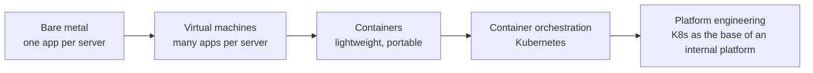
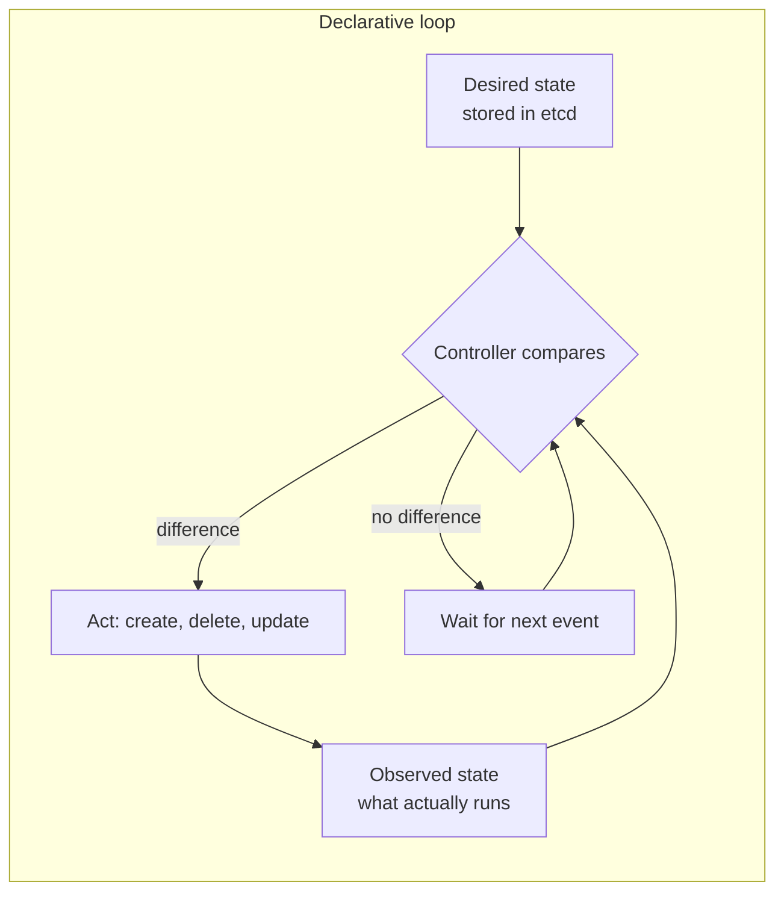
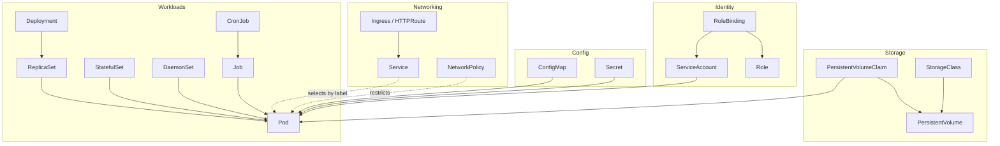
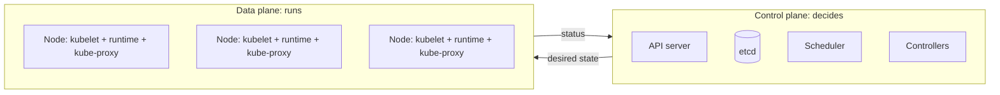
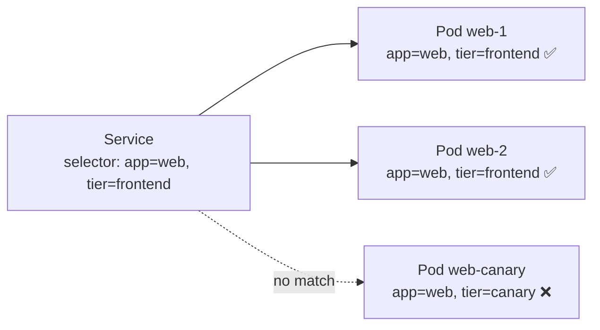

<!-- devopsshack:header -->
> ☸️ **Kubernetes Mastery: Zero to Production** · by **DevOps Shack** · [YouTube](https://www.youtube.com/@devopsshack) · [Hindi channel](https://www.youtube.com/@shackverse) · [devopsshack.com](https://devopsshack.com)
<!-- /devopsshack:header -->

# Architecture 01 · The Big Picture

## Why Kubernetes exists

Running one container is easy: `docker run`. Running 400 containers across 60 machines, keeping them alive when machines die, rolling out new versions without downtime, giving each one a stable network address, attaching the right disk, and scaling up at 9 a.m. is not. Before Kubernetes, teams solved this with shell scripts, Ansible playbooks, custom schedulers and a lot of pager alerts.

Kubernetes turns that work into a platform. You describe the system you want, and Kubernetes keeps the real world matching that description, forever, automatically.



## Imperative vs declarative

**Imperative** means telling the system each step: "start a container, now start another, now put a load balancer in front." If a step fails or a machine dies at 3 a.m., nobody re-runs the steps.

**Declarative** means telling the system the end state: "there should be 3 copies of this container behind a stable address." The system works out the steps, and keeps re-working them whenever reality drifts.



This loop is called **reconciliation**, and it is the single most important idea in Kubernetes. Every feature, from Deployments to autoscaling to cert-manager, is a reconciliation loop.

## Kubernetes objects

Everything you create is an **object** stored in the API. Every object has the same shape:

```yaml
apiVersion: apps/v1          # API group and version
kind: Deployment             # object type
metadata:                    # identity: name, namespace, labels, annotations
  name: web
  namespace: shop
  labels:
    app: web
spec:                        # desired state: written by you
  replicas: 3
  # ...
status:                      # observed state: written by controllers
  readyReplicas: 3
```

- `spec` is **what you want**. You (or your tools) write it.
- `status` is **what exists**. Controllers write it.
- `metadata.labels` are how objects find each other. A Service doesn't know about pods by name; it selects them by label.

## The object family tree



Read the arrows as "creates" or "is used by." A Deployment creates ReplicaSets, which create Pods. A Service never creates pods; it just finds them by label.

## Control plane vs data plane



A crucial production fact: **if the control plane goes down, running pods keep running.** Nodes keep serving traffic with their last known configuration. What stops is *change*: no new pods, no rescheduling after a node failure, no scaling, no deployments. This is why control plane outages are serious but rarely instant customer outages.

## Namespaces

Namespaces split one cluster into named scopes. They provide:

- **Name scoping:** two teams can each have a Service called `api`.
- **Policy scoping:** RBAC, ResourceQuotas, LimitRanges and NetworkPolicies apply per namespace.
- **Not isolation by themselves:** pods in different namespaces can still talk to each other unless NetworkPolicies say otherwise, and they share the same nodes and kernel.

Some objects are **cluster-scoped** and live outside namespaces: Nodes, PersistentVolumes, StorageClasses, ClusterRoles, CRDs, Namespaces themselves.

```bash
kubectl api-resources --namespaced=true    # namespaced kinds
kubectl api-resources --namespaced=false   # cluster-scoped kinds
```

## Labels, selectors and annotations



- **Labels** are identifying key/value pairs used for selection. Keep them small and meaningful: `app`, `component`, `version`, `team`, `env`.
- **Selectors** query labels: equality (`app=web`) or set-based (`env in (prod,staging)`).
- **Annotations** are non-identifying metadata for tools: `prometheus.io/scrape`, `kubernetes.io/change-cause`, ingress controller settings. They can be large; they're never used for selection.

## Check yourself

1. What happens to running pods if all control plane nodes go down? What stops working?
2. Who writes `spec` and who writes `status`?
3. A Service selects pods by name or by label? Why does that matter during a rolling update?
4. Give three cluster-scoped resource kinds.
5. Explain reconciliation in one sentence to a non-engineer.

Next: [02 · kube-apiserver](02-kube-apiserver.md)

<!-- devopsshack:footer -->
---

<p align="center">
  Made with ❤️ by <b><a href="https://devopsshack.com">DevOps Shack</a></b> · Part of <b>Kubernetes Mastery: Zero to Production</b><br/>
  <a href="https://www.youtube.com/@devopsshack">YouTube · DevOps Shack</a> · <a href="https://www.youtube.com/@shackverse">YouTube · DevOps Shack Hindi</a> · <a href="https://devopsshack.com">devopsshack.com</a> · <a href="https://www.instagram.com/devopsshack">Instagram · @devopsshack</a><br/>
  <sub>© DevOps Shack. Original content created by DevOps Shack. Free to learn from and share with credit to DevOps Shack. See <a href="../LICENSE">LICENSE</a>.</sub>
</p>
<!-- /devopsshack:footer -->
