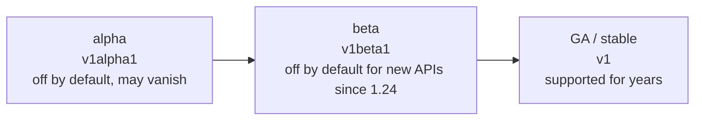
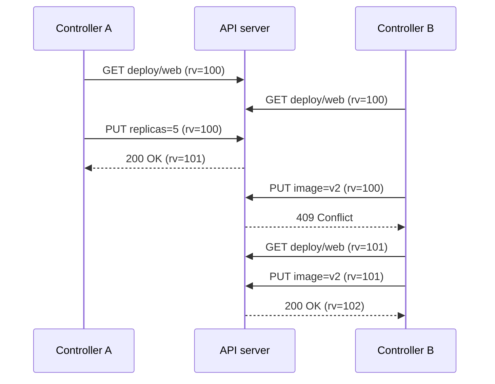
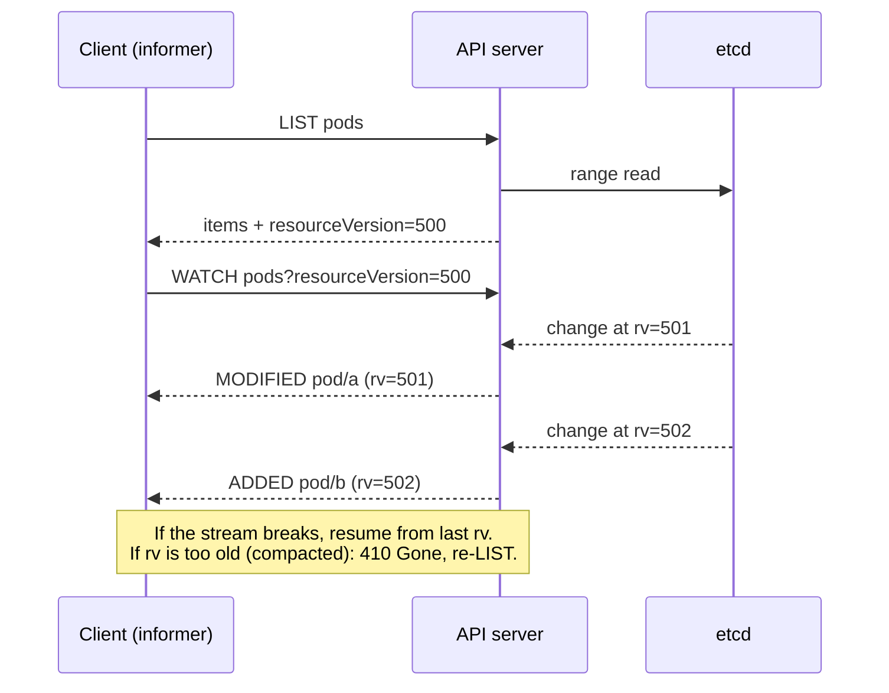
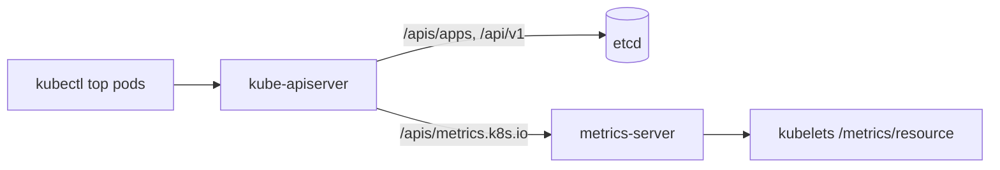

<!-- devopsshack:header -->
> ☸️ **Kubernetes Mastery: Zero to Production** · by **DevOps Shack** · [YouTube](https://www.youtube.com/@devopsshack) · [Hindi channel](https://www.youtube.com/@shackverse) · [devopsshack.com](https://devopsshack.com)
<!-- /devopsshack:header -->

# Architecture 02 · kube-apiserver

The API server is the front door, the bouncer and the filing clerk of the cluster. It is the only component that reads and writes etcd, and every other component (scheduler, controllers, kubelets, kubectl, your CI pipeline) is just a client of it.

## What it does

- Exposes the Kubernetes REST API over HTTPS (port 6443 by default).
- Authenticates every caller, authorises every action, and runs admission control.
- Validates objects against their schema and persists them to etcd.
- Serves **watches**, the streaming change feed that every controller relies on.
- Is **stateless**: you can run several replicas behind a load balancer; all state lives in etcd.

## The request pipeline

Every single request, whether `kubectl get pods` or the kubelet updating pod status, goes through the same stages:

```mermaid
flowchart LR
    R[HTTPS request] --> TLS[TLS termination]
    TLS --> AUTHN[Authentication<br/>who are you?]
    AUTHN --> AUDIT[Audit logging]
    AUDIT --> APF[API Priority & Fairness<br/>rate limiting]
    APF --> AUTHZ[Authorization<br/>are you allowed?]
    AUTHZ --> MUT[Mutating admission<br/>defaults, sidecar injection]
    MUT --> SCHEMA[Schema validation]
    SCHEMA --> VAL[Validating admission<br/>policy checks]
    VAL --> ETCD[(Persist to etcd)]
    ETCD --> RESP[Response + watch event]
```



| Stage | Examples | Failure looks like |
|---|---|---|
| Authentication | x509 client certs, bearer tokens, ServiceAccount tokens, OIDC | `401 Unauthorized` |
| Priority & Fairness | Flow schemas and priority levels that protect the server from noisy clients | `429 Too Many Requests` |
| Authorization | RBAC, Node authorizer, webhook | `403 Forbidden` |
| Mutating admission | Default storage class, ServiceAccount token mount, Istio sidecar injection | Object silently changed |
| Validating admission | Pod Security Admission, ValidatingAdmissionPolicy (CEL), Kyverno, OPA Gatekeeper | `admission webhook ... denied the request` |
| Persistence | Write to etcd with optimistic concurrency | `409 Conflict` (stale `resourceVersion`) |

Mutating runs before validating so that validators see the final object.

## The REST model

Every resource maps to a URL:

```text
/api/v1/namespaces/{ns}/pods/{name}                    # core group (legacy, no group name)
/apis/apps/v1/namespaces/{ns}/deployments/{name}       # named group "apps"
/apis/networking.k8s.io/v1/namespaces/{ns}/ingresses   # named group
/api/v1/nodes/{name}                                   # cluster-scoped
/api/v1/namespaces/{ns}/pods/{name}/log                # subresource
/apis/apps/v1/namespaces/{ns}/deployments/{name}/scale # subresource
```

HTTP verbs map to Kubernetes verbs: `GET` → get/list/watch, `POST` → create, `PUT` → update, `PATCH` → patch, `DELETE` → delete/deletecollection. RBAC rules are written using the Kubernetes verbs.

See it yourself:

```bash
kubectl get pods -v=8                # shows the HTTP calls kubectl makes
kubectl get --raw /api/v1/namespaces/default/pods | jq '.items[].metadata.name'
kubectl proxy &                      # then curl localhost:8001/apis
```

## API groups, versions and maturity



- The same object can be served at several versions (`v1beta1` and `v1`). It is stored in etcd at one **storage version** and converted on the fly.
- Deprecated versions are removed on a published schedule. Before every upgrade, check for removed APIs with tools like `kubent` or `pluto`, or the `apiserver_requested_deprecated_apis` metric.

## Optimistic concurrency and resourceVersion

Kubernetes never locks objects. Every object carries a `metadata.resourceVersion`. An update must include the version it read; if someone else wrote in between, the server rejects it with `409 Conflict` and the client retries.



## Watches: the nervous system

A watch is a long-lived HTTP stream. The client says "give me every change to pods since resourceVersion X," and the server pushes `ADDED`, `MODIFIED` and `DELETED` events as they happen.



The API server keeps a **watch cache** in memory so thousands of watchers don't each hit etcd. This is why the API server can serve huge clusters.

## Server-side apply and field ownership

`kubectl apply --server-side` lets the API server track which manager owns which field (`metadata.managedFields`). If your CI sets `image` and an HPA sets `replicas`, both coexist. If two managers try to own the same field, you get a conflict instead of a silent overwrite.

```bash
kubectl apply --server-side -f deploy.yaml
kubectl apply --server-side --force-conflicts -f deploy.yaml   # take ownership deliberately
kubectl get deploy web -o yaml --show-managed-fields
```

## API aggregation

The API server can proxy entire API groups to other servers. `metrics.k8s.io` (served by metrics-server) is the classic example: `kubectl top` calls the main API server, which forwards to metrics-server via an `APIService` object.



## Production notes

- Run at least 2 (usually 3) API server replicas behind a TCP load balancer with health checks on `/readyz`.
- Watch these metrics: `apiserver_request_duration_seconds`, `apiserver_request_total{code=~"5.."}`, `apiserver_current_inflight_requests`, `apiserver_flowcontrol_rejected_requests_total`.
- Enable an **audit policy**. In an incident you'll want to know who deleted that namespace.
- Slow or failing **admission webhooks** are a top cause of "the cluster is broken" incidents. Always set `timeoutSeconds` and think hard about `failurePolicy`.
- A buggy controller doing unbounded LISTs can overload the server. API Priority & Fairness protects you, but also find and fix the client.

## Check yourself

1. List the stages of the request pipeline in order. Why does mutating admission run before validating?
2. What does a `409 Conflict` mean and how should a client react?
3. What happens when a watch tries to resume from a compacted resourceVersion?
4. How does `kubectl top` reach metrics-server?
5. Why is the API server stateless, and why does that matter for HA?

Next: [03 · etcd](03-etcd.md)

<!-- devopsshack:footer -->
---

<p align="center">
  Made with ❤️ by <b><a href="https://devopsshack.com">DevOps Shack</a></b> · Part of <b>Kubernetes Mastery: Zero to Production</b><br/>
  <a href="https://www.youtube.com/@devopsshack">YouTube · DevOps Shack</a> · <a href="https://www.youtube.com/@shackverse">YouTube · DevOps Shack Hindi</a> · <a href="https://devopsshack.com">devopsshack.com</a> · <a href="https://www.instagram.com/devopsshack">Instagram · @devopsshack</a><br/>
  <sub>© DevOps Shack. Original content created by DevOps Shack. Free to learn from and share with credit to DevOps Shack. See <a href="../LICENSE">LICENSE</a>.</sub>
</p>
<!-- /devopsshack:footer -->
