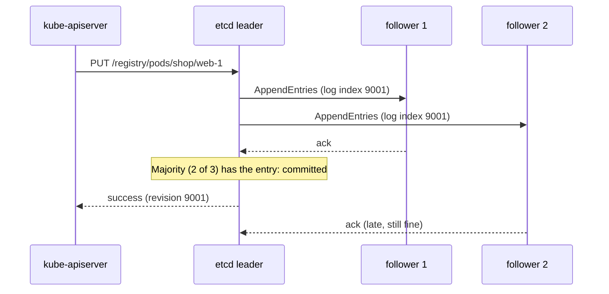
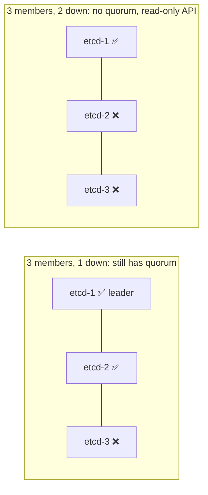
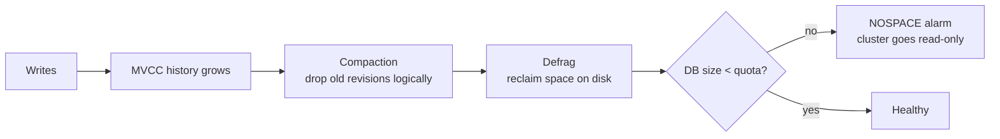
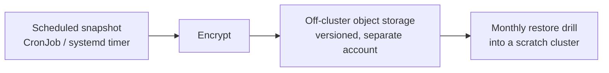

<!-- devopsshack:header -->
> ☸️ **Kubernetes Mastery: Zero to Production** · by **DevOps Shack** · [YouTube](https://www.youtube.com/@devopsshack) · [Hindi channel](https://www.youtube.com/@shackverse) · [devopsshack.com](https://devopsshack.com)
<!-- /devopsshack:header -->

# Architecture 03 · etcd

etcd is the cluster's database: a strongly consistent, distributed key-value store. Every object you have ever created lives here. **Lose etcd without a backup and you lose the cluster's entire state.** Nodes and containers may keep running, but Kubernetes no longer knows they exist.

## Why etcd

Kubernetes needs a store that is:

- **Consistent:** two API servers must never see different truths.
- **Watchable:** clients need a change feed, not polling.
- **Highly available:** survive a machine failure.

etcd gives all three using the **Raft** consensus algorithm.

## Raft in one diagram



- One member is the **leader**; all writes go through it.
- A write is **committed** once a **majority (quorum)** has it in their log.
- If the leader dies, followers hold an election and a new leader takes over in about a second.

## Quorum math

| Members | Quorum | Failures tolerated |
|---|---|---|
| 1 | 1 | 0 |
| 2 | 2 | 0 (worse than 1!) |
| 3 | 2 | 1 |
| 4 | 3 | 1 (no gain over 3) |
| 5 | 3 | 2 |
| 7 | 4 | 3 |

Always run an **odd** number: 3 for most clusters, 5 for very critical ones. More members means slower writes, because more acks are needed.



Without quorum, etcd refuses writes. The API server can still serve some cached reads, but nothing can change.

## How Kubernetes lays out its data

```text
/registry/pods/<namespace>/<name>
/registry/deployments/<namespace>/<name>
/registry/services/specs/<namespace>/<name>
/registry/secrets/<namespace>/<name>
/registry/nodes/<name>
/registry/apiregistration.k8s.io/apiservices/<name>
```

Values are stored as protobuf, not JSON. Secrets are only base64 in the API; in etcd they are plaintext unless you enable **encryption at rest** (`EncryptionConfiguration` with `aescbc`, `secretbox` or, best, a KMS provider).

## Revisions, history and compaction

Every write increments a cluster-wide **revision**. etcd keeps old versions (MVCC) so watchers can resume from a past revision. That history grows forever unless it's **compacted** (the API server requests compaction every 5 minutes by default). Compaction marks old revisions deletable; **defragmentation** actually returns the disk space.



The default backend quota is 2 GiB (commonly raised to 8 GiB). Hitting it raises a `NOSPACE` alarm and etcd stops accepting writes, which looks like a total cluster outage for changes.

## Performance: it's all about disk latency

etcd calls `fsync` on every commit. Slow disks mean slow leader elections, timeouts and flapping.

- Use local SSD/NVMe; never network disks with noisy neighbours.
- Watch `etcd_disk_wal_fsync_duration_seconds` (p99 should be under 10 ms) and `etcd_disk_backend_commit_duration_seconds` (p99 under 25 ms).
- Watch `etcd_server_leader_changes_seen_total`: frequent leader changes mean disk or network trouble.
- Keep etcd members close (same region, low-latency network).

## Backup and restore

```bash
# Backup (run on a control plane node with kubeadm-style certs)
ETCDCTL_API=3 etcdctl \
  --endpoints=https://127.0.0.1:2379 \
  --cacert=/etc/kubernetes/pki/etcd/ca.crt \
  --cert=/etc/kubernetes/pki/etcd/server.crt \
  --key=/etc/kubernetes/pki/etcd/server.key \
  snapshot save /backup/etcd-$(date +%F-%H%M).db

# Check the snapshot
etcdutl snapshot status /backup/etcd-2026-11-11-0400.db -w table

# Restore into a new data directory
etcdutl snapshot restore /backup/etcd-2026-11-11-0400.db \
  --data-dir /var/lib/etcd-restored
# Then point the etcd static pod manifest at the new data dir and restart.
```



A backup you have never restored is a hope, not a backup. Managed services (EKS, AKS, GKE) run and back up etcd for you, but you still need **application-level** backups (Velero) for your namespaces and volumes.

## Health checks

```bash
etcdctl endpoint health --cluster -w table
etcdctl endpoint status --cluster -w table   # leader, DB size, raft index
etcdctl member list -w table
etcdctl alarm list
```

## Check yourself

1. Why does a 4-member etcd cluster tolerate no more failures than a 3-member one?
2. What happens to the Kubernetes API when etcd loses quorum?
3. What's the difference between compaction and defragmentation?
4. Which metric tells you etcd's disk is too slow?
5. Are Secrets encrypted in etcd by default? How do you change that?

Next: [04 · kube-scheduler](04-kube-scheduler.md)

<!-- devopsshack:footer -->
---

<p align="center">
  Made with ❤️ by <b><a href="https://devopsshack.com">DevOps Shack</a></b> · Part of <b>Kubernetes Mastery: Zero to Production</b><br/>
  <a href="https://www.youtube.com/@devopsshack">YouTube · DevOps Shack</a> · <a href="https://www.youtube.com/@shackverse">YouTube · DevOps Shack Hindi</a> · <a href="https://devopsshack.com">devopsshack.com</a> · <a href="https://www.instagram.com/devopsshack">Instagram · @devopsshack</a><br/>
  <sub>© DevOps Shack. Original content created by DevOps Shack. Free to learn from and share with credit to DevOps Shack. See <a href="../LICENSE">LICENSE</a>.</sub>
</p>
<!-- /devopsshack:footer -->
