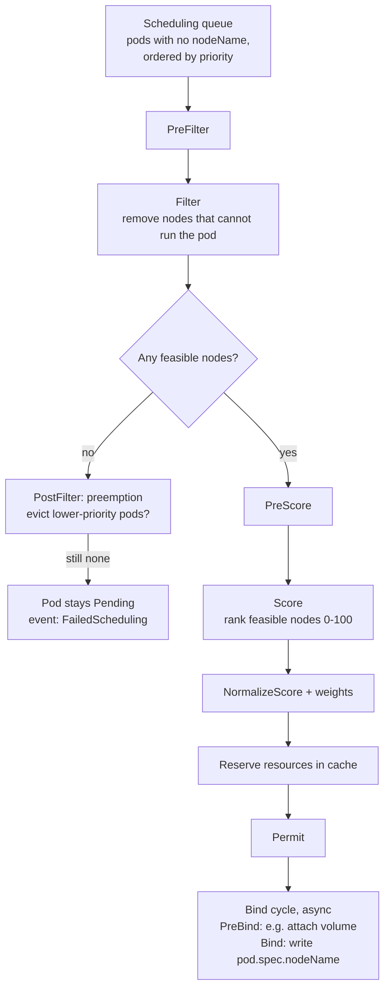
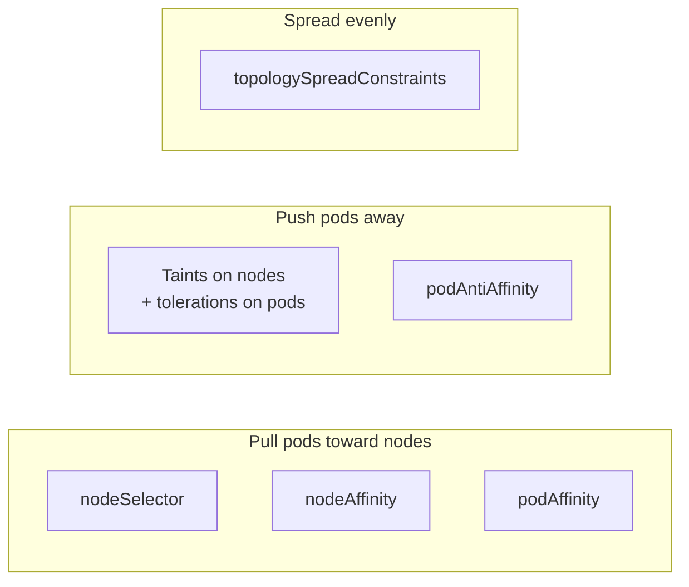
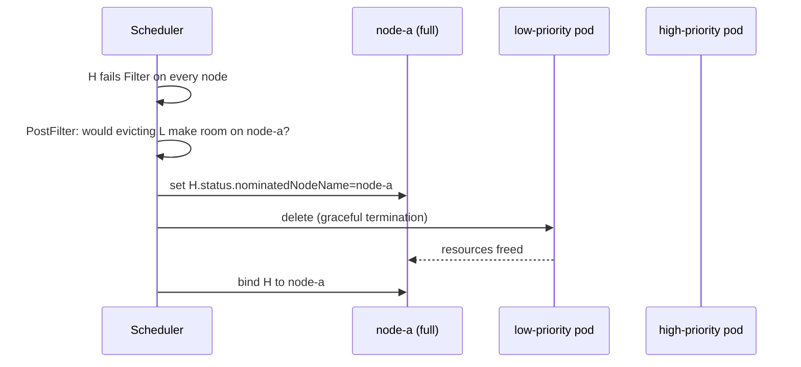

<!-- devopsshack:header -->
> ☸️ **Kubernetes Mastery: Zero to Production** · by **DevOps Shack** · [YouTube](https://www.youtube.com/@devopsshack) · [Hindi channel](https://www.youtube.com/@shackverse) · [devopsshack.com](https://devopsshack.com)
<!-- /devopsshack:header -->

# Architecture 04 · kube-scheduler

The scheduler has exactly one job: for every pod with an empty `spec.nodeName`, pick the best node and write that decision back to the API (a **binding**). It doesn't start containers, doesn't talk to nodes, and doesn't move running pods. The kubelet on the chosen node does the rest.

## The scheduling cycle



The **scheduling cycle** runs one pod at a time to keep decisions consistent. The **binding cycle** runs asynchronously so slow steps (like waiting for a volume) don't block the queue.

## Filter plugins: can this node run the pod?

| Plugin | Rejects a node when... |
|---|---|
| NodeResourcesFit | Sum of **requests** on the node + this pod's requests exceed allocatable CPU/memory/ephemeral-storage/extended resources |
| NodeName | `spec.nodeName` is set to a different node |
| NodeUnschedulable | Node is cordoned |
| NodeAffinity | Required node affinity / `nodeSelector` doesn't match the node's labels |
| TaintToleration | Node has a `NoSchedule`/`NoExecute` taint the pod doesn't tolerate |
| InterPodAffinity | Required pod affinity/anti-affinity can't be satisfied |
| PodTopologySpread | `whenUnsatisfiable: DoNotSchedule` constraint would be violated |
| VolumeBinding / VolumeZone | PVC can't bind on this node or the volume lives in another zone |
| NodePorts | Requested `hostPort` is already in use |

The scheduler looks at **requests**, never actual usage. A node that is 95% idle but fully *requested* is full.

## Score plugins: which feasible node is best?

| Plugin | Prefers nodes that... |
|---|---|
| NodeResourcesFit (LeastAllocated, default) | Have the most free requested capacity, spreading load |
| NodeResourcesFit (MostAllocated) | Are already busiest, bin-packing to save cost |
| NodeResourcesBalancedAllocation | Keep CPU and memory utilisation balanced |
| ImageLocality | Already have the container image cached |
| InterPodAffinity (preferred) | Match preferred affinity rules |
| NodeAffinity (preferred) | Match preferred node affinity |
| PodTopologySpread (ScheduleAnyway) | Improve spread across zones/nodes |
| TaintToleration | Have fewer `PreferNoSchedule` taints |

## Placement controls at a glance



```yaml
spec:
  # Hard rule: only on nodes with SSDs
  affinity:
    nodeAffinity:
      requiredDuringSchedulingIgnoredDuringExecution:
        nodeSelectorTerms:
          - matchExpressions:
              - key: disktype
                operator: In
                values: ["ssd"]
    # Soft rule: avoid putting two replicas on the same node
    podAntiAffinity:
      preferredDuringSchedulingIgnoredDuringExecution:
        - weight: 100
          podAffinityTerm:
            topologyKey: kubernetes.io/hostname
            labelSelector:
              matchLabels: { app: web }
  # Spread evenly across zones
  topologySpreadConstraints:
    - maxSkew: 1
      topologyKey: topology.kubernetes.io/zone
      whenUnsatisfiable: DoNotSchedule
      labelSelector:
        matchLabels: { app: web }
  # Allowed onto GPU nodes, which are tainted
  tolerations:
    - key: nvidia.com/gpu
      operator: Exists
      effect: NoSchedule
```

**Taints are not attraction.** A toleration *allows* a pod onto a tainted node; it doesn't *send* it there. To dedicate nodes, combine a taint (keeps others out) with node affinity (pulls your pods in).

`IgnoredDuringExecution` means the rule is only checked at scheduling time. If node labels change later, running pods are not evicted.

## Priority and preemption



```yaml
apiVersion: scheduling.k8s.io/v1
kind: PriorityClass
metadata:
  name: business-critical
value: 100000
preemptionPolicy: PreemptLowerPriority
description: "Customer-facing APIs"
```

Built-in classes `system-cluster-critical` and `system-node-critical` protect components like CoreDNS and CNI agents. Without PriorityClasses, a burst of batch jobs can starve your production API.

## Why is my pod Pending?

```bash
kubectl describe pod <pod> | sed -n '/Events/,$p'
# 0/6 nodes are available: 3 Insufficient cpu, 2 node(s) had untolerated taint
# {node-role.kubernetes.io/control-plane: }, 1 node(s) didn't match Pod's node affinity/selector.
```

The event message is a per-node tally of which filter rejected each node. Read it, then fix the matching cause: lower requests, add nodes (or let the Cluster Autoscaler/Karpenter do it), add a toleration, fix a label, or relax a spread constraint.

## Beyond the default scheduler

- **Scheduler profiles:** one scheduler binary, several configurations (e.g., a bin-packing profile for batch).
- **Multiple schedulers:** set `spec.schedulerName` to use a custom one (Volcano, YuniKorn for batch/AI).
- **Descheduler:** a separate project that *evicts* pods so they can be rescheduled better, since the scheduler never moves running pods.

## Check yourself

1. Does the scheduler use actual CPU usage or requests? What problem does that cause?
2. What's the difference between a taint and node affinity? How do you dedicate a node pool to one team?
3. What does `IgnoredDuringExecution` mean?
4. Walk through preemption step by step.
5. A pod is Pending with "1 node(s) had volume node affinity conflict." What's going on?

Next: [05 · Controllers & Reconciliation](05-controllers-and-reconciliation.md)

<!-- devopsshack:footer -->
---

<p align="center">
  Made with ❤️ by <b><a href="https://devopsshack.com">DevOps Shack</a></b> · Part of <b>Kubernetes Mastery: Zero to Production</b><br/>
  <a href="https://www.youtube.com/@devopsshack">YouTube · DevOps Shack</a> · <a href="https://www.youtube.com/@shackverse">YouTube · DevOps Shack Hindi</a> · <a href="https://devopsshack.com">devopsshack.com</a> · <a href="https://www.instagram.com/devopsshack">Instagram · @devopsshack</a><br/>
  <sub>© DevOps Shack. Original content created by DevOps Shack. Free to learn from and share with credit to DevOps Shack. See <a href="../LICENSE">LICENSE</a>.</sub>
</p>
<!-- /devopsshack:footer -->
