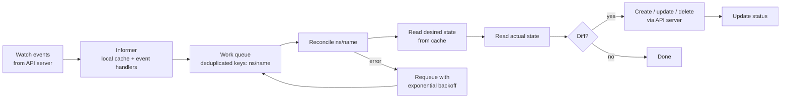
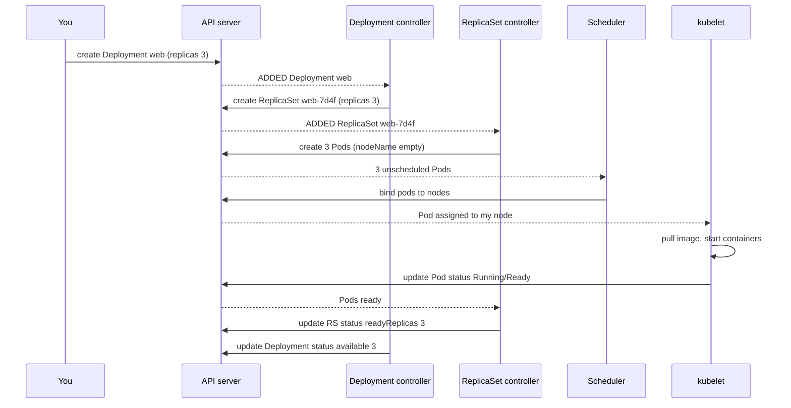
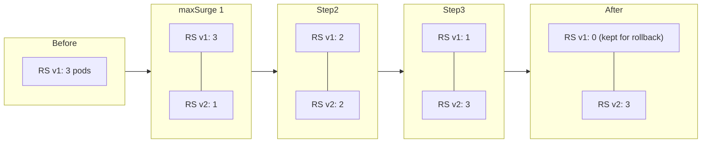
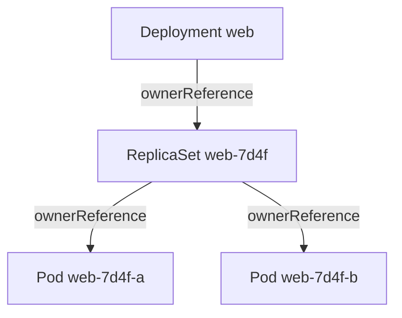
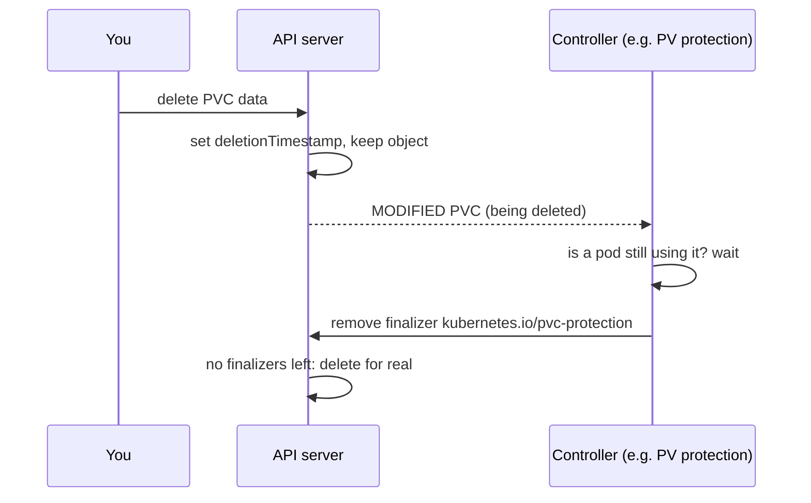

<!-- devopsshack:header -->
> ☸️ **Kubernetes Mastery: Zero to Production** · by **DevOps Shack** · [YouTube](https://www.youtube.com/@devopsshack) · [Hindi channel](https://www.youtube.com/@shackverse) · [devopsshack.com](https://devopsshack.com)
<!-- /devopsshack:header -->

# Architecture 05 · Controllers & Reconciliation

If the API server is the brain's memory, controllers are its reflexes. A controller is a loop that watches some objects, compares desired state with actual state, and takes action to make them match. `kube-controller-manager` is one binary that runs a few dozen of these loops.

## The control loop



Key properties that make controllers robust:

- **Level-triggered, not edge-triggered.** The reconciler doesn't care *what* changed. It looks at the whole current state and fixes it. Missed an event? The next resync catches it.
- **Idempotent.** Running reconcile twice gives the same result. Crashing halfway is safe.
- **Informer caches.** Controllers read from a local in-memory cache fed by watches, so they don't hammer the API server.
- **Work queue deduplication.** Ten rapid changes to the same Deployment collapse into one reconcile.

## Controllers inside kube-controller-manager

| Controller | Watches | Ensures |
|---|---|---|
| Deployment | Deployments, ReplicaSets | Right ReplicaSets exist; rolling updates progress |
| ReplicaSet | ReplicaSets, Pods | Exactly N pods match the selector |
| StatefulSet | StatefulSets, Pods, PVCs | Ordered, stable-identity pods with their own PVCs |
| DaemonSet | DaemonSets, Nodes, Pods | One pod per matching node |
| Job / CronJob | Jobs, CronJobs, Pods | Pods run to completion; Jobs created on schedule |
| Node lifecycle | Nodes, Leases | Marks nodes NotReady, taints them, triggers eviction |
| EndpointSlice | Services, Pods | Each Service's endpoint list tracks ready pods |
| Namespace | Namespaces | Deletes everything inside a terminating namespace |
| ServiceAccount / token | Namespaces, SAs | Default SA exists in every namespace |
| Garbage collector | Everything with ownerReferences | Dependents are deleted with their owner |
| PV binder / attach-detach | PVCs, PVs, VolumeAttachments | Claims bind to volumes; volumes attach to the right node |
| HPA | HPAs, metrics API | Replica counts follow metrics |
| ResourceQuota | Quotas, objects in namespace | Usage is tracked against quota |

## A Deployment, traced through three controllers



No component tells the next one what to do. Each one just watches the API and reacts. This loose coupling is why Kubernetes is so extensible: you can add your own controller and it participates exactly like the built-in ones.

## Rolling updates as reconciliation



The Deployment controller only ever adjusts the replica counts of two ReplicaSets, gated by `maxSurge`, `maxUnavailable` and pod readiness. Rollback (`kubectl rollout undo`) simply scales the old ReplicaSet back up.

## Owner references and garbage collection



Delete the Deployment and the garbage collector deletes the ReplicaSet, then its Pods. Propagation policies:

- `Background` (default): owner deleted immediately, dependents cleaned up after.
- `Foreground`: dependents deleted first; owner waits with a `foregroundDeletion` finalizer.
- `Orphan`: dependents are kept and their ownerReferences removed (`kubectl delete deploy web --cascade=orphan`).

## Finalizers: "don't delete me yet"

A finalizer is a string in `metadata.finalizers`. When you delete an object that has finalizers, the API server only sets `deletionTimestamp`. The object stays until every controller that owns a finalizer does its cleanup and removes its string.



A namespace stuck in `Terminating` almost always means some object inside has a finalizer whose controller is gone (for example, a CRD's operator was uninstalled first). Fix the controller, or as a last resort remove the finalizer knowingly.

## Leader election

Controller managers and schedulers run with several replicas for HA, but only one may act at a time. They compete for a `Lease` object in `kube-system`; the holder renews it every few seconds. If it stops renewing, another replica takes over.

```bash
kubectl -n kube-system get lease kube-controller-manager kube-scheduler -o wide
```

## Check yourself

1. What does "level-triggered" mean, and why is it more robust than reacting to individual events?
2. Trace the controllers involved from `kubectl create deployment` to running pods.
3. What happens to pods when you delete a Deployment with `--cascade=orphan`?
4. Why might a namespace be stuck in Terminating?
5. How do three controller-manager replicas avoid fighting each other?

Next: [06 · cloud-controller-manager](06-cloud-controller-manager.md)

<!-- devopsshack:footer -->
---

<p align="center">
  Made with ❤️ by <b><a href="https://devopsshack.com">DevOps Shack</a></b> · Part of <b>Kubernetes Mastery: Zero to Production</b><br/>
  <a href="https://www.youtube.com/@devopsshack">YouTube · DevOps Shack</a> · <a href="https://www.youtube.com/@shackverse">YouTube · DevOps Shack Hindi</a> · <a href="https://devopsshack.com">devopsshack.com</a> · <a href="https://www.instagram.com/devopsshack">Instagram · @devopsshack</a><br/>
  <sub>© DevOps Shack. Original content created by DevOps Shack. Free to learn from and share with credit to DevOps Shack. See <a href="../LICENSE">LICENSE</a>.</sub>
</p>
<!-- /devopsshack:footer -->
