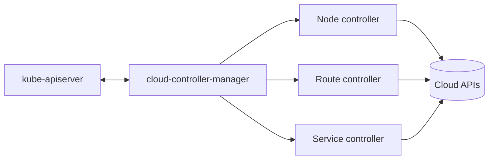
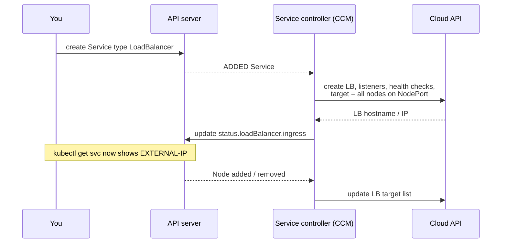

<!-- devopsshack:header -->
> ☸️ **Kubernetes Mastery: Zero to Production** · by **DevOps Shack** · [YouTube](https://www.youtube.com/@devopsshack) · [Hindi channel](https://www.youtube.com/@shackverse) · [devopsshack.com](https://devopsshack.com)
<!-- /devopsshack:header -->

# Architecture 06 · cloud-controller-manager

Kubernetes doesn't know how to create an AWS load balancer or a GCP route. That knowledge lives in the **cloud-controller-manager (CCM)**, a separate binary each cloud provider ships. It was split out of kube-controller-manager so cloud code could evolve independently of Kubernetes releases.



## Its three core controllers

| Controller | What it does | What breaks without it |
|---|---|---|
| **Node** | Labels nodes with zone, region and instance type; sets provider IDs and addresses; deletes Node objects whose VMs no longer exist | Nodes stay `uninitialized` (tainted `node.cloudprovider.kubernetes.io/uninitialized`), zone-aware scheduling fails |
| **Route** | Programs cloud route tables so pod CIDRs are reachable between nodes (only for some network setups) | Cross-node pod traffic fails |
| **Service** | Creates, updates and deletes cloud load balancers for `type: LoadBalancer` Services | `EXTERNAL-IP` stays `<pending>` forever |

## How a LoadBalancer Service becomes a real load balancer



Behaviour is tuned with annotations, and they are provider-specific:

```yaml
metadata:
  annotations:
    # AWS (with AWS Load Balancer Controller)
    service.beta.kubernetes.io/aws-load-balancer-type: external
    service.beta.kubernetes.io/aws-load-balancer-nlb-target-type: ip
    service.beta.kubernetes.io/aws-load-balancer-scheme: internet-facing
    # Azure
    service.beta.kubernetes.io/azure-load-balancer-internal: "true"
    # GCP
    networking.gke.io/load-balancer-type: Internal
```

On AWS, most production clusters replace the in-tree service logic with the **AWS Load Balancer Controller**, which also handles Ingress → ALB and can target pod IPs directly (no NodePort hop).

## Volume provisioning moved to CSI

Older clusters used in-tree cloud volume plugins (`kubernetes.io/aws-ebs`). These have been migrated to **CSI drivers** (`ebs.csi.aws.com`, `disk.csi.azure.com`, `pd.csi.storage.gke.io`). The CCM no longer creates disks; the CSI driver does. See [Storage & CSI](11-storage-csi.md).

## On-prem and bare metal

There's no cloud LB API on bare metal, so `type: LoadBalancer` stays pending unless you install something that plays that role:

- **MetalLB** or **kube-vip**: announce Service IPs via ARP (L2) or BGP.
- **Cilium LB IPAM + BGP control plane**.

## Check yourself

1. A new node is tainted `node.cloudprovider.kubernetes.io/uninitialized`. What's not working?
2. Why does `EXTERNAL-IP` stay `<pending>` on a kind or bare-metal cluster?
3. Which component creates cloud disks today: the CCM or a CSI driver?

Next: [07 · Worker Node: kubelet & Runtime](07-worker-node-kubelet-runtime.md)

<!-- devopsshack:footer -->
---

<p align="center">
  Made with ❤️ by <b><a href="https://devopsshack.com">DevOps Shack</a></b> · Part of <b>Kubernetes Mastery: Zero to Production</b><br/>
  <a href="https://www.youtube.com/@devopsshack">YouTube · DevOps Shack</a> · <a href="https://www.youtube.com/@shackverse">YouTube · DevOps Shack Hindi</a> · <a href="https://devopsshack.com">devopsshack.com</a> · <a href="https://www.instagram.com/devopsshack">Instagram · @devopsshack</a><br/>
  <sub>© DevOps Shack. Original content created by DevOps Shack. Free to learn from and share with credit to DevOps Shack. See <a href="../LICENSE">LICENSE</a>.</sub>
</p>
<!-- /devopsshack:footer -->
