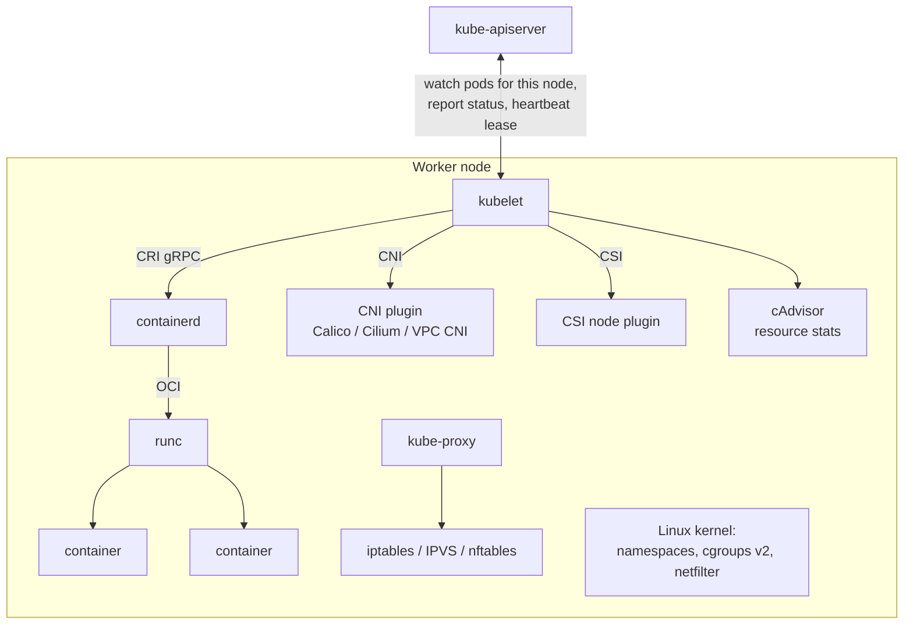
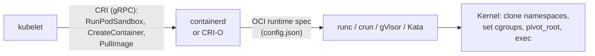
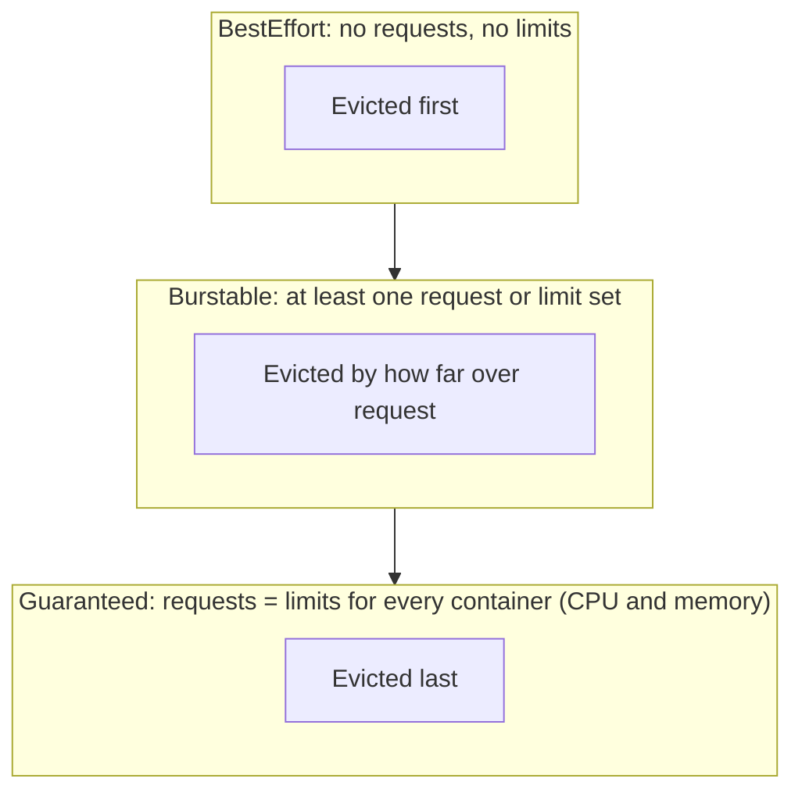
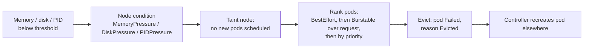

<!-- devopsshack:header -->
> ☸️ **Kubernetes Mastery: Zero to Production** · by **DevOps Shack** · [YouTube](https://www.youtube.com/@devopsshack) · [Hindi channel](https://www.youtube.com/@shackverse) · [devopsshack.com](https://devopsshack.com)
<!-- /devopsshack:header -->

# Architecture 07 · Worker Node: kubelet & Container Runtime

A worker node is a Linux (or Windows) machine running three things: the **kubelet**, a **container runtime** and **kube-proxy** (or an eBPF replacement). Everything else on the node is pods.



## The kubelet's job

The kubelet is the node agent. It doesn't create pods on its own initiative; it makes sure the pods the API server has assigned to its node are running and healthy.

```mermaid
flowchart LR
    A[Pod assigned to this node] --> B[Admit<br/>enough resources? node conditions OK?]
    B --> C[Create pod sandbox<br/>pause container + network namespace]
    C --> D[CNI: attach pod network, assign IP]
    D --> E[Mount volumes<br/>ConfigMaps, Secrets, PVCs via CSI]
    E --> F[Pull images]
    F --> G[Run init containers, in order]
    G --> H[Start app + sidecar containers]
    H --> I[Run probes: startup, liveness, readiness]
    I --> J[Report status to API server]
    J --> I
```



Other duties:

- **Heartbeats:** updates a `Lease` in `kube-node-lease` every ~10 s and the Node status periodically. Miss enough heartbeats and the node lifecycle controller marks the node `NotReady`.
- **Static pods:** runs manifests from `/etc/kubernetes/manifests` without the API server. This is how kubeadm runs the control plane itself.
- **Eviction:** kills pods when the node runs low on memory, disk or PIDs.
- **Garbage collection:** cleans up dead containers and unused images.
- **Serves an API** on port 10250: logs, exec, port-forward and metrics all go API server → kubelet.

## CRI, containerd and runc



- **CRI** is the plugin interface between kubelet and runtimes. Docker Engine itself was never CRI-compliant; the `dockershim` adapter was removed in 1.24. Images built with Docker still work everywhere because they're standard OCI images.
- **containerd** (or CRI-O) manages images, snapshots and container lifecycles.
- **runc** is the low-level OCI runtime that asks the kernel to create the isolated process.
- **RuntimeClass** lets you pick a different low-level runtime per pod (gVisor or Kata for stronger isolation).

Debug the runtime directly with `crictl`:

```bash
crictl ps -a                 # all containers on this node
crictl pods                  # pod sandboxes
crictl logs <container-id>
crictl inspect <container-id> | jq '.info.runtimeSpec.linux.resources'
crictl images
```

## What a container really is

A container is a normal Linux process with:

- **Namespaces** for isolation: `pid`, `net`, `mnt`, `uts`, `ipc`, `user`, `cgroup`.
- **cgroups** for limits: CPU, memory, PIDs, I/O.
- A **root filesystem** from layered image snapshots (overlayfs).
- **Capabilities, seccomp, AppArmor/SELinux** to restrict what it can do.

All containers in a pod share the **network namespace** (same IP, talk over `localhost`) and can share volumes. The tiny `pause` container holds that namespace open for the pod's lifetime.

## Requests, limits and QoS



- **CPU requests** become cgroup weights (`cpu.weight`): a share of CPU when there's contention.
- **CPU limits** become CFS quota (`cpu.max`): hard throttling, even when the node is idle. Throttling causes latency spikes, which is why many teams set CPU requests but no CPU limits for latency-sensitive services.
- **Memory limits** are hard: exceed them and the kernel OOM-kills the container (`OOMKilled`, exit code 137).
- **Memory requests** are used for scheduling and eviction ranking.

## Node allocatable

```text
Node capacity
  - kube-reserved      (kubelet, runtime)
  - system-reserved    (sshd, systemd, OS)
  - eviction threshold (e.g. memory.available < 100Mi)
  = Allocatable        (what the scheduler can hand to pods)
```

```bash
kubectl describe node <node> | sed -n '/Capacity/,/System Info/p'
```

## Node-pressure eviction



Soft thresholds have a grace period; hard thresholds act immediately. If the kubelet isn't fast enough, the kernel OOM killer steps in first, and it doesn't respect Kubernetes priorities.

## Probes

| Probe | Question it answers | On failure |
|---|---|---|
| startupProbe | Has the app finished starting? | Keep waiting; other probes disabled until it passes; restart after `failureThreshold` |
| livenessProbe | Is the process stuck beyond recovery? | Kubelet **restarts the container** |
| readinessProbe | Can it serve traffic right now? | **Removed from Service endpoints**, not restarted |

The classic mistake is a liveness probe that checks a database. When the database blips, every pod restarts at once and turns a small outage into a big one. Liveness checks the process; readiness checks the ability to serve.

## Check yourself

1. What is the `pause` container for?
2. Why were Docker-built images unaffected by the dockershim removal?
3. A container keeps exiting with code 137. What happened and where do you look?
4. Explain CPU throttling and why some teams drop CPU limits.
5. A node stops sending heartbeats. Walk through what happens to its pods.

Next: [08 · kube-proxy & Service Networking](08-kube-proxy-and-services.md)

<!-- devopsshack:footer -->
---

<p align="center">
  Made with ❤️ by <b><a href="https://devopsshack.com">DevOps Shack</a></b> · Part of <b>Kubernetes Mastery: Zero to Production</b><br/>
  <a href="https://www.youtube.com/@devopsshack">YouTube · DevOps Shack</a> · <a href="https://www.youtube.com/@shackverse">YouTube · DevOps Shack Hindi</a> · <a href="https://devopsshack.com">devopsshack.com</a> · <a href="https://www.instagram.com/devopsshack">Instagram · @devopsshack</a><br/>
  <sub>© DevOps Shack. Original content created by DevOps Shack. Free to learn from and share with credit to DevOps Shack. See <a href="../LICENSE">LICENSE</a>.</sub>
</p>
<!-- /devopsshack:footer -->
