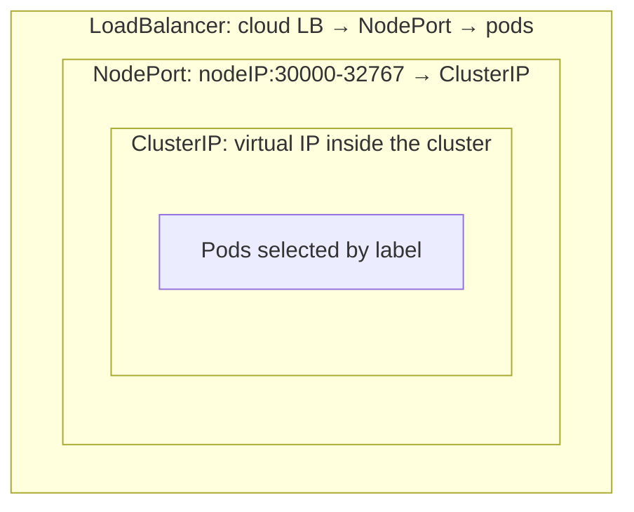
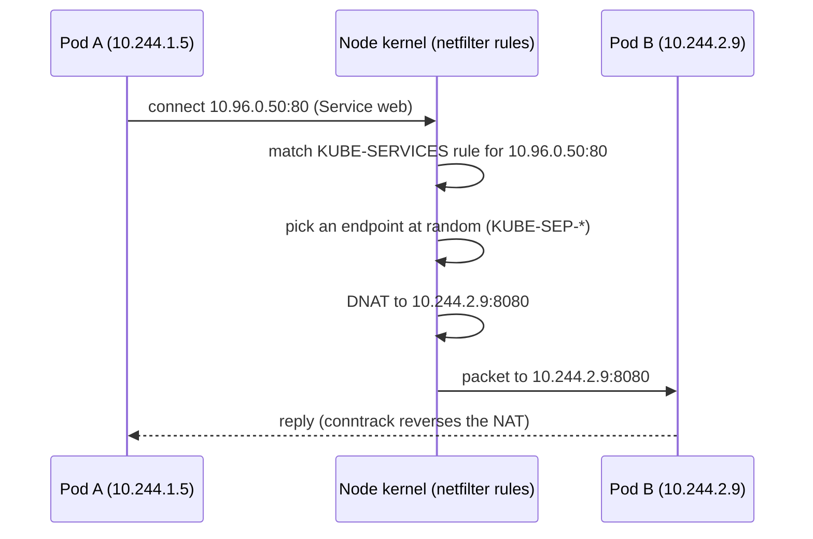
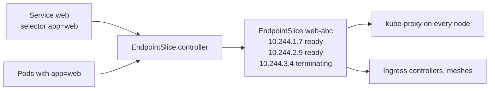
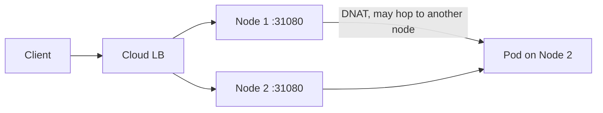

<!-- devopsshack:header -->
> ☸️ **Kubernetes Mastery: Zero to Production** · by **DevOps Shack** · [YouTube](https://www.youtube.com/@devopsshack) · [Hindi channel](https://www.youtube.com/@shackverse) · [devopsshack.com](https://devopsshack.com)
<!-- /devopsshack:header -->

# Architecture 08 · kube-proxy & Service Networking

Pods are disposable. They get new IPs every time they're recreated. A **Service** gives a set of pods one stable virtual IP and DNS name, and **kube-proxy** (or an eBPF replacement) makes that virtual IP actually work on every node.

## Service types



| Type | Reachable from | Typical use |
|---|---|---|
| ClusterIP (default) | Inside the cluster | Service-to-service traffic |
| NodePort | Any node's IP on a high port | Dev, or behind your own LB |
| LoadBalancer | Internet / VPC via a cloud LB | Exposing a service or an ingress controller |
| ExternalName | Inside the cluster; a DNS CNAME | Aliasing an external database hostname |
| Headless (`clusterIP: None`) | DNS returns pod IPs directly | StatefulSets, client-side load balancing |

## How a ClusterIP actually works

There is no process listening on a ClusterIP. It's a rule in the kernel on every node.



kube-proxy's job is just to **keep those rules in sync**: it watches Services and EndpointSlices and rewrites the rules when pods come and go.

## EndpointSlices



Only pods that pass their **readiness probe** are marked ready. That's the link between probes and traffic. A Service with no ready endpoints returns connection refused or timeouts.

```bash
kubectl get endpointslices -l kubernetes.io/service-name=web -o wide
```

## Proxy modes compared

| Mode | How | Pros | Cons |
|---|---|---|---|
| iptables (default for years) | Chains of NAT rules, random selection | Mature, everywhere | Rule updates and lookups slow at tens of thousands of Services |
| IPVS | Kernel L4 load balancer, hash tables | Fast at scale; rr, lc, sh algorithms | Being deprecated in favour of nftables |
| nftables (GA in recent versions) | Modern netfilter with sets and maps | Scales well, the long-term replacement | Newer; check your distro/kernel |
| eBPF (Cilium kube-proxy replacement) | BPF programs at socket/TC level | Fastest, no conntrack per packet for many paths, rich observability | Requires Cilium and a recent kernel |

## NodePort and LoadBalancer traffic paths



`externalTrafficPolicy` decides how traffic entering a node is handled:

- `Cluster` (default): any node accepts traffic and forwards to any pod, possibly on another node. Even spread, extra hop, client IP is SNAT'd away.
- `Local`: nodes only forward to pods on themselves. Preserves the client source IP and avoids the hop; nodes without a local pod fail the LB health check and receive no traffic. Watch for uneven load.

`internalTrafficPolicy: Local` does the same for in-cluster traffic (handy for node-local agents).

## Session affinity and topology

- `sessionAffinity: ClientIP` pins a client IP to one endpoint (with a timeout).
- **Topology-aware routing** (`service.kubernetes.io/topology-mode: Auto`, or `trafficDistribution: PreferClose`) keeps traffic in the same zone when there are enough endpoints, cutting cross-zone cost and latency.

## Debugging a Service

```bash
kubectl get svc web -o wide                          # selector, ports
kubectl get pods -l app=web -o wide                  # do labels match?
kubectl get endpointslices -l kubernetes.io/service-name=web
kubectl run tmp --rm -it --image=nicolaka/netshoot -- bash
  curl -v web.shop.svc.cluster.local:80
  nslookup web.shop
# On a node:
sudo iptables-save | grep web
sudo ipvsadm -Ln            # IPVS mode
```

The usual culprits: selector doesn't match pod labels, `targetPort` doesn't match the container port, pods aren't ready, or a NetworkPolicy blocks the traffic.

## Check yourself

1. Is there a process listening on a ClusterIP? What actually answers?
2. How does a failing readiness probe remove a pod from traffic?
3. Compare `externalTrafficPolicy: Cluster` and `Local`.
4. Why does iptables mode struggle at very large scale?
5. When would you use a headless Service?

Next: [09 · Pod Networking & CNI](09-pod-networking-cni.md)

<!-- devopsshack:footer -->
---

<p align="center">
  Made with ❤️ by <b><a href="https://devopsshack.com">DevOps Shack</a></b> · Part of <b>Kubernetes Mastery: Zero to Production</b><br/>
  <a href="https://www.youtube.com/@devopsshack">YouTube · DevOps Shack</a> · <a href="https://www.youtube.com/@shackverse">YouTube · DevOps Shack Hindi</a> · <a href="https://devopsshack.com">devopsshack.com</a> · <a href="https://www.instagram.com/devopsshack">Instagram · @devopsshack</a><br/>
  <sub>© DevOps Shack. Original content created by DevOps Shack. Free to learn from and share with credit to DevOps Shack. See <a href="../LICENSE">LICENSE</a>.</sub>
</p>
<!-- /devopsshack:footer -->
