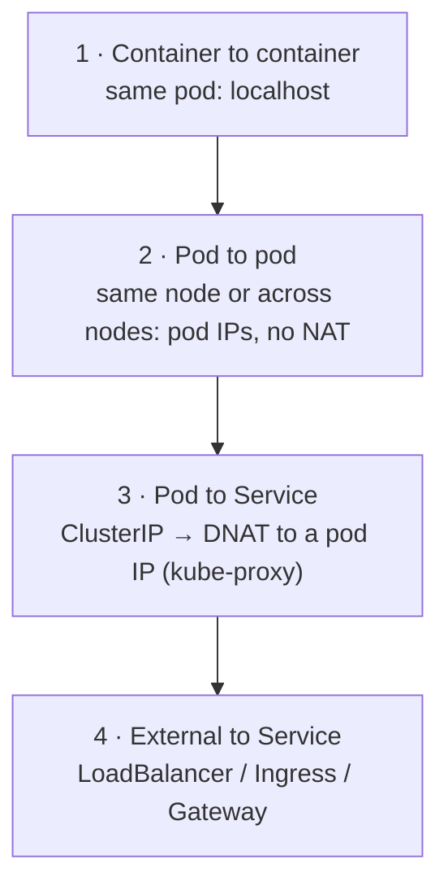
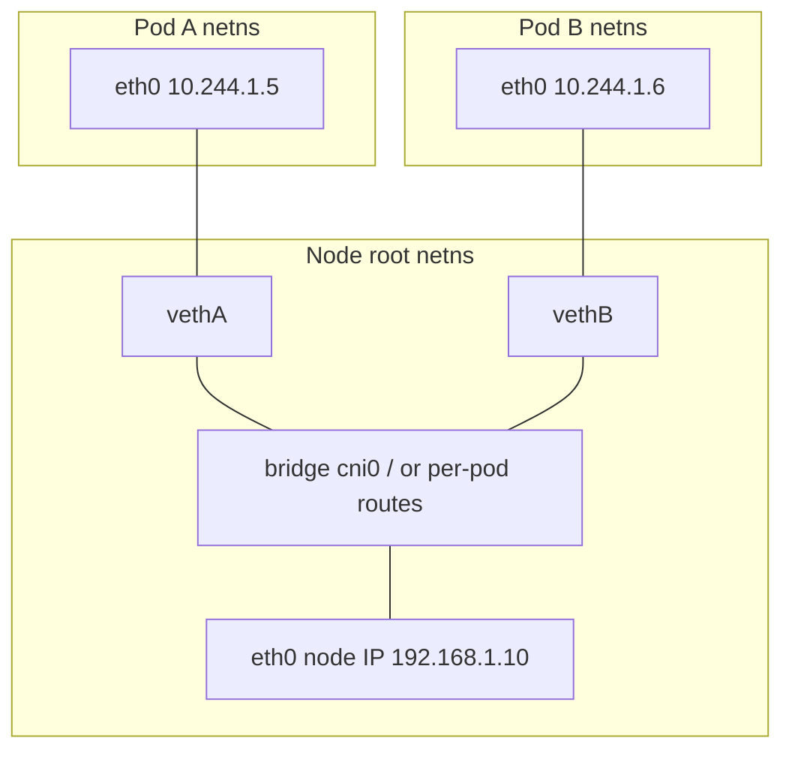
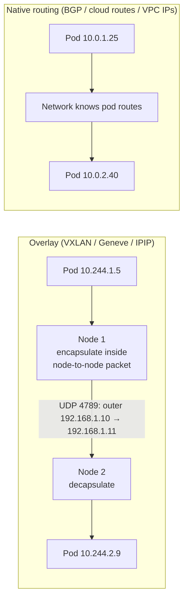
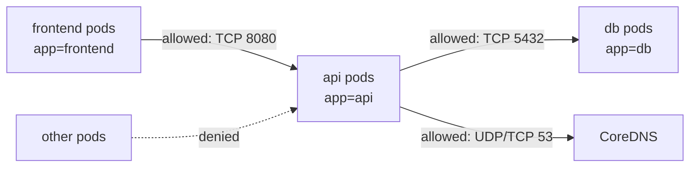

<!-- devopsshack:header -->
> ☸️ **Kubernetes Mastery: Zero to Production** · by **DevOps Shack** · [YouTube](https://www.youtube.com/@devopsshack) · [Hindi channel](https://www.youtube.com/@shackverse) · [devopsshack.com](https://devopsshack.com)
<!-- /devopsshack:header -->

# Architecture 09 · Pod Networking & CNI

## The Kubernetes network model

Kubernetes makes three promises and leaves the implementation to a plugin:

1. Every pod gets its own IP address.
2. Every pod can reach every other pod's IP directly, on any node, **without NAT**.
3. Agents on a node (like the kubelet) can reach every pod on that node.

The plugin that keeps these promises is a **CNI (Container Network Interface)** plugin: Calico, Cilium, Flannel, AWS VPC CNI, Azure CNI, GKE Dataplane V2 and others.

## Four kinds of traffic



## Inside a node



When a pod is created, the kubelet calls the CNI plugin with the pod's network namespace. The plugin:

1. Creates a **veth pair**: one end becomes `eth0` inside the pod, the other stays on the host.
2. Asks **IPAM** for an IP from the node's pod CIDR (or from the VPC subnet, for cloud CNIs).
3. Sets routes so traffic can leave and return.

Same-node pod-to-pod traffic never leaves the machine.

## Across nodes: overlay vs native routing



| | Overlay | Native routing |
|---|---|---|
| Works on any network | ✅ | Needs routing support (BGP, cloud route tables, VPC IPs) |
| Overhead | Encapsulation adds bytes; MTU must be lowered (e.g. 1450) | None |
| Pod IPs visible to the network | No | Yes (firewalls, VPC flow logs can see them) |
| Examples | Flannel VXLAN, Calico IPIP/VXLAN, Cilium tunnel mode | Calico BGP, Cilium native, AWS VPC CNI, Azure CNI |

**MTU mismatches** are a classic overlay bug: small requests work, large responses hang. Check the MTU on pod interfaces vs the underlay.

## Cloud CNIs: pods get real VPC IPs

AWS VPC CNI attaches secondary IPs (or prefixes) from the VPC subnet to each node's ENIs and hands them to pods. Pods are first-class VPC citizens, but:

- Pod density per node is limited by ENI and IP limits per instance type (enable **prefix delegation** to raise it).
- You can **run out of subnet IPs**. Plan CIDRs generously or use secondary CIDRs / custom networking.

Azure CNI (with overlay or pod subnet modes) and GKE VPC-native clusters follow similar ideas.

## Choosing a CNI

| CNI | Strengths |
|---|---|
| **Calico** | Mature, BGP or overlay, rich NetworkPolicy (plus its own global policies), eBPF dataplane option |
| **Cilium** | eBPF everywhere: kube-proxy replacement, L7-aware policy, Hubble observability, encryption, Cluster Mesh, Gateway API |
| **Flannel** | Simple overlay, no NetworkPolicy on its own |
| **AWS VPC CNI / Azure CNI / GKE** | Native cloud integration, pods on VPC IPs; often paired with Calico or Cilium for policy |

Remember: **NetworkPolicy is only enforced if your CNI supports it.** Applying a NetworkPolicy on plain Flannel does nothing, silently.

## NetworkPolicy in one picture



```yaml
apiVersion: networking.k8s.io/v1
kind: NetworkPolicy
metadata:
  name: api-allow-frontend
  namespace: shop
spec:
  podSelector:
    matchLabels: { app: api }
  policyTypes: ["Ingress"]
  ingress:
    - from:
        - podSelector:
            matchLabels: { app: frontend }
      ports:
        - protocol: TCP
          port: 8080
```

Rules of thumb: pods are open until a policy selects them; once selected, only what's allowed gets through; policies are additive (a union, never a deny-overrides-allow); and when you add egress policies, **always allow DNS**.

## Debugging pod networking

```bash
kubectl run net --rm -it --image=nicolaka/netshoot -- bash
  ip addr; ip route
  ping <other-pod-ip>
  traceroute <other-pod-ip>
  tcpdump -i eth0 -nn port 8080
kubectl -n kube-system get pods -l k8s-app=calico-node   # or cilium
cilium status && hubble observe --pod shop/api           # Cilium
```

## Check yourself

1. State the three rules of the Kubernetes network model.
2. What is a veth pair and where do its two ends live?
3. Why do overlays need a lower MTU, and what symptom does a mismatch cause?
4. On EKS, why might new pods fail with "failed to assign an IP address"?
5. You applied a NetworkPolicy and nothing changed. What's the first thing to check?

Next: [10 · Cluster DNS & CoreDNS](10-dns-coredns.md)

<!-- devopsshack:footer -->
---

<p align="center">
  Made with ❤️ by <b><a href="https://devopsshack.com">DevOps Shack</a></b> · Part of <b>Kubernetes Mastery: Zero to Production</b><br/>
  <a href="https://www.youtube.com/@devopsshack">YouTube · DevOps Shack</a> · <a href="https://www.youtube.com/@shackverse">YouTube · DevOps Shack Hindi</a> · <a href="https://devopsshack.com">devopsshack.com</a> · <a href="https://www.instagram.com/devopsshack">Instagram · @devopsshack</a><br/>
  <sub>© DevOps Shack. Original content created by DevOps Shack. Free to learn from and share with credit to DevOps Shack. See <a href="../LICENSE">LICENSE</a>.</sub>
</p>
<!-- /devopsshack:footer -->
