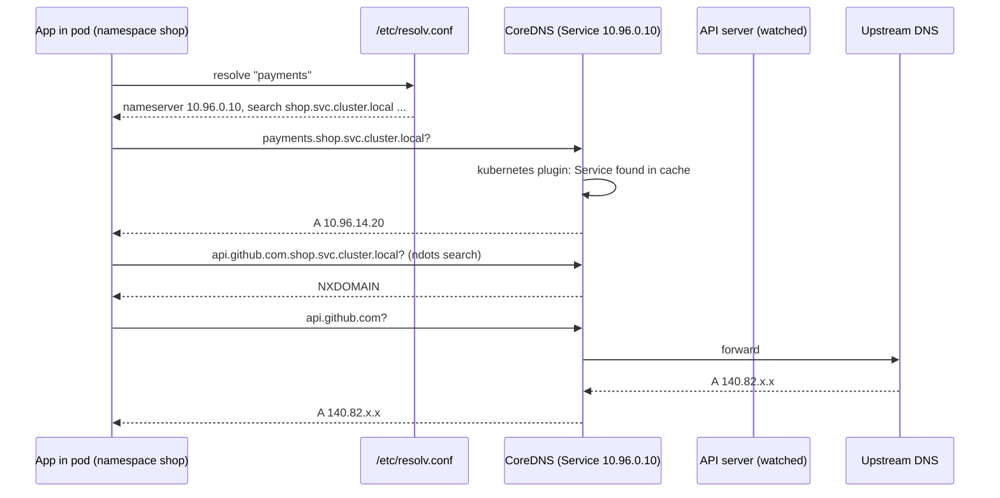
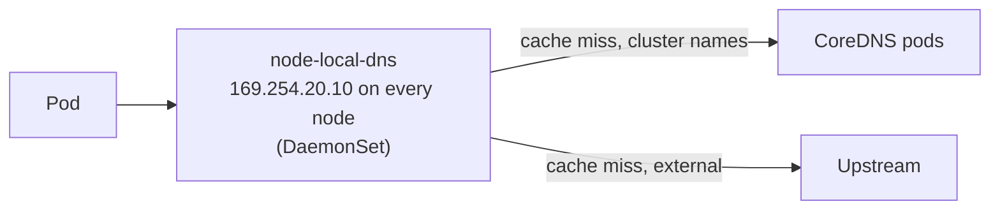

<!-- devopsshack:header -->
> ☸️ **Kubernetes Mastery: Zero to Production** · by **DevOps Shack** · [YouTube](https://www.youtube.com/@devopsshack) · [Hindi channel](https://www.youtube.com/@shackverse) · [devopsshack.com](https://devopsshack.com)
<!-- /devopsshack:header -->

# Architecture 10 · Cluster DNS & CoreDNS

Applications don't use ClusterIPs; they use names like `payments` or `postgres.db.svc.cluster.local`. **CoreDNS** runs as a Deployment in `kube-system`, watches Services and EndpointSlices, and answers those DNS queries.

## The resolution path



## What records exist

| Name | Answer |
|---|---|
| `svc.ns.svc.cluster.local` | A/AAAA: the ClusterIP |
| Headless `svc.ns.svc.cluster.local` | A records for every ready pod IP |
| `pod-0.svc.ns.svc.cluster.local` | A record for a StatefulSet pod (via headless service) |
| `_http._tcp.svc.ns.svc.cluster.local` | SRV records for named ports |
| `ExternalName` svc | CNAME to the external hostname |

## resolv.conf and the ndots trap

```text
nameserver 10.96.0.10
search shop.svc.cluster.local svc.cluster.local cluster.local
options ndots:5
```

`ndots:5` means any name with fewer than 5 dots is tried against every search domain first. So `api.github.com` (2 dots) generates up to 4 lookups, three of which fail, before the real one. At high request rates this multiplies DNS load and adds latency.

Fixes:

- Use fully qualified names with a trailing dot for external hosts: `api.github.com.`
- Lower ndots per pod:

```yaml
spec:
  dnsConfig:
    options:
      - name: ndots
        value: "2"
```

## The Corefile

```text
.:53 {
    errors
    health { lameduck 5s }
    ready
    kubernetes cluster.local in-addr.arpa ip6.arpa {
        pods insecure
        fallthrough in-addr.arpa ip6.arpa
        ttl 30
    }
    prometheus :9153
    forward . /etc/resolv.conf { max_concurrent 1000 }
    cache 30
    loop
    reload
    loadbalance
}
```

Add a stub domain for a corporate zone:

```text
corp.example.com:53 {
    forward . 10.10.0.2 10.10.0.3
}
```

## NodeLocal DNSCache



A DaemonSet cache on every node cuts latency, removes conntrack races on UDP (a known source of 5-second DNS timeouts), and protects CoreDNS from load spikes. Strongly recommended for big or busy clusters.

## Production notes

- Run at least 2 CoreDNS replicas spread across nodes/zones, with a PodDisruptionBudget. Scale with `cluster-proportional-autoscaler` or HPA.
- Watch `coredns_dns_request_duration_seconds`, `coredns_dns_responses_total{rcode="SERVFAIL"}` and `coredns_forward_healthcheck_failures_total`.
- Egress NetworkPolicies must allow UDP **and TCP** 53 to CoreDNS (large responses use TCP).

## Debugging DNS

```bash
kubectl run dns --rm -it --image=nicolaka/netshoot -- bash
  cat /etc/resolv.conf
  dig payments.shop.svc.cluster.local
  dig +search payments
kubectl -n kube-system logs -l k8s-app=kube-dns --tail=50
kubectl -n kube-system get endpointslices -l kubernetes.io/service-name=kube-dns
```

## Check yourself

1. Why does resolving `api.github.com` from a pod generate several DNS queries?
2. What's the DNS name of pod `mysql-1` in StatefulSet `mysql` with headless service `mysql` in namespace `db`?
3. Why do egress policies need TCP 53 as well as UDP 53?
4. What problem does NodeLocal DNSCache solve?

Next: [11 · Storage & CSI](11-storage-csi.md)

<!-- devopsshack:footer -->
---

<p align="center">
  Made with ❤️ by <b><a href="https://devopsshack.com">DevOps Shack</a></b> · Part of <b>Kubernetes Mastery: Zero to Production</b><br/>
  <a href="https://www.youtube.com/@devopsshack">YouTube · DevOps Shack</a> · <a href="https://www.youtube.com/@shackverse">YouTube · DevOps Shack Hindi</a> · <a href="https://devopsshack.com">devopsshack.com</a> · <a href="https://www.instagram.com/devopsshack">Instagram · @devopsshack</a><br/>
  <sub>© DevOps Shack. Original content created by DevOps Shack. Free to learn from and share with credit to DevOps Shack. See <a href="../LICENSE">LICENSE</a>.</sub>
</p>
<!-- /devopsshack:footer -->
