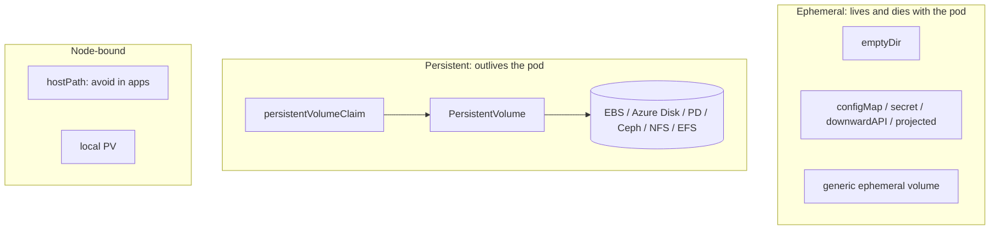
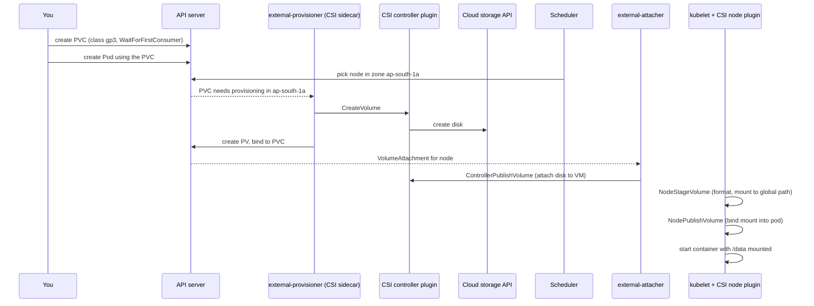
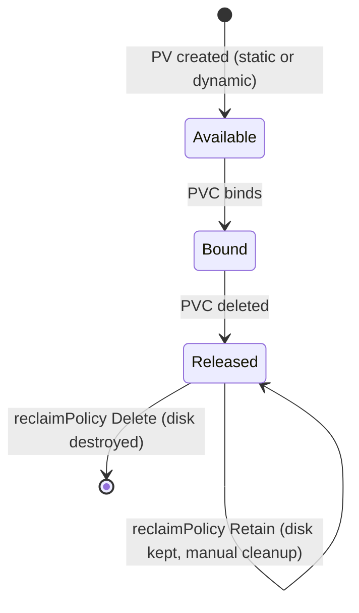
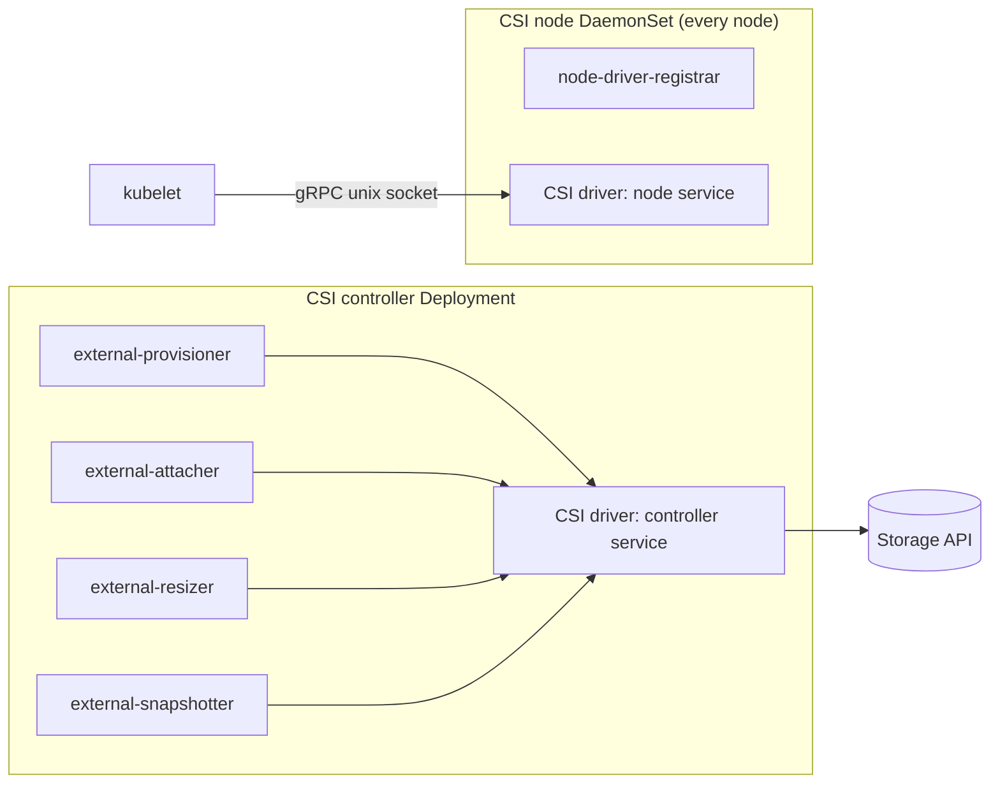

<!-- devopsshack:header -->
> ☸️ **Kubernetes Mastery: Zero to Production** · by **DevOps Shack** · [YouTube](https://www.youtube.com/@devopsshack) · [Hindi channel](https://www.youtube.com/@shackverse) · [devopsshack.com](https://devopsshack.com)
<!-- /devopsshack:header -->

# Architecture 11 · Storage & CSI

Containers have ephemeral filesystems: when a container restarts, its writes are gone. Kubernetes storage is about giving pods data that outlives containers (volumes) or outlives pods entirely (persistent volumes).

## Volume types at a glance



## The PV / PVC / StorageClass trio

- **PersistentVolumeClaim (PVC):** a pod's request: "I need 20 GiB, ReadWriteOnce, class `gp3`."
- **PersistentVolume (PV):** an actual piece of storage in the cluster.
- **StorageClass:** a recipe that tells a provisioner how to create PVs on demand.



## StorageClass example

```yaml
apiVersion: storage.k8s.io/v1
kind: StorageClass
metadata:
  name: gp3
  annotations:
    storageclass.kubernetes.io/is-default-class: "true"
provisioner: ebs.csi.aws.com
parameters:
  type: gp3
  encrypted: "true"
reclaimPolicy: Delete            # or Retain for important data
volumeBindingMode: WaitForFirstConsumer
allowVolumeExpansion: true
```

`WaitForFirstConsumer` delays provisioning until a pod is scheduled, so the disk is created in the **same zone** as the pod. With `Immediate`, a disk can land in zone A while the pod can only schedule in zone B, and the pod is stuck Pending with a "volume node affinity conflict."

## Access modes

| Mode | Meaning | Typical backends |
|---|---|---|
| ReadWriteOnce (RWO) | Read-write by **one node** (several pods on that node can share) | EBS, Azure Disk, PD |
| ReadWriteOncePod (RWOP) | Read-write by exactly one pod | CSI block drivers |
| ReadOnlyMany (ROX) | Read-only by many nodes | NFS, snapshots |
| ReadWriteMany (RWX) | Read-write by many nodes | EFS, Azure Files, Filestore, CephFS, NFS |

## Lifecycle and reclaim policy



Use `Retain` for anything you can't afford to lose to a mistaken `kubectl delete pvc`.

## CSI architecture



The sidecars are generic and maintained by Kubernetes SIG Storage; the driver only implements the CSI gRPC calls. That's why a dozen vendors can plug in without touching Kubernetes code.

## Snapshots, expansion and cloning

```yaml
apiVersion: snapshot.storage.k8s.io/v1
kind: VolumeSnapshot
metadata:
  name: data-snap-2026-11-11
spec:
  volumeSnapshotClassName: ebs-snapclass
  source:
    persistentVolumeClaimName: data-postgres-0
---
apiVersion: v1
kind: PersistentVolumeClaim
metadata:
  name: data-restore
spec:
  storageClassName: gp3
  dataSource:
    name: data-snap-2026-11-11
    kind: VolumeSnapshot
    apiGroup: snapshot.storage.k8s.io
  accessModes: ["ReadWriteOnce"]
  resources:
    requests:
      storage: 50Gi
```

To expand: edit the PVC's `spec.resources.requests.storage` upward (the class must allow expansion). Shrinking is not supported.

## StatefulSets and volumeClaimTemplates

Each StatefulSet replica gets its own PVC (`data-postgres-0`, `data-postgres-1`...). When a pod is rescheduled it reattaches **the same** PVC. Deleting or scaling down a StatefulSet does **not** delete those PVCs by default (configurable with `persistentVolumeClaimRetentionPolicy`).

## Common storage failures

| Symptom | Likely cause |
|---|---|
| PVC stuck Pending | No default StorageClass, wrong class name, provisioner not installed, quota exceeded |
| Pod Pending: volume node affinity conflict | Disk in a different zone than schedulable nodes |
| `Multi-Attach error` | RWO disk still attached to the old node (node died, attach not cleaned up yet) |
| Pod stuck ContainerCreating with mount timeout | CSI node plugin not running, IAM permissions, wrong fsType |
| Disk full in a pod | Expand the PVC; check log rotation and emptyDir sizeLimit |

## Check yourself

1. Why is `WaitForFirstConsumer` the right default for zonal disks?
2. Which access mode lets pods on three different nodes write to the same volume?
3. What happens to the cloud disk when you delete a PVC with reclaim policy `Delete`? With `Retain`?
4. Name the CSI sidecars and what each does.
5. A pod moved nodes after a crash and now shows `Multi-Attach error`. Why?

Next: [12 · Life of a kubectl apply](12-life-of-kubectl-apply.md)

<!-- devopsshack:footer -->
---

<p align="center">
  Made with ❤️ by <b><a href="https://devopsshack.com">DevOps Shack</a></b> · Part of <b>Kubernetes Mastery: Zero to Production</b><br/>
  <a href="https://www.youtube.com/@devopsshack">YouTube · DevOps Shack</a> · <a href="https://www.youtube.com/@shackverse">YouTube · DevOps Shack Hindi</a> · <a href="https://devopsshack.com">devopsshack.com</a> · <a href="https://www.instagram.com/devopsshack">Instagram · @devopsshack</a><br/>
  <sub>© DevOps Shack. Original content created by DevOps Shack. Free to learn from and share with credit to DevOps Shack. See <a href="../LICENSE">LICENSE</a>.</sub>
</p>
<!-- /devopsshack:footer -->
