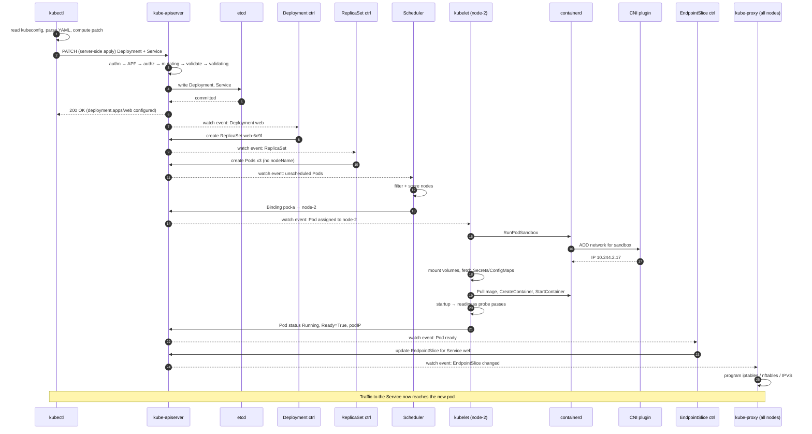
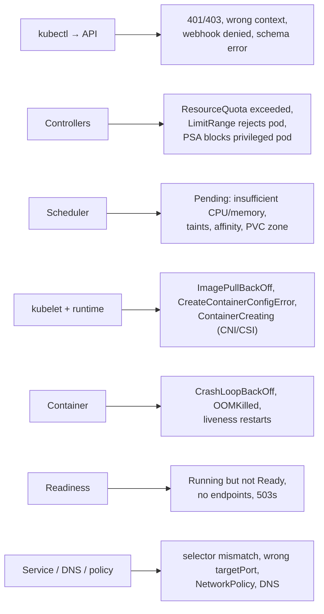

<!-- devopsshack:header -->
> ☸️ **Kubernetes Mastery: Zero to Production** · by **DevOps Shack** · [YouTube](https://www.youtube.com/@devopsshack) · [Hindi channel](https://www.youtube.com/@shackverse) · [devopsshack.com](https://devopsshack.com)
<!-- /devopsshack:header -->

# Architecture 12 · Life of a `kubectl apply`

This page ties the whole architecture together by tracing one command, from your keyboard to a container serving traffic. It's the single most common "explain Kubernetes architecture" interview question. Learn to tell this story fluently.

```bash
kubectl apply -f web.yaml   # a Deployment (3 replicas) + a Service
```

## The full trace



## Step by step, in words

1. **kubectl** loads your kubeconfig (cluster URL, CA, credentials), reads the YAML, and sends the objects to the API server. With client-side apply it computes a three-way merge using the `last-applied-configuration` annotation; with `--server-side` the API server does the merge and tracks field ownership.
2. **The API server** authenticates you (cert, token or OIDC), applies priority and fairness, checks RBAC, runs mutating webhooks (defaults, injected sidecars), validates the schema, runs validating policies, and writes to **etcd**. At this point kubectl returns. Nothing is running yet. You've only recorded intent.
3. **The Deployment controller** sees the new Deployment and creates a ReplicaSet whose name includes a hash of the pod template.
4. **The ReplicaSet controller** sees it needs 3 pods and has 0, so it creates 3 Pod objects with no node assigned.
5. **The scheduler** sees unscheduled pods, filters out nodes that can't fit them, scores the rest, and writes a binding for each pod.
6. **The kubelet** on each chosen node sees a pod assigned to it. It asks **containerd** to create a pod sandbox; the **CNI plugin** wires up networking and assigns an IP; the kubelet mounts volumes, pulls images, runs init containers, then starts the app containers.
7. **Probes** run. When readiness passes, the kubelet reports `Ready=True`.
8. **The EndpointSlice controller** adds the pod's IP to the Service's endpoints.
9. **kube-proxy** on every node updates its rules. **CoreDNS** already serves the Service name. Traffic flows.

## Where it can go wrong, mapped to each step



This map is also the best **troubleshooting order**. Find the first step that didn't happen and you've found the layer to dig into. The [troubleshooting playbooks](../05-troubleshooting-playbooks/README.md) follow exactly this structure.

## Watch it happen

```bash
# Terminal 1: watch events across the namespace
kubectl get events -n demo --watch

# Terminal 2: watch objects appear
kubectl get deploy,rs,pods,endpointslices -n demo -w

# Terminal 3: apply
kubectl apply -n demo -f web.yaml
```

## Check yourself

1. At what point does `kubectl apply` return? Is anything running at that moment?
2. Which component assigns the pod IP?
3. Which component decides which node runs the pod, and which component actually starts it?
4. How does a newly ready pod start receiving Service traffic?
5. A pod is `Running` but users get 503s. Which steps would you check, in order?

Next: [13 · Pod Lifecycle & Termination](13-pod-lifecycle.md)

<!-- devopsshack:footer -->
---

<p align="center">
  Made with ❤️ by <b><a href="https://devopsshack.com">DevOps Shack</a></b> · Part of <b>Kubernetes Mastery: Zero to Production</b><br/>
  <a href="https://www.youtube.com/@devopsshack">YouTube · DevOps Shack</a> · <a href="https://www.youtube.com/@shackverse">YouTube · DevOps Shack Hindi</a> · <a href="https://devopsshack.com">devopsshack.com</a> · <a href="https://www.instagram.com/devopsshack">Instagram · @devopsshack</a><br/>
  <sub>© DevOps Shack. Original content created by DevOps Shack. Free to learn from and share with credit to DevOps Shack. See <a href="../LICENSE">LICENSE</a>.</sub>
</p>
<!-- /devopsshack:footer -->
