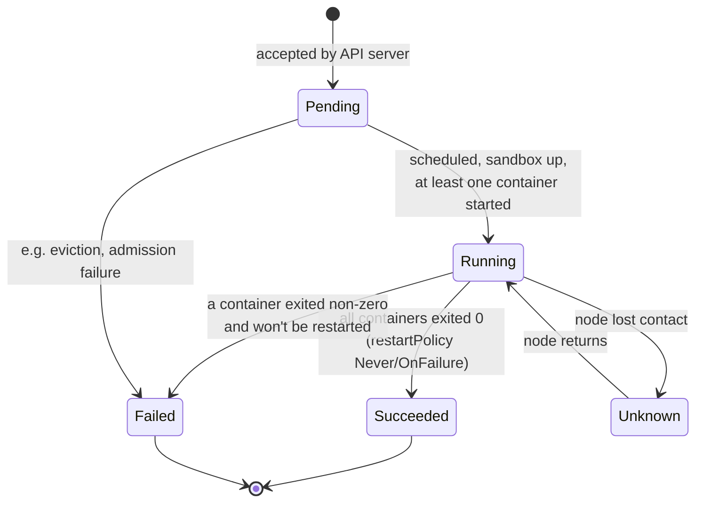
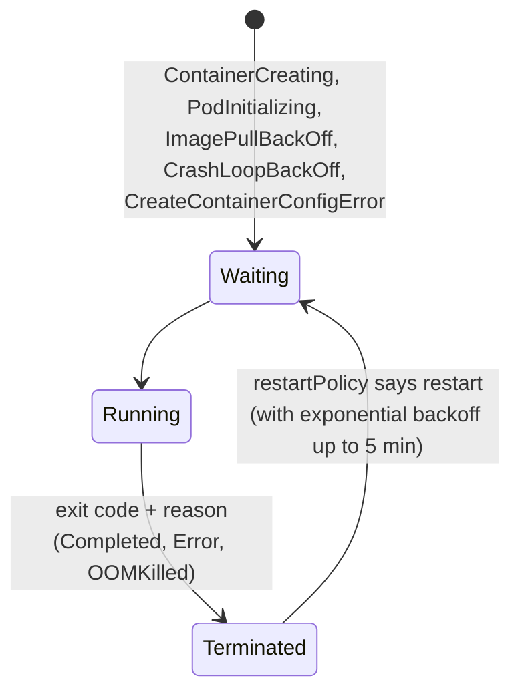
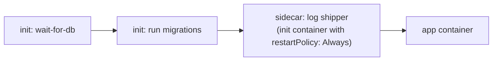
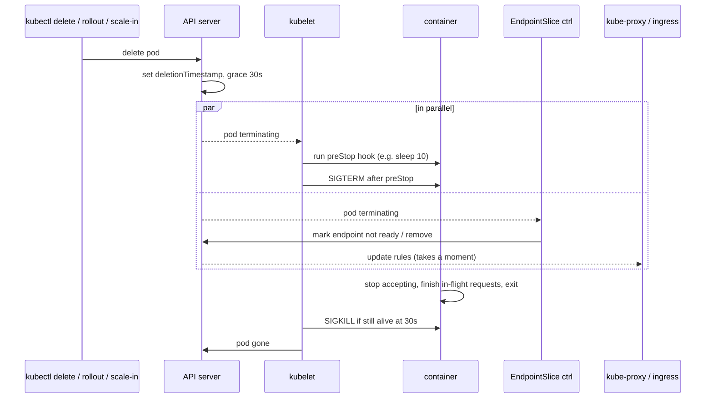

<!-- devopsshack:header -->
> ☸️ **Kubernetes Mastery: Zero to Production** · by **DevOps Shack** · [YouTube](https://www.youtube.com/@devopsshack) · [Hindi channel](https://www.youtube.com/@shackverse) · [devopsshack.com](https://devopsshack.com)
<!-- /devopsshack:header -->

# Architecture 13 · Pod Lifecycle & Termination

## Pod phases



The phase is a summary. For real detail, look at **conditions** and **container states**.

## Pod conditions

| Condition | True means |
|---|---|
| PodScheduled | Bound to a node |
| PodReadyToStartContainers | Sandbox and networking are ready |
| Initialized | All init containers completed |
| ContainersReady | Every container passes readiness |
| Ready | Pod can receive Service traffic (includes readiness gates) |

```bash
kubectl get pod web-1 -o jsonpath='{range .status.conditions[*]}{.type}={.status}{"\n"}{end}'
```

## Container states



`CrashLoopBackOff` is not an error itself. It's the kubelet waiting before the next restart because the container keeps dying. The real cause is in `kubectl logs --previous` and the last terminated state's exit code.

| Exit code | Usually means |
|---|---|
| 0 | Clean exit (bad for a long-running server: it "completed") |
| 1 | Application error |
| 126 / 127 | Command not executable / not found (wrong entrypoint) |
| 137 | SIGKILL: OOMKilled, or killed after grace period |
| 139 | Segfault |
| 143 | SIGTERM: graceful stop |

## Init containers and native sidecars



- **Init containers** run one at a time, in order, each to completion, before app containers start. If one fails, the pod restarts it (per restartPolicy).
- **Native sidecars** are init containers with `restartPolicy: Always`. They start before the app, keep running alongside it, are restarted independently, and are stopped **after** the app on shutdown. This fixes old problems like Jobs never completing because a sidecar proxy kept running.

```yaml
spec:
  initContainers:
    - name: migrate
      image: shop/api:2.4.0
      command: ["./migrate", "up"]
    - name: log-shipper
      image: fluent/fluent-bit:3.1
      restartPolicy: Always        # native sidecar
  containers:
    - name: api
      image: shop/api:2.4.0
```

## Graceful termination: the most misunderstood sequence



The important word is **parallel**. Endpoint removal and SIGTERM race each other. If your app exits instantly on SIGTERM, load balancers may still send it requests for a second or two, and users see errors during every deploy.

The standard fix:

```yaml
spec:
  terminationGracePeriodSeconds: 45
  containers:
    - name: api
      lifecycle:
        preStop:
          sleep:
            seconds: 10        # or exec: ["sleep","10"] on older versions
```

And in the application: on SIGTERM, stop accepting new connections, drain in-flight requests, close DB pools, then exit. Make sure your process is PID 1 or uses an init like `tini`, or the signal never reaches your app.

## Restart policies

| restartPolicy | Used by | Behaviour |
|---|---|---|
| Always (default) | Deployments, StatefulSets, DaemonSets | Restart on any exit |
| OnFailure | Jobs | Restart only on non-zero exit |
| Never | Jobs, debug pods | Never restart |

## Disruptions

- **Involuntary:** node crash, kernel panic, OOM eviction, cloud instance reclaimed.
- **Voluntary:** `kubectl drain`, cluster upgrades, autoscaler scale-down.

A **PodDisruptionBudget** limits voluntary disruptions:

```yaml
apiVersion: policy/v1
kind: PodDisruptionBudget
metadata:
  name: api-pdb
spec:
  minAvailable: 2          # or maxUnavailable: 1
  selector:
    matchLabels: { app: api }
```

Drains respect it through the **Eviction API**. A PDB that allows zero disruptions (e.g., `minAvailable: 3` with 3 replicas) will block node drains and upgrades forever.

## Check yourself

1. A pod is `Running` but not `Ready`. Which condition is false and what are the consequences?
2. What's the difference between an init container and a native sidecar?
3. Why do users see errors during rolling updates even with readiness probes? How does a preStop sleep help?
4. What does exit code 137 tell you?
5. How can a PDB block a cluster upgrade?

Next: [14 · AuthN, AuthZ & Admission](14-authn-authz-admission.md)

<!-- devopsshack:footer -->
---

<p align="center">
  Made with ❤️ by <b><a href="https://devopsshack.com">DevOps Shack</a></b> · Part of <b>Kubernetes Mastery: Zero to Production</b><br/>
  <a href="https://www.youtube.com/@devopsshack">YouTube · DevOps Shack</a> · <a href="https://www.youtube.com/@shackverse">YouTube · DevOps Shack Hindi</a> · <a href="https://devopsshack.com">devopsshack.com</a> · <a href="https://www.instagram.com/devopsshack">Instagram · @devopsshack</a><br/>
  <sub>© DevOps Shack. Original content created by DevOps Shack. Free to learn from and share with credit to DevOps Shack. See <a href="../LICENSE">LICENSE</a>.</sub>
</p>
<!-- /devopsshack:footer -->
