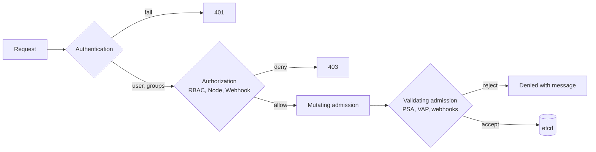
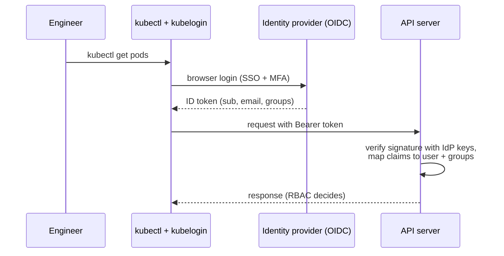
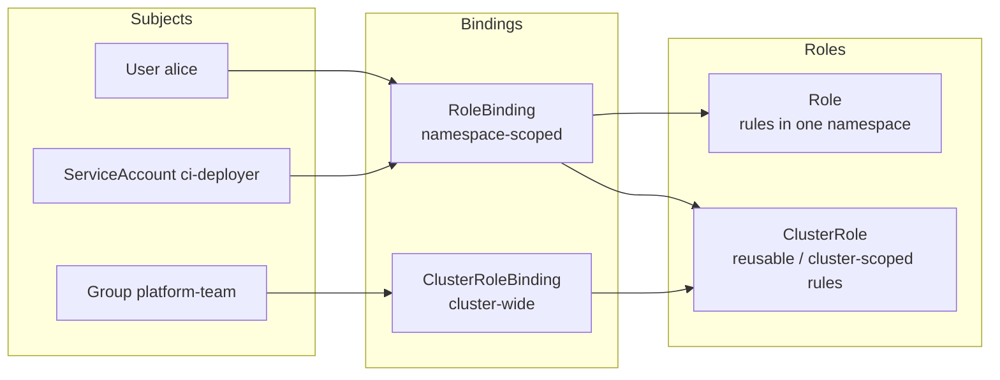
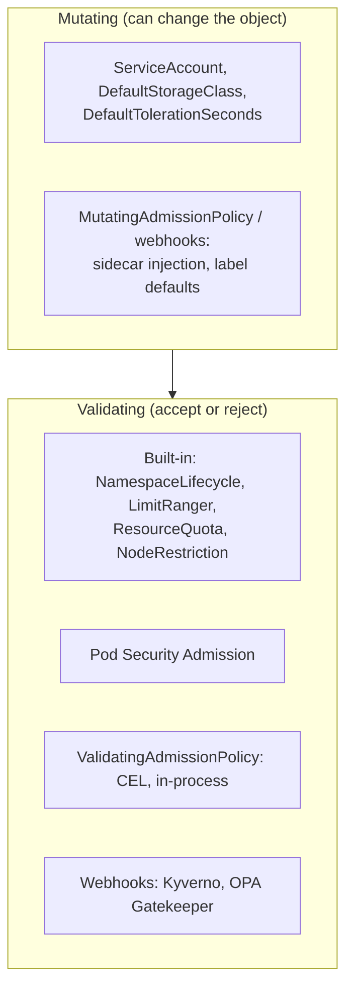

<!-- devopsshack:header -->
> ☸️ **Kubernetes Mastery: Zero to Production** · by **DevOps Shack** · [YouTube](https://www.youtube.com/@devopsshack) · [Hindi channel](https://www.youtube.com/@shackverse) · [devopsshack.com](https://devopsshack.com)
<!-- /devopsshack:header -->

# Architecture 14 · Authentication, Authorization & Admission

Every API request answers three questions in order: **Who are you?** (authentication) **Are you allowed to do this?** (authorization) **Is this object acceptable?** (admission).



## Authentication: who are you?

Kubernetes has **no user database**. Humans are identified by something an external system vouches for; workloads use ServiceAccounts.

| Method | Who uses it | Notes |
|---|---|---|
| X.509 client certificates | Admins (kubeadm `admin.conf`), kubelets | CN = username, O = groups. Hard to revoke; keep short-lived |
| OIDC tokens | Humans via SSO (Okta, Entra ID, Google, Keycloak, Dex) | The production standard for people. Structured authentication config allows multiple issuers |
| ServiceAccount tokens | Pods, CI systems | Projected, audience-bound, auto-rotated, short-lived JWTs |
| Webhook token auth | Cloud IAM (e.g. EKS access entries / aws-iam-authenticator) | Delegates to an external service |
| Anonymous | Health checks | `system:anonymous`; keep permissions minimal |



### ServiceAccounts and workload identity

Every pod runs as a ServiceAccount (`default` if you don't choose). The kubelet mounts a short-lived projected token at `/var/run/secrets/kubernetes.io/serviceaccount/token`.

- Set `automountServiceAccountToken: false` for pods that never call the API.
- Cloud **workload identity** (EKS Pod Identity / IRSA, AKS Workload Identity, GKE Workload Identity) exchanges that token for cloud credentials. No static cloud keys in Secrets.

## Authorization: RBAC



The four combinations:

| Binding | Role | Effect |
|---|---|---|
| RoleBinding | Role | Permissions in that one namespace |
| RoleBinding | ClusterRole | ClusterRole's rules, **limited to the binding's namespace** (great for reuse) |
| ClusterRoleBinding | ClusterRole | Permissions in every namespace + cluster-scoped resources |
| ClusterRoleBinding | Role | Not allowed |

```yaml
apiVersion: rbac.authorization.k8s.io/v1
kind: Role
metadata:
  name: deployer
  namespace: shop
rules:
  - apiGroups: ["apps"]
    resources: ["deployments"]
    verbs: ["get", "list", "watch", "patch", "update"]
  - apiGroups: [""]
    resources: ["pods", "pods/log"]
    verbs: ["get", "list", "watch"]
---
apiVersion: rbac.authorization.k8s.io/v1
kind: RoleBinding
metadata:
  name: ci-deployer
  namespace: shop
subjects:
  - kind: ServiceAccount
    name: ci-deployer
    namespace: shop
roleRef:
  kind: Role
  name: deployer
  apiGroup: rbac.authorization.k8s.io
```

```bash
kubectl auth can-i delete pods -n shop --as system:serviceaccount:shop:ci-deployer
kubectl auth can-i --list -n shop --as alice
kubectl auth whoami
```

RBAC is **allow-only**: there are no deny rules. Permissions are the union of every binding.

Dangerous permissions to watch for: `*` on `*`, `create pods` (can mount any Secret or run privileged), `get secrets` cluster-wide, `escalate`/`bind`/`impersonate`, `nodes/proxy`, and write access to webhooks or CRDs.

The **Node authorizer** restricts each kubelet to objects related to pods on its own node (combined with the `NodeRestriction` admission plugin).

## Admission control



### Pod Security Admission (PSA)

Three profiles, enforced per namespace with labels:

| Profile | Allows |
|---|---|
| privileged | Everything |
| baseline | Blocks known escalations: privileged, hostNetwork/hostPID, hostPath, added dangerous capabilities |
| restricted | Baseline + must run as non-root, drop ALL capabilities, seccomp RuntimeDefault, no privilege escalation |

```bash
kubectl label ns shop \
  pod-security.kubernetes.io/enforce=restricted \
  pod-security.kubernetes.io/warn=restricted \
  pod-security.kubernetes.io/audit=restricted
```

### ValidatingAdmissionPolicy (CEL)

Policies evaluated inside the API server, no webhook to run or break:

```yaml
apiVersion: admissionregistration.k8s.io/v1
kind: ValidatingAdmissionPolicy
metadata:
  name: require-team-label
spec:
  failurePolicy: Fail
  matchConstraints:
    resourceRules:
      - apiGroups: ["apps"]
        apiVersions: ["v1"]
        operations: ["CREATE", "UPDATE"]
        resources: ["deployments"]
  validations:
    - expression: "has(object.metadata.labels) && 'team' in object.metadata.labels"
      message: "Every Deployment needs a 'team' label."
---
apiVersion: admissionregistration.k8s.io/v1
kind: ValidatingAdmissionPolicyBinding
metadata:
  name: require-team-label
spec:
  policyName: require-team-label
  validationActions: ["Deny"]
```

### Webhook failure modes

`failurePolicy: Fail` + a webhook whose pods are down = **nobody can create pods**, including the webhook's own replacement pods. Mitigations: exclude `kube-system` and the webhook's own namespace with `namespaceSelector`, keep `timeoutSeconds` low, run the webhook with HA and a PDB, and prefer in-process ValidatingAdmissionPolicy where possible.

## Check yourself

1. Where are Kubernetes users stored?
2. What does a RoleBinding that references a ClusterRole grant?
3. Why is `create pods` effectively a path to reading every Secret in the namespace?
4. Name the three Pod Security profiles and what `restricted` adds.
5. A validating webhook is down and no pods can be created anywhere. Why, and how do you prevent it?

Next: [15 · High Availability Control Plane](15-high-availability.md)

<!-- devopsshack:footer -->
---

<p align="center">
  Made with ❤️ by <b><a href="https://devopsshack.com">DevOps Shack</a></b> · Part of <b>Kubernetes Mastery: Zero to Production</b><br/>
  <a href="https://www.youtube.com/@devopsshack">YouTube · DevOps Shack</a> · <a href="https://www.youtube.com/@shackverse">YouTube · DevOps Shack Hindi</a> · <a href="https://devopsshack.com">devopsshack.com</a> · <a href="https://www.instagram.com/devopsshack">Instagram · @devopsshack</a><br/>
  <sub>© DevOps Shack. Original content created by DevOps Shack. Free to learn from and share with credit to DevOps Shack. See <a href="../LICENSE">LICENSE</a>.</sub>
</p>
<!-- /devopsshack:footer -->
