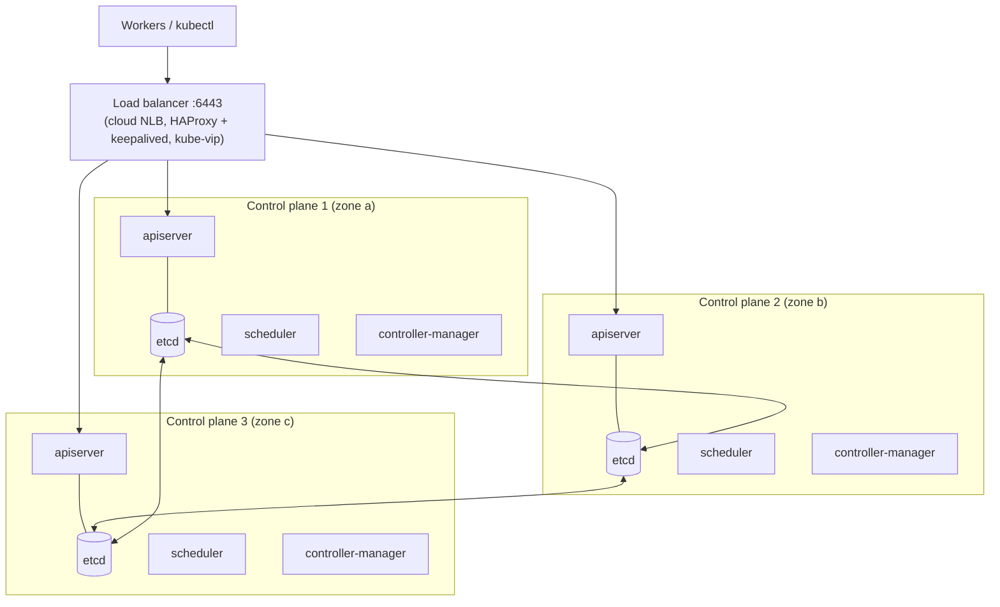
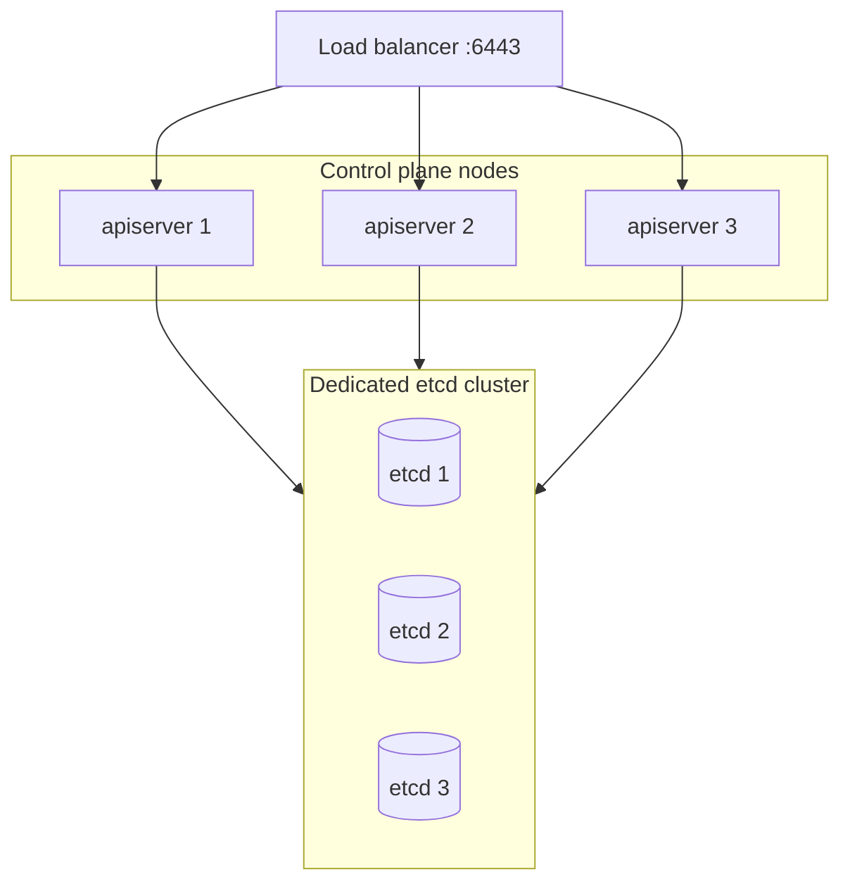
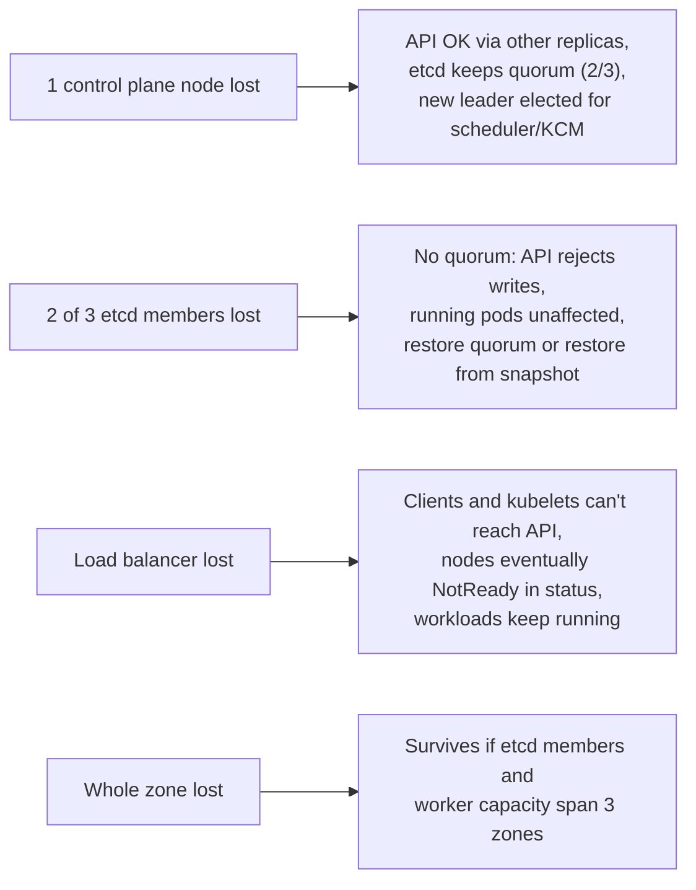

<!-- devopsshack:header -->
> ☸️ **Kubernetes Mastery: Zero to Production** · by **DevOps Shack** · [YouTube](https://www.youtube.com/@devopsshack) · [Hindi channel](https://www.youtube.com/@shackverse) · [devopsshack.com](https://devopsshack.com)
<!-- /devopsshack:header -->

# Architecture 15 · High Availability Control Plane

A single control plane node is a single point of failure for *change*. Production clusters run the control plane on at least three nodes across failure domains.

## Stacked etcd topology



Each control plane node runs an API server and a local etcd member. Simple, fewer machines; losing a node loses one API server **and** one etcd member at the same time. This is kubeadm's default HA layout.

## External etcd topology



etcd failures and control-plane failures are decoupled, and etcd gets dedicated fast disks. Costs more machines and more operational work.

## How each component achieves HA

| Component | Model | Mechanism |
|---|---|---|
| kube-apiserver | Active-active | Stateless; LB spreads requests; health check `/readyz` |
| etcd | Leader-follower | Raft quorum (needs a majority alive) |
| kube-scheduler | Active-passive | Leader election via Lease |
| kube-controller-manager | Active-passive | Leader election via Lease |
| cloud-controller-manager | Active-passive | Leader election via Lease |
| CoreDNS | Active-active | Multiple replicas behind a Service, PDB, spread |

## Failure scenarios



## Workload HA is a separate job

A highly available control plane does nothing for an app with one replica. Workload HA needs:

- **Multiple replicas** spread with `topologySpreadConstraints` across zones and nodes.
- **PodDisruptionBudgets** so drains can't take all replicas at once.
- **Readiness probes and graceful shutdown** so traffic shifts cleanly.
- **Enough spare capacity** (or autoscaling) to absorb a lost zone.
- **Zonal storage awareness:** an EBS volume can't follow a pod to another zone; use replication at the app layer (database replicas) for zone failure.

## Certificates

kubeadm clusters use certificates that expire after one year (the CA lasts ten). An expired API server or kubelet certificate is a classic outage.

```bash
kubeadm certs check-expiration
kubeadm certs renew all          # then restart control plane static pods
```

Kubelet client certificates rotate automatically when `rotateCertificates: true` (the default in kubeadm).

## Check yourself

1. Compare stacked and external etcd topologies.
2. Why can three API servers all be active while only one scheduler acts at a time?
3. What is the impact of losing the API server load balancer?
4. Your control plane spans three zones. Is your app automatically zone-resilient? Why not?
5. How do you check and renew kubeadm certificates?

Next: [16 · Ingress & Gateway API Traffic Flow](16-ingress-gateway-traffic.md)

<!-- devopsshack:footer -->
---

<p align="center">
  Made with ❤️ by <b><a href="https://devopsshack.com">DevOps Shack</a></b> · Part of <b>Kubernetes Mastery: Zero to Production</b><br/>
  <a href="https://www.youtube.com/@devopsshack">YouTube · DevOps Shack</a> · <a href="https://www.youtube.com/@shackverse">YouTube · DevOps Shack Hindi</a> · <a href="https://devopsshack.com">devopsshack.com</a> · <a href="https://www.instagram.com/devopsshack">Instagram · @devopsshack</a><br/>
  <sub>© DevOps Shack. Original content created by DevOps Shack. Free to learn from and share with credit to DevOps Shack. See <a href="../LICENSE">LICENSE</a>.</sub>
</p>
<!-- /devopsshack:footer -->
