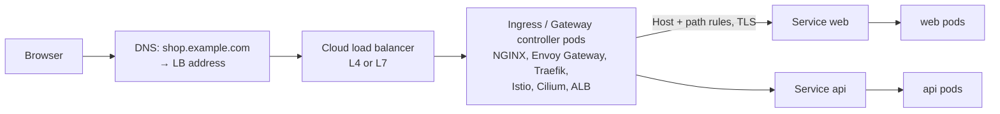
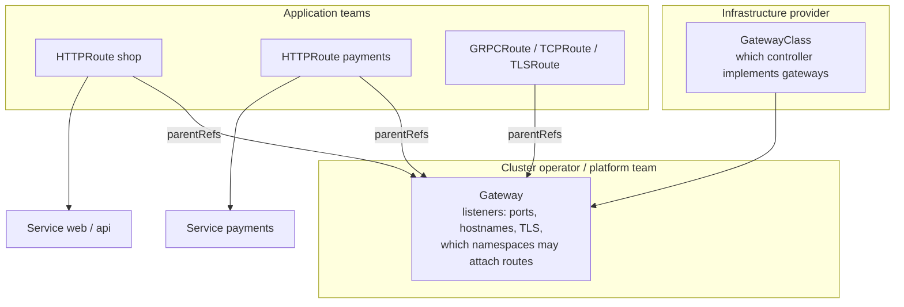
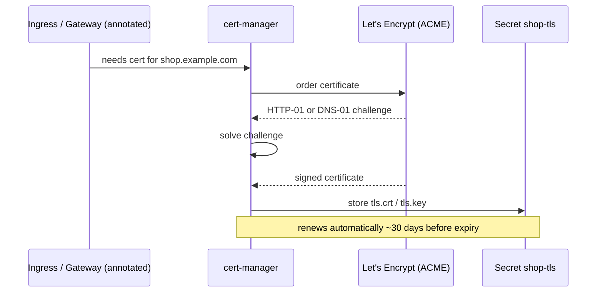

<!-- devopsshack:header -->
> ☸️ **Kubernetes Mastery: Zero to Production** · by **DevOps Shack** · [YouTube](https://www.youtube.com/@devopsshack) · [Hindi channel](https://www.youtube.com/@shackverse) · [devopsshack.com](https://devopsshack.com)
<!-- /devopsshack:header -->

# Architecture 16 · Ingress & Gateway API: North-South Traffic

Services handle traffic **inside** the cluster (east-west) and basic L4 exposure. Real HTTP applications need host- and path-based routing, TLS termination, redirects and canaries. That's the job of **Ingress** and its successor, the **Gateway API**.

## The full path from browser to pod



Many controllers skip the Service's ClusterIP and send traffic straight to pod IPs read from EndpointSlices, which gives them better load balancing and keepalive control.

## Ingress

```yaml
apiVersion: networking.k8s.io/v1
kind: Ingress
metadata:
  name: shop
  namespace: shop
  annotations:
    cert-manager.io/cluster-issuer: letsencrypt-prod
spec:
  ingressClassName: nginx
  tls:
    - hosts: ["shop.example.com"]
      secretName: shop-tls
  rules:
    - host: shop.example.com
      http:
        paths:
          - path: /api
            pathType: Prefix
            backend:
              service: { name: api, port: { number: 80 } }
          - path: /
            pathType: Prefix
            backend:
              service: { name: web, port: { number: 80 } }
```

Ingress limitations: only HTTP(S), one resource mixing infra and app concerns, and anything beyond host/path (rewrites, header matching, canary weights, timeouts) lives in **controller-specific annotations** that don't port between controllers.

> The community ingress-nginx project has been retired (announced for March 2026). Existing installs keep working but receive no new fixes, so new clusters should choose a maintained controller or move to the Gateway API.

## Gateway API

The Gateway API splits responsibilities by role and makes advanced routing first-class.



```yaml
apiVersion: gateway.networking.k8s.io/v1
kind: Gateway
metadata:
  name: public
  namespace: infra
spec:
  gatewayClassName: envoy
  listeners:
    - name: https
      protocol: HTTPS
      port: 443
      hostname: "*.example.com"
      tls:
        certificateRefs:
          - name: wildcard-example-com
      allowedRoutes:
        namespaces:
          from: Selector
          selector:
            matchLabels: { gateway-access: "public" }
---
apiVersion: gateway.networking.k8s.io/v1
kind: HTTPRoute
metadata:
  name: shop
  namespace: shop
spec:
  parentRefs:
    - name: public
      namespace: infra
  hostnames: ["shop.example.com"]
  rules:
    - matches:
        - path: { type: PathPrefix, value: /api }
      backendRefs:
        - name: api-v1
          port: 80
          weight: 90
        - name: api-v2          # 10% canary, no annotations needed
          port: 80
          weight: 10
    - backendRefs:
        - name: web
          port: 80
```

| | Ingress | Gateway API |
|---|---|---|
| Protocols | HTTP/HTTPS | HTTP, gRPC, TLS, TCP, UDP |
| Traffic splitting, header matching, mirroring | Annotations (non-portable) | Built in |
| Role separation | One object | GatewayClass / Gateway / Routes |
| Cross-namespace routing | Awkward | Explicit with allowedRoutes and ReferenceGrant |
| Status | Stable, frozen | GA core, actively developed; the recommended future path |

## TLS with cert-manager



## Where TLS terminates

- **At the cloud LB:** simple, offloads CPU; traffic inside the VPC may be plaintext.
- **At the ingress/gateway (most common):** certs managed in-cluster with cert-manager.
- **End-to-end / mTLS to the pod:** with re-encryption or a service mesh, for strict compliance.

## Check yourself

1. Trace a request from a browser to a pod through an ingress controller.
2. Why are Ingress annotations a portability problem?
3. Which Gateway API object does the platform team own, and which does an app team own?
4. Write the rule that sends 10% of `/api` traffic to a new version.
5. How does cert-manager prove domain ownership?

Next: [17 · Extending Kubernetes](17-extending-kubernetes.md)

<!-- devopsshack:footer -->
---

<p align="center">
  Made with ❤️ by <b><a href="https://devopsshack.com">DevOps Shack</a></b> · Part of <b>Kubernetes Mastery: Zero to Production</b><br/>
  <a href="https://www.youtube.com/@devopsshack">YouTube · DevOps Shack</a> · <a href="https://www.youtube.com/@shackverse">YouTube · DevOps Shack Hindi</a> · <a href="https://devopsshack.com">devopsshack.com</a> · <a href="https://www.instagram.com/devopsshack">Instagram · @devopsshack</a><br/>
  <sub>© DevOps Shack. Original content created by DevOps Shack. Free to learn from and share with credit to DevOps Shack. See <a href="../LICENSE">LICENSE</a>.</sub>
</p>
<!-- /devopsshack:footer -->
