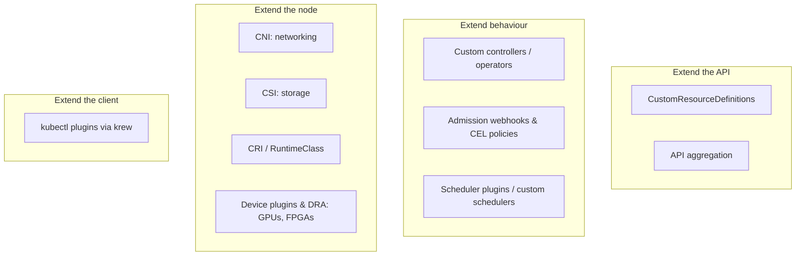
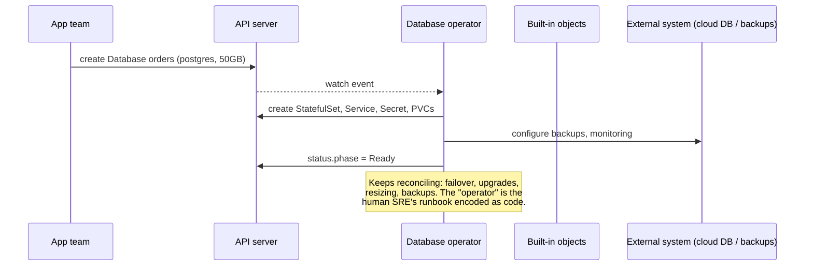

<!-- devopsshack:header -->
> ☸️ **Kubernetes Mastery: Zero to Production** · by **DevOps Shack** · [YouTube](https://www.youtube.com/@devopsshack) · [Hindi channel](https://www.youtube.com/@shackverse) · [devopsshack.com](https://devopsshack.com)
<!-- /devopsshack:header -->

# Architecture 17 · Extending Kubernetes

Kubernetes is less a product than a platform for building platforms. Almost every popular tool (Argo CD, cert-manager, Prometheus Operator, Karpenter, Crossplane, Istio) extends it in one of the ways below.



## CRDs: teaching the API new nouns

```yaml
apiVersion: apiextensions.k8s.io/v1
kind: CustomResourceDefinition
metadata:
  name: databases.platform.devopsshack.com
spec:
  group: platform.devopsshack.com
  scope: Namespaced
  names:
    kind: Database
    plural: databases
    singular: database
    shortNames: ["db"]
  versions:
    - name: v1
      served: true
      storage: true
      subresources:
        status: {}
      additionalPrinterColumns:
        - name: Engine
          type: string
          jsonPath: .spec.engine
        - name: Phase
          type: string
          jsonPath: .status.phase
      schema:
        openAPIV3Schema:
          type: object
          properties:
            spec:
              type: object
              required: ["engine", "storageGB"]
              properties:
                engine:
                  type: string
                  enum: ["postgres", "mysql"]
                storageGB:
                  type: integer
                  minimum: 10
                  maximum: 1000
              x-kubernetes-validations:
                - rule: "self.engine != 'mysql' || self.storageGB <= 500"
                  message: "MySQL databases are capped at 500 GB"
            status:
              type: object
              properties:
                phase: { type: string }
```

Now `kubectl get databases` works, RBAC applies to it, and it's stored in etcd. But a CRD alone **does nothing**. It's just data until a controller acts on it.

## Operators: CRD + controller + operational knowledge



Operator maturity, roughly: install → upgrade → full lifecycle (backup, restore, failover) → deep insights (metrics, alerts) → auto-pilot (auto-tuning, auto-scaling).

Popular operator frameworks: **Kubebuilder** and **Operator SDK** (Go, controller-runtime), **Kopf** (Python), **Metacontroller**. Well-known operators: CloudNativePG, Strimzi (Kafka), Prometheus Operator, cert-manager, Argo CD itself.

## Operator design rules

- Reconcile must be **idempotent** and level-based.
- Use **owner references** so child objects are garbage-collected.
- Use **finalizers** for external cleanup (delete the cloud DB before the CR disappears).
- Write progress to the **status subresource** with conditions, never to spec.
- Use **generation / observedGeneration** to tell users whether the latest spec has been processed.
- Rate-limit and back off on errors; never hot-loop against the API server.

## Device plugins and Dynamic Resource Allocation

GPUs and other hardware are advertised by **device plugins** (e.g. the NVIDIA device plugin) as extended resources (`nvidia.com/gpu: 1`). **Dynamic Resource Allocation (DRA)**, GA in recent releases, goes further: claims, sharing, partitioning (MIG) and richer parameters, which matters for AI/ML workloads.

## kubectl plugins

Any executable named `kubectl-foo` on your PATH becomes `kubectl foo`. Install community plugins with **krew**: `kubectl krew install ctx ns neat tree stern`.

## Check yourself

1. What's the difference between a CRD and an operator?
2. Why should an operator write to `status` and never modify the user's `spec`?
3. How does an operator clean up an external resource when the custom resource is deleted?
4. How does a pod request a GPU?

Next: [18 · Managed Kubernetes Architectures](18-managed-kubernetes.md)

<!-- devopsshack:footer -->
---

<p align="center">
  Made with ❤️ by <b><a href="https://devopsshack.com">DevOps Shack</a></b> · Part of <b>Kubernetes Mastery: Zero to Production</b><br/>
  <a href="https://www.youtube.com/@devopsshack">YouTube · DevOps Shack</a> · <a href="https://www.youtube.com/@shackverse">YouTube · DevOps Shack Hindi</a> · <a href="https://devopsshack.com">devopsshack.com</a> · <a href="https://www.instagram.com/devopsshack">Instagram · @devopsshack</a><br/>
  <sub>© DevOps Shack. Original content created by DevOps Shack. Free to learn from and share with credit to DevOps Shack. See <a href="../LICENSE">LICENSE</a>.</sub>
</p>
<!-- /devopsshack:footer -->
