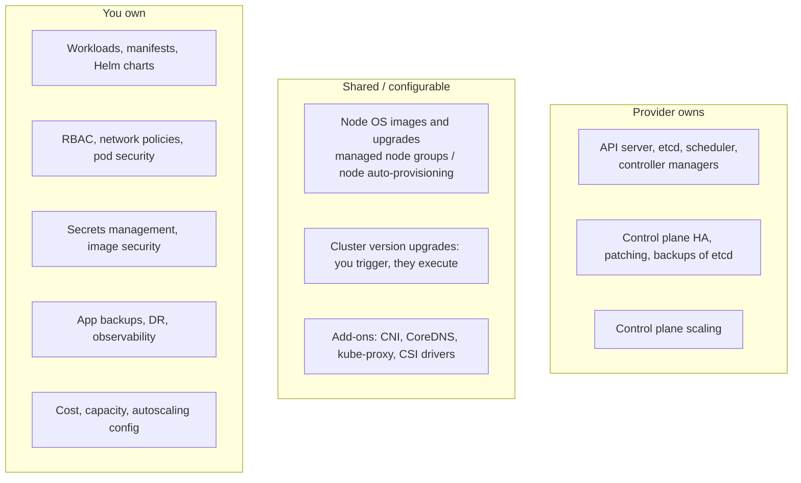
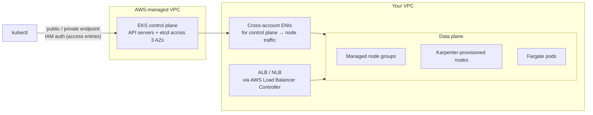

<!-- devopsshack:header -->
> ☸️ **Kubernetes Mastery: Zero to Production** · by **DevOps Shack** · [YouTube](https://www.youtube.com/@devopsshack) · [Hindi channel](https://www.youtube.com/@shackverse) · [devopsshack.com](https://devopsshack.com)
<!-- /devopsshack:header -->

# Architecture 18 · Managed Kubernetes: EKS, AKS, GKE

In managed Kubernetes, the provider runs the control plane. You still own a lot more than people think.

## The shared responsibility line

## EKS architecture

Key EKS concepts: IAM-based authentication with **access entries**, **VPC CNI** (pods get VPC IPs), **EKS Pod Identity / IRSA** for pod-to-AWS permissions, **EKS add-ons** (CoreDNS, kube-proxy, VPC CNI, EBS CSI), **Karpenter** for fast, flexible node provisioning, and **EKS Auto Mode**, where AWS also manages nodes and core add-ons.

## AKS architecture

- Control plane is free (Free tier) or SLA-backed (Standard/Premium tiers).
- Authentication through **Microsoft Entra ID**, with Azure RBAC for Kubernetes as an option.
- Networking: Azure CNI (overlay or pod subnet), with Cilium dataplane available.
- **Workload Identity** for pods to reach Azure services.
- Node pools on VM Scale Sets; **Node Auto Provisioning** (Karpenter-based); **AKS Automatic** for a more managed experience.

## GKE architecture

- **Standard** mode (you manage node pools) and **Autopilot** (Google manages nodes; you pay per pod resource request and get hardened defaults).
- VPC-native networking; **Dataplane V2** is Cilium/eBPF based.
- **Workload Identity Federation** for GKE.
- Release channels (Rapid, Regular, Stable, Extended) drive automatic upgrades with maintenance windows and exclusions.

## Side by side

| | EKS | AKS | GKE |
|---|---|---|---|
| Control plane cost | Hourly fee per cluster | Free tier or paid SLA tier | Fee per cluster (free tier credit for one zonal/Autopilot cluster) |
| Human auth | IAM → access entries | Entra ID | Google IAM |
| Pod → cloud identity | Pod Identity / IRSA | Workload Identity | Workload Identity Federation |
| Default CNI | VPC CNI | Azure CNI (overlay) | VPC-native (Dataplane V2 option) |
| Fully managed nodes | Auto Mode, Fargate | AKS Automatic, NAP | Autopilot |
| Node autoscaling | Karpenter, Cluster Autoscaler | NAP, Cluster Autoscaler | Node auto-provisioning, CA |

## Version support

Managed providers support each Kubernetes minor version for a limited window (often about 14 months standard, with paid extended support on EKS and AKS LTS). Falling behind means forced upgrades or extra cost. Plan **at least two upgrades a year**.

## Check yourself

1. In a managed cluster, who backs up etcd? Who backs up your PersistentVolumes?
2. How does a pod on EKS get AWS permissions without storing access keys?
3. What does GKE Autopilot manage that Standard doesn't, and how is it billed?
4. Why is staying on an old Kubernetes version expensive on managed services?

Back to [Architecture overview](README.md) · Continue to [Modules](../02-modules/README.md)

<!-- devopsshack:footer -->
---

  Made with ❤️ by <b><a href="https://devopsshack.com">DevOps Shack</a></b> · Part of <b>Kubernetes Mastery: Zero to Production</b> 
  <a href="https://www.youtube.com/@devopsshack">YouTube · DevOps Shack</a> · <a href="https://www.youtube.com/@shackverse">YouTube · DevOps Shack Hindi</a> · <a href="https://devopsshack.com">devopsshack.com</a> · <a href="https://www.instagram.com/devopsshack">Instagram · @devopsshack</a> 
  © DevOps Shack. Original content created by DevOps Shack. Free to learn from and share with credit to DevOps Shack. See <a href="../LICENSE">LICENSE</a>.

<!-- /devopsshack:footer -->
