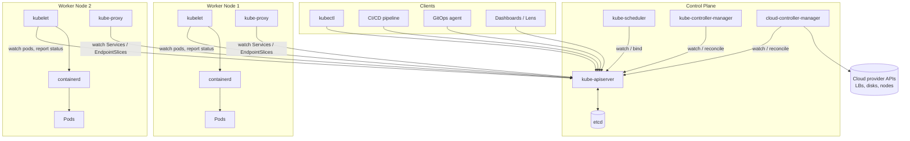

<!-- devopsshack:header -->
> ☸️ **Kubernetes Mastery: Zero to Production** · by **DevOps Shack** · [YouTube](https://www.youtube.com/@devopsshack) · [Hindi channel](https://www.youtube.com/@shackverse) · [devopsshack.com](https://devopsshack.com)
<!-- /devopsshack:header -->

# 01 · Kubernetes Architecture: The Deep Dive

This section explains how Kubernetes actually works inside, component by component, with diagrams for every moving part. Read it once end to end, then come back to individual pages whenever a module, lab or interview question touches that component.

## The whole system on one page

Three ideas explain almost everything in this picture:

1. **The API server is the only door.** Every component, including the scheduler and the kubelet, talks only to the API server. Nothing talks to etcd except the API server. Nothing talks to another component directly.
2. **Everything is desired state plus a reconciler.** You write *what you want* into the API (a Deployment with 3 replicas). Controllers continuously compare what you want with what exists and act to close the gap.
3. **Components watch, they don't poll.** Each component opens a long-lived *watch* on the resources it cares about and reacts to change events. That's why Kubernetes feels instant despite having no central orchestrator "calling" components.

## Pages in this section

| # | Page | What you'll understand |
|---|---|---|
| 01 | [The Big Picture](01-big-picture.md) | Why Kubernetes exists, declarative model, objects, the reconciliation idea |
| 02 | [kube-apiserver](02-kube-apiserver.md) | Request pipeline, REST model, watches, API groups and versions, aggregation |
| 03 | [etcd](03-etcd.md) | Raft, quorum, key layout, revisions, compaction, backup and restore |
| 04 | [kube-scheduler](04-kube-scheduler.md) | Scheduling cycle, filter and score plugins, affinity, taints, preemption |
| 05 | [Controllers & Reconciliation](05-controllers-and-reconciliation.md) | Control loops, informers, work queues, owner references, garbage collection |
| 06 | [cloud-controller-manager](06-cloud-controller-manager.md) | Node, route and service controllers, how LoadBalancers get created |
| 07 | [Worker Node: kubelet & Runtime](07-worker-node-kubelet-runtime.md) | kubelet loop, CRI, containerd, runc, cgroups, probes, eviction |
| 08 | [kube-proxy & Service Networking](08-kube-proxy-and-services.md) | ClusterIP, NodePort, LoadBalancer, iptables vs IPVS vs nftables vs eBPF |
| 09 | [Pod Networking & CNI](09-pod-networking-cni.md) | The network model, veth pairs, overlays vs native routing, Calico, Cilium |
| 10 | [Cluster DNS & CoreDNS](10-dns-coredns.md) | Service discovery, records, ndots, search paths, NodeLocal DNSCache |
| 11 | [Storage & CSI](11-storage-csi.md) | Volumes, PV/PVC binding, StorageClasses, dynamic provisioning, CSI sidecars |
| 12 | [Life of a `kubectl apply`](12-life-of-kubectl-apply.md) | The full end-to-end trace from YAML to a running container |
| 13 | [Pod Lifecycle & Termination](13-pod-lifecycle.md) | Phases, conditions, container states, init/sidecar containers, graceful shutdown |
| 14 | [AuthN, AuthZ & Admission](14-authn-authz-admission.md) | Certificates, tokens, OIDC, RBAC, webhooks, Pod Security Admission |
| 15 | [High Availability Control Plane](15-high-availability.md) | Stacked vs external etcd, load balancing the API server, leader election |
| 16 | [Ingress & Gateway API Traffic Flow](16-ingress-gateway-traffic.md) | North-south traffic from the internet to a pod |
| 17 | [Extending Kubernetes](17-extending-kubernetes.md) | CRDs, operators, API aggregation, webhooks, scheduler plugins |
| 18 | [Managed Kubernetes Architectures](18-managed-kubernetes.md) | EKS, AKS and GKE: what you own vs what the provider owns |

## How to study this section

- **First pass:** read pages 01, 02, 05, 07 and 12. They give you the mental model; everything else hangs off it.
- **Second pass:** networking (08, 09, 10, 16) and storage (11). Most production incidents live here.
- **Third pass:** security (14), HA (15) and extensibility (17). This is where senior and staff-level interviews go.

Each page ends with "Check yourself" questions. If you can answer them out loud without peeking, move on.

Next: [01 · The Big Picture](01-big-picture.md)

<!-- devopsshack:footer -->
---

  Made with ❤️ by <b><a href="https://devopsshack.com">DevOps Shack</a></b> · Part of <b>Kubernetes Mastery: Zero to Production</b> 
  <a href="https://www.youtube.com/@devopsshack">YouTube · DevOps Shack</a> · <a href="https://www.youtube.com/@shackverse">YouTube · DevOps Shack Hindi</a> · <a href="https://devopsshack.com">devopsshack.com</a> · <a href="https://www.instagram.com/devopsshack">Instagram · @devopsshack</a> 
  © DevOps Shack. Original content created by DevOps Shack. Free to learn from and share with credit to DevOps Shack. See <a href="../LICENSE">LICENSE</a>.

<!-- /devopsshack:footer -->
