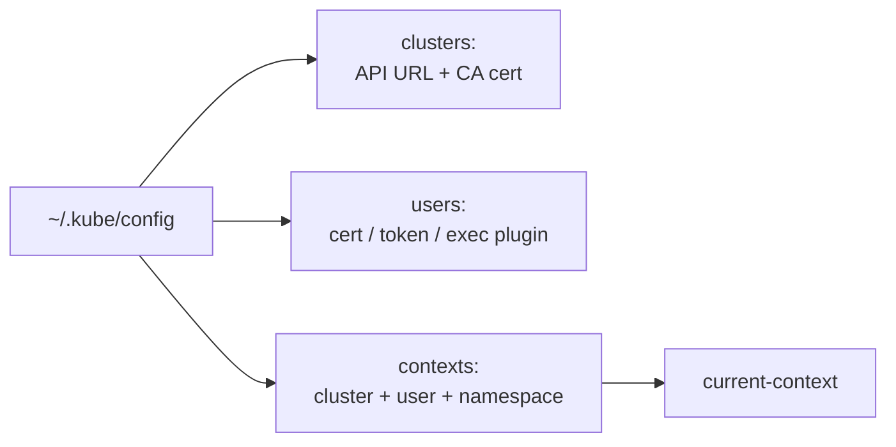

<!-- devopsshack:header -->
> ☸️ **Kubernetes Mastery: Zero to Production** · by **DevOps Shack** · [YouTube](https://www.youtube.com/@devopsshack) · [Hindi channel](https://www.youtube.com/@shackverse) · [devopsshack.com](https://devopsshack.com)
<!-- /devopsshack:header -->

# Module 01 · Foundations & Your First Cluster

## What you need before Kubernetes

Kubernetes runs containers, so be comfortable with:

- **Linux basics:** processes, signals, files and permissions, `systemctl`, `journalctl`, networking commands (`ip`, `ss`, `curl`, `dig`).
- **Containers:** building images with a Dockerfile, tags vs digests, registries, `docker run -p -e -v`, multi-stage builds, why images should be small and run as non-root.
- **YAML:** indentation, lists vs maps, multi-document files (`---`), and block strings (`|`).
- **Networking:** IP, ports, DNS, TCP vs UDP, HTTP, TLS, load balancers.

If any of that is shaky, spend a few days there first. Most "Kubernetes problems" in interviews and production are really Linux, container or networking problems.

## Pick a local cluster

| Tool | Best for | Notes |
|---|---|---|
| **kind** | Labs in this repo, CI, multi-node practice | Kubernetes nodes as Docker containers; fast, disposable |
| **minikube** | Beginners, add-ons (ingress, metrics-server, dashboard) | VM or container driver |
| **k3d / k3s** | Lightweight clusters, edge, Raspberry Pi | k3s is a certified, trimmed distribution |
| **Docker Desktop / Rancher Desktop / OrbStack** | One-click single node | Fine for app development |

Every lab in this repository is written for **kind** unless stated otherwise.

```bash
# Install kubectl + kind (Linux example; see official docs for macOS/Windows)
curl -LO "https://dl.k8s.io/release/$(curl -Ls https://dl.k8s.io/release/stable.txt)/bin/linux/amd64/kubectl"
sudo install -m 0755 kubectl /usr/local/bin/kubectl
curl -Lo kind https://kind.sigs.k8s.io/dl/latest/kind-linux-amd64
sudo install -m 0755 kind /usr/local/bin/kind
```

A 3-node cluster:

```yaml
# kind-3node.yaml
kind: Cluster
apiVersion: kind.x-k8s.io/v1alpha4
name: devopsshack
nodes:
  - role: control-plane
    extraPortMappings:
      - containerPort: 30080
        hostPort: 30080
  - role: worker
  - role: worker
```

```bash
kind create cluster --config kind-3node.yaml
kubectl cluster-info
kubectl get nodes -o wide
```

## kubeconfig and contexts



```bash
kubectl config get-contexts
kubectl config use-context kind-devopsshack
kubectl config set-context --current --namespace=demo
export KUBECONFIG=~/.kube/config:~/.kube/prod-config   # merge files
```

In production, a wrong context is how people delete the wrong cluster. Use a shell prompt that shows the context (kube-ps1, starship), and tools like `kubectx`/`kubens`.

## kubectl: the shape of every command

```text
kubectl <verb> <resource> [name] [flags]
kubectl get    pods        web-1  -n shop -o yaml
```

```bash
kubectl get pods -A -o wide               # all namespaces, more columns
kubectl describe pod web-1                # details + events (start every debug here)
kubectl logs web-1 -c app --previous      # logs of the previous crashed container
kubectl exec -it web-1 -- sh              # shell inside
kubectl apply -f app.yaml                 # declarative create/update
kubectl delete -f app.yaml
kubectl explain deployment.spec.strategy  # built-in API docs
kubectl create deployment web --image=nginx --dry-run=client -o yaml > web.yaml   # generate YAML
```

`kubectl explain` and `--dry-run=client -o yaml` are the two habits that make you fast, in the CKA exam and at work.

## Imperative vs declarative workflows

| Imperative | Declarative |
|---|---|
| `kubectl run`, `create`, `scale`, `set image`, `expose` | `kubectl apply -f` on files kept in Git |
| Fast for experiments and exams | Reviewable, repeatable, auditable |
| Drifts from what's in Git | Git is the source of truth (GitOps) |

Production rule: experiment imperatively, run declaratively.

## Your first application

```bash
kubectl create namespace demo
kubectl -n demo create deployment hello --image=nginxdemos/hello --replicas=3 --port=80
kubectl -n demo expose deployment hello --type=NodePort --port=80 \
  --overrides='{"spec":{"ports":[{"port":80,"targetPort":80,"nodePort":30080}]}}'
curl localhost:30080
kubectl -n demo get deploy,rs,pods,svc -o wide
kubectl -n demo delete pod -l app=hello --wait=false   # watch them come back
kubectl -n demo get pods -w
```

You just watched reconciliation: you deleted pods, the ReplicaSet controller noticed the gap, and created replacements.

## Common mistakes

- Running everything in `default`. Create namespaces per app or team.
- Using `:latest` image tags. You can't tell what's running and rollbacks don't work. Pin versions or digests.
- Editing live objects with `kubectl edit` in production. The change vanishes on the next `apply` from Git.

## Practice

- [Lab 01 · Your First Cluster](../04-labs/lab-01-first-cluster/README.md)
- Assignments [A001](../06-assignments/A001-cluster-tour.md)–[A005](../06-assignments/A005-namespace-hygiene.md)
- Cheat sheet: [kubectl essentials](../03-cheatsheets/kubectl.md)

Next: [Module 02 · Pods](02-pods.md)

<!-- devopsshack:footer -->
---

<p align="center">
  Made with ❤️ by <b><a href="https://devopsshack.com">DevOps Shack</a></b> · Part of <b>Kubernetes Mastery: Zero to Production</b><br/>
  <a href="https://www.youtube.com/@devopsshack">YouTube · DevOps Shack</a> · <a href="https://www.youtube.com/@shackverse">YouTube · DevOps Shack Hindi</a> · <a href="https://devopsshack.com">devopsshack.com</a> · <a href="https://www.instagram.com/devopsshack">Instagram · @devopsshack</a><br/>
  <sub>© DevOps Shack. Original content created by DevOps Shack. Free to learn from and share with credit to DevOps Shack. See <a href="../LICENSE">LICENSE</a>.</sub>
</p>
<!-- /devopsshack:footer -->
