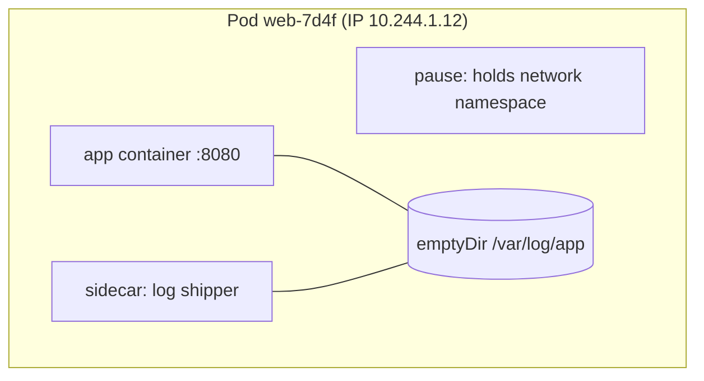
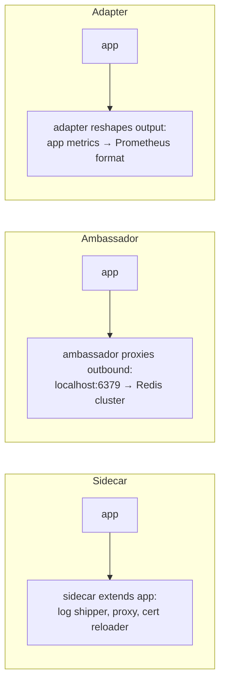

<!-- devopsshack:header -->
> ☸️ **Kubernetes Mastery: Zero to Production** · by **DevOps Shack** · [YouTube](https://www.youtube.com/@devopsshack) · [Hindi channel](https://www.youtube.com/@shackverse) · [devopsshack.com](https://devopsshack.com)
<!-- /devopsshack:header -->

# Module 02 · Pods

A **pod** is the smallest thing Kubernetes schedules: one or more containers that share a network namespace (one IP, talk over `localhost`), can share volumes, and are always placed on the same node together.



## A complete pod spec, annotated

```yaml
apiVersion: v1
kind: Pod
metadata:
  name: web
  labels:
    app: web
spec:
  serviceAccountName: web
  automountServiceAccountToken: false
  securityContext:                 # pod-level: applies to all containers
    runAsNonRoot: true
    runAsUser: 10001
    fsGroup: 10001
    seccompProfile: { type: RuntimeDefault }
  initContainers:
    - name: wait-for-db
      image: busybox:1.36
      command: ["sh", "-c", "until nc -z postgres 5432; do echo waiting; sleep 2; done"]
  containers:
    - name: app
      image: ghcr.io/devopsshack/web:1.4.2
      ports:
        - name: http
          containerPort: 8080
      env:
        - name: LOG_LEVEL
          value: info
        - name: POD_NAME
          valueFrom:
            fieldRef: { fieldPath: metadata.name }
      resources:
        requests: { cpu: 100m, memory: 128Mi }
        limits: { memory: 256Mi }
      readinessProbe:
        httpGet: { path: /ready, port: http }
        periodSeconds: 5
      livenessProbe:
        httpGet: { path: /healthz, port: http }
        initialDelaySeconds: 10
      securityContext:             # container-level: overrides pod-level
        allowPrivilegeEscalation: false
        readOnlyRootFilesystem: true
        capabilities: { drop: ["ALL"] }
      volumeMounts:
        - name: tmp
          mountPath: /tmp
  volumes:
    - name: tmp
      emptyDir: {}
```

## You almost never create bare pods

A bare pod is not rescheduled if its node dies. Use a controller:

| You want | Use |
|---|---|
| Stateless, N identical replicas | Deployment |
| Stable identity and storage per replica | StatefulSet |
| One per node | DaemonSet |
| Run to completion | Job / CronJob |

Bare pods are fine for quick debugging: `kubectl run tmp --rm -it --image=nicolaka/netshoot -- bash`.

## Multi-container patterns



Put containers in the same pod only if they **must** share a lifecycle, a network namespace or local files. A web app and its database do *not* belong in one pod: they scale differently and fail differently.

## Environment, commands and arguments

| Dockerfile | Pod spec | Meaning |
|---|---|---|
| `ENTRYPOINT` | `command` | The executable |
| `CMD` | `args` | Its arguments |

Setting `command` overrides `ENTRYPOINT`, setting `args` overrides `CMD`.

## The downward API

Expose pod metadata to the app without calling the API server:

```yaml
env:
  - name: NODE_NAME
    valueFrom: { fieldRef: { fieldPath: spec.nodeName } }
  - name: POD_IP
    valueFrom: { fieldRef: { fieldPath: status.podIP } }
  - name: MEM_LIMIT
    valueFrom: { resourceFieldRef: { containerName: app, resource: limits.memory } }
```

## Debugging pods

```bash
kubectl get pod web -o wide                       # node, IP, status
kubectl describe pod web                          # events: scheduling, pulls, probe failures
kubectl logs web -c app --previous                # last crash
kubectl exec -it web -c app -- sh
kubectl debug -it web --image=busybox:1.36 --target=app   # ephemeral container sharing process namespace
kubectl debug node/worker-1 -it --image=ubuntu    # shell on the node (host fs at /host)
kubectl get pod web -o jsonpath='{.status.containerStatuses[*].lastState}'
```

Ephemeral containers are the answer to "my image is distroless, there's no shell." They attach a debug container to the running pod without restarting it.

## Static pods

The kubelet runs any manifest in its static pod directory (`/etc/kubernetes/manifests` on kubeadm) without the API server. A read-only "mirror pod" appears in the API. This is how kubeadm runs the API server, etcd, scheduler and controller manager. To change them, edit the file on the node.

## Common mistakes

- No resource requests: the scheduler packs blindly and the pod is first to be evicted.
- Running as root with a writable root filesystem.
- Liveness probe that depends on downstream services.
- Using `hostPath` in application pods (security risk and pins the pod to one node's data).

## Practice

- [Lab 02 · Pods & Multi-Container Patterns](../04-labs/lab-02-pods-multicontainer/README.md)
- Assignments [A006](../06-assignments/A006-multi-container-pod.md)–[A010](../06-assignments/A010-static-pod.md)
- Architecture: [Pod Lifecycle & Termination](../01-architecture/13-pod-lifecycle.md)

Next: [Module 03 · Namespaces, Labels & Annotations](03-namespaces-labels-annotations.md)

<!-- devopsshack:footer -->
---

<p align="center">
  Made with ❤️ by <b><a href="https://devopsshack.com">DevOps Shack</a></b> · Part of <b>Kubernetes Mastery: Zero to Production</b><br/>
  <a href="https://www.youtube.com/@devopsshack">YouTube · DevOps Shack</a> · <a href="https://www.youtube.com/@shackverse">YouTube · DevOps Shack Hindi</a> · <a href="https://devopsshack.com">devopsshack.com</a> · <a href="https://www.instagram.com/devopsshack">Instagram · @devopsshack</a><br/>
  <sub>© DevOps Shack. Original content created by DevOps Shack. Free to learn from and share with credit to DevOps Shack. See <a href="../LICENSE">LICENSE</a>.</sub>
</p>
<!-- /devopsshack:footer -->
