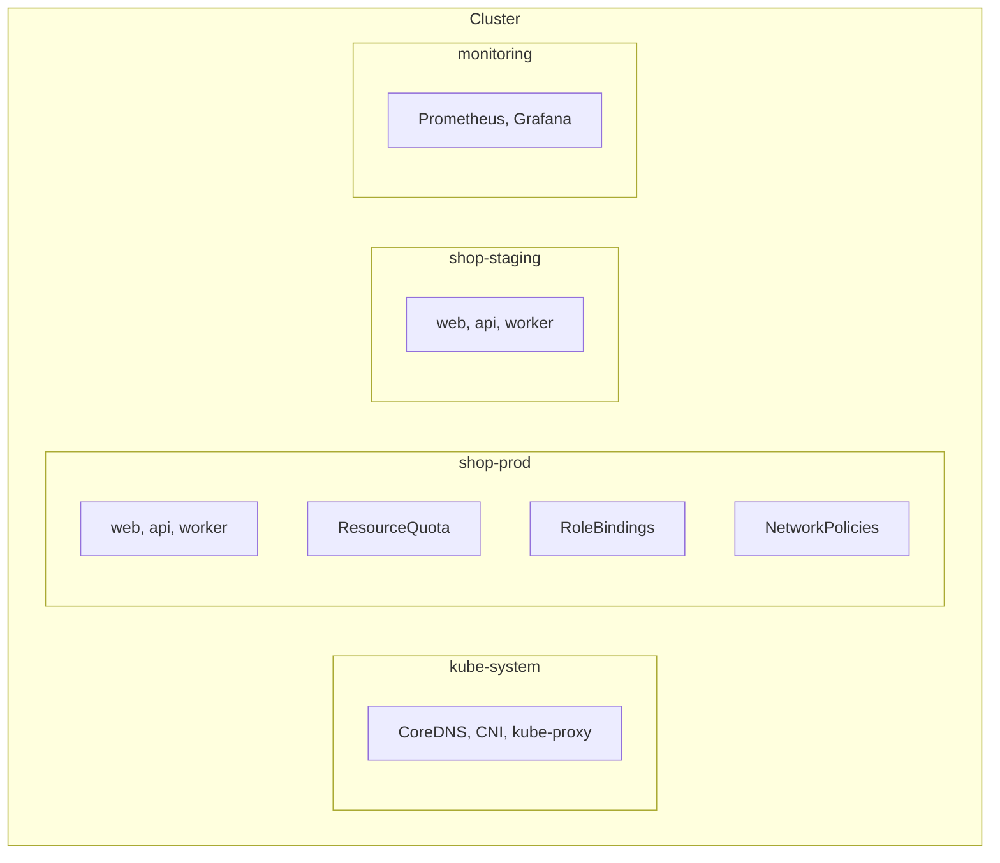
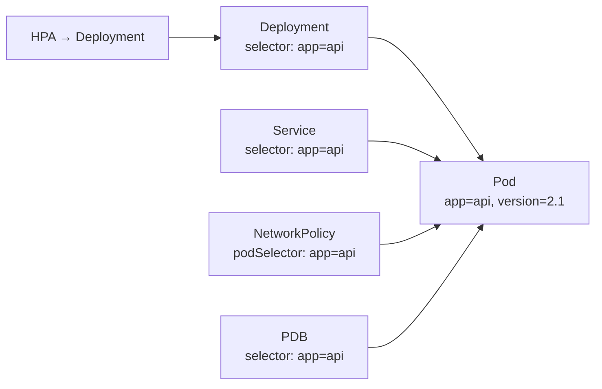

<!-- devopsshack:header -->
> ☸️ **Kubernetes Mastery: Zero to Production** · by **DevOps Shack** · [YouTube](https://www.youtube.com/@devopsshack) · [Hindi channel](https://www.youtube.com/@shackverse) · [devopsshack.com](https://devopsshack.com)
<!-- /devopsshack:header -->

# Module 03 · Namespaces, Labels & Annotations

## Namespaces



Namespaces give you:

- **Name scoping:** `api` can exist in both `shop-prod` and `shop-staging`.
- **A policy boundary:** RBAC, ResourceQuota, LimitRange, NetworkPolicy and Pod Security labels apply per namespace.
- **A lifecycle unit:** `kubectl delete ns shop-staging` removes everything in it.

They do **not** give you network isolation (add NetworkPolicies), node isolation (add taints/affinity) or kernel isolation (use separate node pools, sandboxed runtimes or separate clusters).

Built-in namespaces: `default`, `kube-system` (cluster components), `kube-public` (readable by all, e.g. cluster-info), `kube-node-lease` (node heartbeats).

### Namespace strategies

| Strategy | Example | Good for |
|---|---|---|
| Per team | `payments`, `search` | Team ownership, quotas per team |
| Per app per env | `shop-dev`, `shop-prod` | Small orgs, shared clusters |
| Per environment cluster, namespace per app | prod cluster: `shop`, `payments` | Most mid-to-large orgs |
| Per PR / preview | `shop-pr-412` | Ephemeral preview environments |

### Cross-namespace DNS

From any pod: `api.shop-prod.svc.cluster.local` (or `api.shop-prod`). Within the same namespace, just `api`.

## Labels

Labels are the glue of Kubernetes. Services, Deployments, NetworkPolicies, PDBs, affinity rules and `kubectl` queries all find objects through labels.



### Recommended labels

```yaml
metadata:
  labels:
    app.kubernetes.io/name: api
    app.kubernetes.io/instance: api-prod
    app.kubernetes.io/version: "2.1.0"
    app.kubernetes.io/component: backend
    app.kubernetes.io/part-of: shop
    app.kubernetes.io/managed-by: helm
    team: payments
    env: prod
```

### Selectors

```bash
kubectl get pods -l app=api
kubectl get pods -l 'env in (prod,staging),tier!=cache'
kubectl get pods -l '!canary'                 # label not present
kubectl label pod api-123 debug=true
kubectl label pod api-123 debug-              # remove
kubectl get pods -L app,version               # show labels as columns
```

**Warning:** a Deployment's `spec.selector` is immutable. And if you relabel a running pod so it no longer matches, the ReplicaSet creates a replacement while your relabelled pod keeps running outside its control. That's a useful debugging trick: pull a misbehaving pod out of rotation without killing it.

## Annotations

Annotations hold non-identifying metadata, often consumed by tools:

```yaml
metadata:
  annotations:
    kubernetes.io/change-cause: "bump to 2.1.0 for CVE-2026-1234 fix"
    prometheus.io/scrape: "true"
    prometheus.io/port: "9090"
    cert-manager.io/cluster-issuer: letsencrypt-prod
    owner-contact: "#payments-oncall"
```

| | Labels | Annotations |
|---|---|---|
| Used for selection | Yes | No |
| Size | Short (63-char values) | Up to 256 KB total |
| Typical content | app, env, team, version | URLs, JSON config, change reasons, tool settings |

## Field selectors

Some fields can be filtered server-side:

```bash
kubectl get pods --field-selector status.phase=Failed -A
kubectl get pods --field-selector spec.nodeName=worker-2
kubectl get events --field-selector type=Warning,involvedObject.kind=Pod
```

## Practice

- Assignment [A005 · Namespace Hygiene](../06-assignments/A005-namespace-hygiene.md)
- Cheat sheet: [kubectl essentials](../03-cheatsheets/kubectl.md)

Next: [Module 04 · Deployments & ReplicaSets](04-deployments.md)

<!-- devopsshack:footer -->
---

<p align="center">
  Made with ❤️ by <b><a href="https://devopsshack.com">DevOps Shack</a></b> · Part of <b>Kubernetes Mastery: Zero to Production</b><br/>
  <a href="https://www.youtube.com/@devopsshack">YouTube · DevOps Shack</a> · <a href="https://www.youtube.com/@shackverse">YouTube · DevOps Shack Hindi</a> · <a href="https://devopsshack.com">devopsshack.com</a> · <a href="https://www.instagram.com/devopsshack">Instagram · @devopsshack</a><br/>
  <sub>© DevOps Shack. Original content created by DevOps Shack. Free to learn from and share with credit to DevOps Shack. See <a href="../LICENSE">LICENSE</a>.</sub>
</p>
<!-- /devopsshack:footer -->
