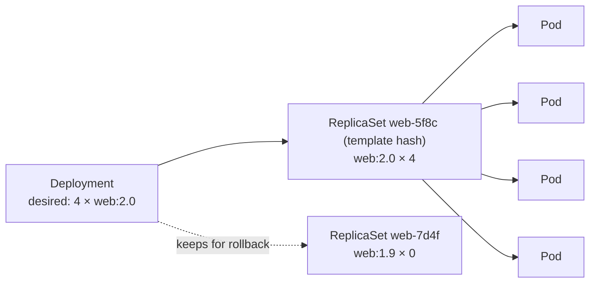
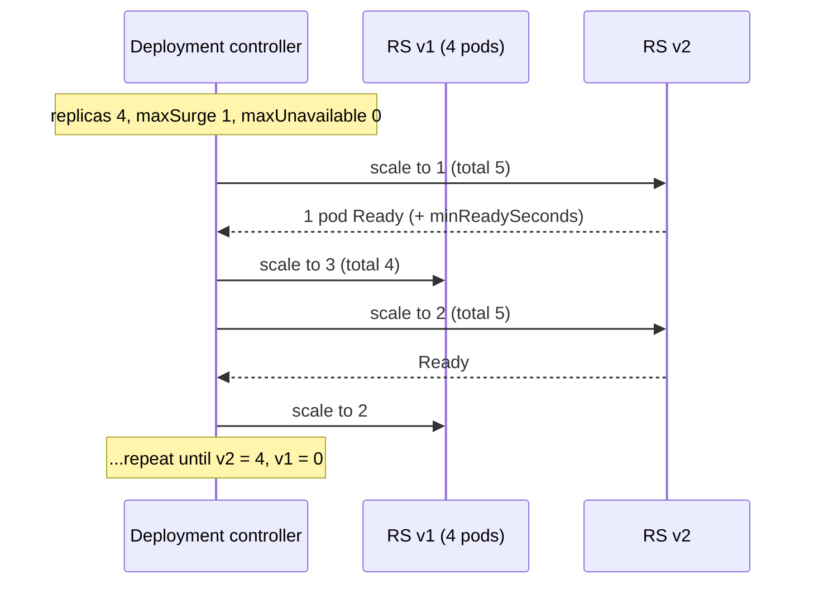

<!-- devopsshack:header -->
> ☸️ **Kubernetes Mastery: Zero to Production** · by **DevOps Shack** · [YouTube](https://www.youtube.com/@devopsshack) · [Hindi channel](https://www.youtube.com/@shackverse) · [devopsshack.com](https://devopsshack.com)
<!-- /devopsshack:header -->

# Module 04 · Deployments & ReplicaSets

A **Deployment** manages stateless applications: it keeps N identical pods running and replaces them safely when you change the pod template.



## The manifest

```yaml
apiVersion: apps/v1
kind: Deployment
metadata:
  name: web
  namespace: shop
  annotations:
    kubernetes.io/change-cause: "web 2.0: new checkout page"
spec:
  replicas: 4
  revisionHistoryLimit: 5
  minReadySeconds: 10            # pod must stay Ready this long to count as available
  progressDeadlineSeconds: 600   # mark rollout failed if no progress in 10 min
  selector:
    matchLabels: { app: web }    # immutable; must match template labels
  strategy:
    type: RollingUpdate
    rollingUpdate:
      maxSurge: 25%              # extra pods allowed above replicas during rollout
      maxUnavailable: 0          # never drop below desired capacity
  template:
    metadata:
      labels: { app: web }
    spec:
      containers:
        - name: web
          image: ghcr.io/devopsshack/web:2.0.0
          ports: [{ containerPort: 8080 }]
          readinessProbe:
            httpGet: { path: /ready, port: 8080 }
          resources:
            requests: { cpu: 200m, memory: 256Mi }
            limits: { memory: 512Mi }
```

Only changes to `spec.template` trigger a rollout. Scaling (`replicas`) doesn't.

## Rolling update mechanics



| Setting | Effect |
|---|---|
| `maxSurge: 0, maxUnavailable: 1` | No extra capacity needed; capacity dips by one pod |
| `maxSurge: 1, maxUnavailable: 0` | Never lose capacity; needs room for one extra pod |
| `maxSurge: 100%, maxUnavailable: 0` | Fastest safe rollout; temporarily doubles the pods |
| `type: Recreate` | Kill all old pods, then start new ones. Downtime, but never two versions at once (needed for some schema changes or RWO volumes) |

**Readiness gates the rollout.** If new pods never become Ready, the rollout stalls instead of taking down the old version. After `progressDeadlineSeconds`, the Deployment's `Progressing` condition becomes `False` with reason `ProgressDeadlineExceeded`, which is what CI pipelines should check.

## Day-to-day commands

```bash
kubectl set image deploy/web web=ghcr.io/devopsshack/web:2.0.1 -n shop
kubectl rollout status deploy/web -n shop --timeout=5m
kubectl rollout history deploy/web -n shop
kubectl rollout history deploy/web -n shop --revision=3
kubectl rollout undo deploy/web -n shop                  # back to previous
kubectl rollout undo deploy/web -n shop --to-revision=3
kubectl rollout pause deploy/web -n shop                 # batch several changes
kubectl rollout resume deploy/web -n shop
kubectl rollout restart deploy/web -n shop               # new pods, same spec (e.g. pick up a new Secret)
kubectl scale deploy/web --replicas=6 -n shop
```

`rollout restart` works by adding a timestamp annotation to the pod template, which counts as a template change.

## ReplicaSets

You rarely touch ReplicaSets directly. They exist so the Deployment can keep old versions around for instant rollback. The pod template hash in the name (`web-5f8c9d7b6`) also appears as the `pod-template-hash` label on each pod.

## Rollout strategies beyond the built-in

The built-in Deployment only does rolling and recreate. For **blue-green**, **canary with metrics analysis** and **traffic-weighted** rollouts, see [Module 24 · Deployment Strategies](24-deployment-strategies.md) (Argo Rollouts, Flagger, Gateway API weights).

## Production checklist for a Deployment

- At least 2 replicas (3+ for anything customer-facing), spread across zones.
- Readiness probe that reflects real ability to serve; `minReadySeconds` for flaky starts.
- `maxUnavailable: 0` for critical services.
- Graceful shutdown with a `preStop` sleep (see [Module 11](11-health-probes-lifecycle.md)).
- A PodDisruptionBudget.
- Pinned image tag or digest; never `latest`.
- `revisionHistoryLimit` small enough to keep etcd tidy.

## Practice

- [Lab 03 · Deployments & Rolling Updates](../04-labs/lab-03-deployments-rolling-updates/README.md)
- Assignments [A011](../06-assignments/A011-rolling-update-tuning.md)–[A015](../06-assignments/A015-deployment-revision-history.md)
- Playbook: [Rollout stuck](../05-troubleshooting-playbooks/18-rollout-stuck.md)

Next: [Module 05 · Services](05-services.md)

<!-- devopsshack:footer -->
---

<p align="center">
  Made with ❤️ by <b><a href="https://devopsshack.com">DevOps Shack</a></b> · Part of <b>Kubernetes Mastery: Zero to Production</b><br/>
  <a href="https://www.youtube.com/@devopsshack">YouTube · DevOps Shack</a> · <a href="https://www.youtube.com/@shackverse">YouTube · DevOps Shack Hindi</a> · <a href="https://devopsshack.com">devopsshack.com</a> · <a href="https://www.instagram.com/devopsshack">Instagram · @devopsshack</a><br/>
  <sub>© DevOps Shack. Original content created by DevOps Shack. Free to learn from and share with credit to DevOps Shack. See <a href="../LICENSE">LICENSE</a>.</sub>
</p>
<!-- /devopsshack:footer -->
