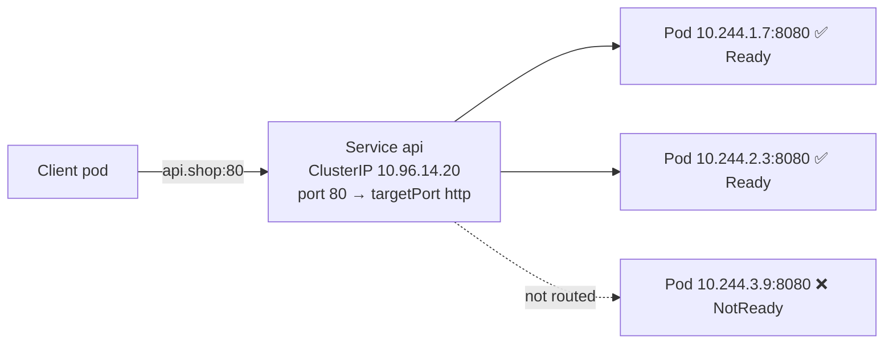
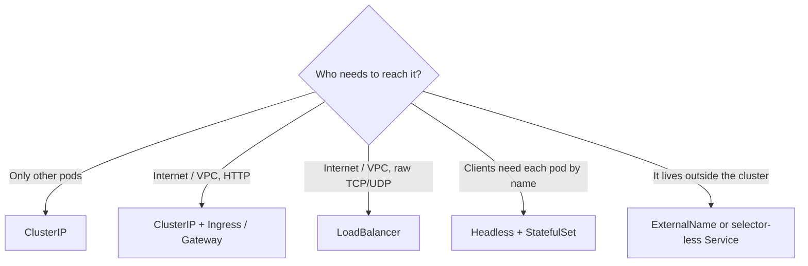

<!-- devopsshack:header -->
> ☸️ **Kubernetes Mastery: Zero to Production** · by **DevOps Shack** · [YouTube](https://www.youtube.com/@devopsshack) · [Hindi channel](https://www.youtube.com/@shackverse) · [devopsshack.com](https://devopsshack.com)
<!-- /devopsshack:header -->

# Module 05 · Services

A Service gives a changing set of pods one stable name and virtual IP. For how it's implemented in the kernel, read [Architecture 08](../01-architecture/08-kube-proxy-and-services.md). This module is about using Services well.



## Ports, explained once and for all

```yaml
apiVersion: v1
kind: Service
metadata:
  name: api
  namespace: shop
spec:
  type: ClusterIP
  selector:
    app: api
  ports:
    - name: http
      port: 80            # what clients connect to on the Service
      targetPort: http    # the container port (by name or number)
      protocol: TCP
```

| Field | Where | Meaning |
|---|---|---|
| `port` | Service | Port clients use: `api:80` |
| `targetPort` | Service → pod | Container's port. Use the **name** so you can change numbers without touching the Service |
| `nodePort` | NodePort/LB | Port opened on every node (30000–32767) |
| `containerPort` | Pod | Documentation + naming; doesn't open or restrict anything by itself |

## All Service types

```yaml
# NodePort
spec:
  type: NodePort
  ports: [{ port: 80, targetPort: 8080, nodePort: 30080 }]
---
# LoadBalancer
spec:
  type: LoadBalancer
  externalTrafficPolicy: Local       # keep client IP
  loadBalancerSourceRanges: ["203.0.113.0/24"]
---
# Headless: DNS returns pod IPs, no virtual IP
spec:
  clusterIP: None
  selector: { app: kafka }
---
# ExternalName: DNS CNAME to something outside
spec:
  type: ExternalName
  externalName: orders-db.c1x2.ap-south-1.rds.amazonaws.com
```

### A Service without a selector

Point a Service at anything (an IP outside the cluster, a legacy VM) by creating the EndpointSlice yourself:

```yaml
apiVersion: v1
kind: Service
metadata: { name: legacy-billing, namespace: shop }
spec:
  ports: [{ port: 443, targetPort: 443 }]
---
apiVersion: discovery.k8s.io/v1
kind: EndpointSlice
metadata:
  name: legacy-billing-1
  namespace: shop
  labels:
    kubernetes.io/service-name: legacy-billing
addressType: IPv4
ports: [{ port: 443 }]
endpoints:
  - addresses: ["10.20.30.40"]
```

## Choosing a type



One LoadBalancer per HTTP service gets expensive fast. Put one LoadBalancer in front of an ingress/gateway controller and route by host and path.

## Multi-port and named ports

```yaml
ports:
  - name: http
    port: 80
    targetPort: http
  - name: metrics
    port: 9090
    targetPort: metrics
```

Ports must be named when there's more than one. Service meshes and some ingress controllers also use the name prefix (`http-`, `grpc-`) to detect the protocol.

## Debugging checklist

```bash
kubectl get svc api -n shop -o yaml | grep -A5 selector
kubectl get pods -n shop -l app=api --show-labels
kubectl get endpointslices -n shop -l kubernetes.io/service-name=api
kubectl run t --rm -it --image=nicolaka/netshoot -n shop -- curl -sv api:80/healthz
kubectl port-forward svc/api 8080:80 -n shop
```

1. **No endpoints?** Selector doesn't match labels, or no pod is Ready.
2. **Endpoints exist but connection refused?** `targetPort` is wrong, or the app listens on `127.0.0.1` instead of `0.0.0.0`.
3. **Timeouts?** NetworkPolicy, or the app is overloaded.
4. **Name doesn't resolve?** Wrong namespace or DNS issue (see [DNS playbook](../05-troubleshooting-playbooks/09-dns-failures.md)).

## Practice

- [Lab 04 · Services & DNS](../04-labs/lab-04-services-dns/README.md)
- Assignments [A016](../06-assignments/A016-service-types-tour.md)–[A020](../06-assignments/A020-debug-broken-service.md)
- Playbook: [Service has no endpoints](../05-troubleshooting-playbooks/08-service-no-endpoints.md)

Next: [Module 06 · ConfigMaps & Secrets](06-configmaps-secrets.md)

<!-- devopsshack:footer -->
---

<p align="center">
  Made with ❤️ by <b><a href="https://devopsshack.com">DevOps Shack</a></b> · Part of <b>Kubernetes Mastery: Zero to Production</b><br/>
  <a href="https://www.youtube.com/@devopsshack">YouTube · DevOps Shack</a> · <a href="https://www.youtube.com/@shackverse">YouTube · DevOps Shack Hindi</a> · <a href="https://devopsshack.com">devopsshack.com</a> · <a href="https://www.instagram.com/devopsshack">Instagram · @devopsshack</a><br/>
  <sub>© DevOps Shack. Original content created by DevOps Shack. Free to learn from and share with credit to DevOps Shack. See <a href="../LICENSE">LICENSE</a>.</sub>
</p>
<!-- /devopsshack:footer -->
