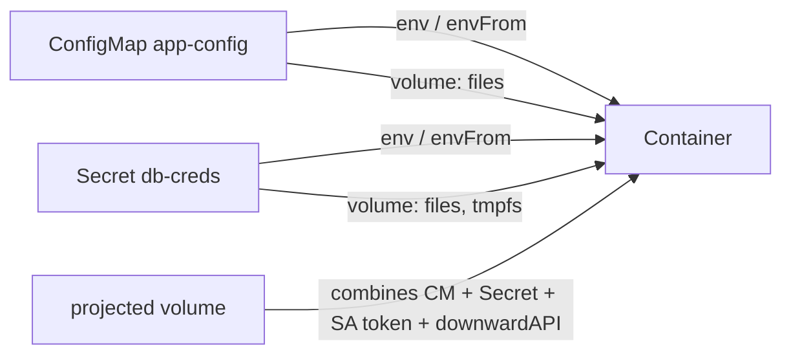
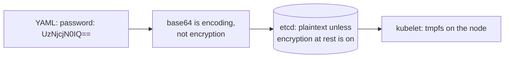

<!-- devopsshack:header -->
> ☸️ **Kubernetes Mastery: Zero to Production** · by **DevOps Shack** · [YouTube](https://www.youtube.com/@devopsshack) · [Hindi channel](https://www.youtube.com/@shackverse) · [devopsshack.com](https://devopsshack.com)
<!-- /devopsshack:header -->

# Module 06 · ConfigMaps & Secrets

Build the image once, configure it per environment. **ConfigMaps** hold non-sensitive configuration; **Secrets** hold sensitive values. Both can be injected as environment variables or mounted as files.



## Creating them

```bash
kubectl create configmap app-config --from-literal=LOG_LEVEL=info --from-file=app.properties
kubectl create secret generic db-creds --from-literal=username=app --from-literal=password='S3cr3t!'
kubectl create secret tls shop-tls --cert=tls.crt --key=tls.key
kubectl create secret docker-registry regcred --docker-server=ghcr.io --docker-username=u --docker-password=TOKEN
```

```yaml
apiVersion: v1
kind: ConfigMap
metadata:
  name: app-config
data:
  LOG_LEVEL: info
  FEATURE_CHECKOUT_V2: "true"
  app.properties: |
    cache.ttl=300
    payments.timeout=5s
---
apiVersion: v1
kind: Secret
metadata:
  name: db-creds
type: Opaque
stringData:              # plain text in, stored base64-encoded
  username: app
  password: S3cr3t!
```

## Consuming them

```yaml
spec:
  containers:
    - name: api
      image: shop/api:2.1.0
      envFrom:
        - configMapRef: { name: app-config }        # every key becomes an env var
      env:
        - name: DB_PASSWORD
          valueFrom:
            secretKeyRef: { name: db-creds, key: password }
      volumeMounts:
        - name: config
          mountPath: /etc/app
          readOnly: true
        - name: creds
          mountPath: /etc/creds
          readOnly: true
  volumes:
    - name: config
      configMap:
        name: app-config
        items:
          - key: app.properties
            path: app.properties
    - name: creds
      secret:
        secretName: db-creds
        defaultMode: 0400
```

## Env vars vs mounted files

| | Environment variables | Mounted files |
|---|---|---|
| Updates when the ConfigMap/Secret changes | **No**, only on pod restart | **Yes**, eventually (kubelet sync, ~1 min). Not with `subPath` |
| Exposure | Visible in `/proc`, crash dumps, child processes | File permissions; Secrets on tmpfs |
| Best for | Simple flags | Config files, certificates, credentials |

To roll pods when config changes, either `kubectl rollout restart`, or put a hash of the config in a pod annotation (Helm's `checksum/config` pattern, Kustomize's `configMapGenerator` name suffix), or use a reloader controller.

## Immutable ConfigMaps and Secrets

```yaml
immutable: true
```

Immutable objects can't be edited (only deleted and recreated), protect against accidental changes, and reduce API server load because kubelets stop watching them. Combine with versioned names (`app-config-v7`) for clean, rollback-friendly config changes.

## The truth about Secrets



A Kubernetes Secret is only as safe as:

1. **RBAC:** who can `get`/`list`/`watch` secrets, and who can `create pods` (which can mount any secret in the namespace).
2. **Encryption at rest** in etcd (KMS provider ideally). Managed clusters often enable envelope encryption with a cloud KMS.
3. **Where the YAML lives:** never commit raw Secrets to Git.

Production patterns, covered in [Module 18](18-secrets-management.md): External Secrets Operator (sync from AWS Secrets Manager, Vault, Azure Key Vault, GCP Secret Manager), Sealed Secrets or SOPS (encrypted in Git), and the Secrets Store CSI driver (mount directly from the vault).

## Size and limits

ConfigMaps and Secrets are limited to 1 MiB each. Don't store large files in them; use an image layer, a volume or object storage.

## Common mistakes

- Expecting env vars to update live.
- Mounting with `subPath` and wondering why updates never arrive.
- `kubectl get secret -o yaml` pasted into a ticket. That's the password, just base64'd.
- One giant ConfigMap shared by ten apps, so every change restarts everything.

## Practice

- [Lab 05 · Config & Secrets](../04-labs/lab-05-config-secrets/README.md)
- Assignments [A021](../06-assignments/A021-configmap-env-and-files.md)–[A024](../06-assignments/A024-immutable-config-rollout.md)
- Playbook: [CreateContainerConfigError](../05-troubleshooting-playbooks/05-createcontainerconfigerror.md)

Next: [Module 07 · Storage](07-storage.md)

<!-- devopsshack:footer -->
---

<p align="center">
  Made with ❤️ by <b><a href="https://devopsshack.com">DevOps Shack</a></b> · Part of <b>Kubernetes Mastery: Zero to Production</b><br/>
  <a href="https://www.youtube.com/@devopsshack">YouTube · DevOps Shack</a> · <a href="https://www.youtube.com/@shackverse">YouTube · DevOps Shack Hindi</a> · <a href="https://devopsshack.com">devopsshack.com</a> · <a href="https://www.instagram.com/devopsshack">Instagram · @devopsshack</a><br/>
  <sub>© DevOps Shack. Original content created by DevOps Shack. Free to learn from and share with credit to DevOps Shack. See <a href="../LICENSE">LICENSE</a>.</sub>
</p>
<!-- /devopsshack:footer -->
