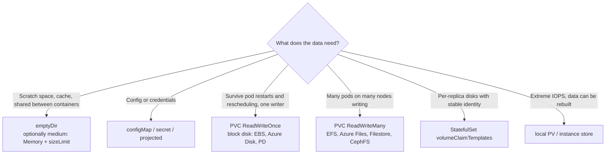

<!-- devopsshack:header -->
> ☸️ **Kubernetes Mastery: Zero to Production** · by **DevOps Shack** · [YouTube](https://www.youtube.com/@devopsshack) · [Hindi channel](https://www.youtube.com/@shackverse) · [devopsshack.com](https://devopsshack.com)
<!-- /devopsshack:header -->

# Module 07 · Storage: Volumes, PVs & PVCs

The architecture of storage (CSI, provisioning flow, attach/mount) is covered in [Architecture 11](../01-architecture/11-storage-csi.md). This module is the practical how-to.

## Decision guide



## emptyDir

```yaml
volumes:
  - name: cache
    emptyDir:
      sizeLimit: 1Gi        # pod is evicted if exceeded
  - name: shm
    emptyDir:
      medium: Memory        # tmpfs; counts against the container memory limit
      sizeLimit: 256Mi
```

Survives container restarts, dies with the pod.

## Dynamic provisioning (the normal way)

```yaml
apiVersion: v1
kind: PersistentVolumeClaim
metadata:
  name: uploads
  namespace: shop
spec:
  accessModes: ["ReadWriteOnce"]
  storageClassName: gp3            # omit to use the default class
  resources:
    requests:
      storage: 20Gi
---
apiVersion: apps/v1
kind: Deployment
metadata: { name: uploader, namespace: shop }
spec:
  replicas: 1                      # RWO + Deployment → keep to 1 replica
  strategy: { type: Recreate }     # avoid two pods fighting for the disk during rollout
  selector: { matchLabels: { app: uploader } }
  template:
    metadata: { labels: { app: uploader } }
    spec:
      containers:
        - name: app
          image: shop/uploader:1.0
          volumeMounts:
            - { name: data, mountPath: /data }
      volumes:
        - name: data
          persistentVolumeClaim:
            claimName: uploads
```

A Deployment with an RWO volume and `RollingUpdate` often deadlocks: the new pod lands on another node and can't attach the disk the old pod still holds. Use `Recreate`, or a StatefulSet.

## Static provisioning

An admin creates the PV first (e.g., an existing NFS export), and a PVC binds to it by size, access mode, class and optional selector:

```yaml
apiVersion: v1
kind: PersistentVolume
metadata:
  name: nfs-reports
spec:
  capacity: { storage: 100Gi }
  accessModes: ["ReadWriteMany"]
  persistentVolumeReclaimPolicy: Retain
  storageClassName: ""             # empty = only static binding
  nfs:
    server: 10.0.5.20
    path: /exports/reports
---
apiVersion: v1
kind: PersistentVolumeClaim
metadata: { name: reports }
spec:
  accessModes: ["ReadWriteMany"]
  storageClassName: ""
  volumeName: nfs-reports          # pin to that PV
  resources: { requests: { storage: 100Gi } }
```

## Day-2 operations

```bash
kubectl get pvc,pv -A
kubectl describe pvc uploads -n shop                    # events explain Pending
kubectl patch pvc uploads -n shop -p '{"spec":{"resources":{"requests":{"storage":"40Gi"}}}}'   # expand
kubectl get volumeattachments                           # which node holds which disk
kubectl patch pv <pv> -p '{"spec":{"persistentVolumeReclaimPolicy":"Retain"}}'  # protect data before risky work
```

## Storage performance basics

- Cloud block volumes have IOPS/throughput tied to size or provisioned separately (gp3 lets you set both).
- Filesystems over network (EFS/NFS) have higher latency; don't put a busy database on them.
- `fsGroup` on large volumes can make pod start slow (recursive chown); use `fsGroupChangePolicy: OnRootMismatch`.

## Data safety rules

1. Use `reclaimPolicy: Retain` (or snapshot before deletion) for anything precious.
2. Snapshots are not backups unless they're copied off the provider/account.
3. Test restores. Velero (with CSI snapshots or file-level backup) is the standard; see [Module 28](28-backup-disaster-recovery.md).

## Practice

- [Lab 06 · Persistent Storage](../04-labs/lab-06-persistent-storage/README.md)
- Assignments [A025](../06-assignments/A025-dynamic-provisioning.md)–[A028](../06-assignments/A028-rwx-shared-storage.md)
- Playbooks: [PVC Pending](../05-troubleshooting-playbooks/14-pvc-pending.md) · [Multi-Attach error](../05-troubleshooting-playbooks/15-multi-attach-error.md)

Next: [Module 08 · StatefulSets](08-statefulsets.md)

<!-- devopsshack:footer -->
---

<p align="center">
  Made with ❤️ by <b><a href="https://devopsshack.com">DevOps Shack</a></b> · Part of <b>Kubernetes Mastery: Zero to Production</b><br/>
  <a href="https://www.youtube.com/@devopsshack">YouTube · DevOps Shack</a> · <a href="https://www.youtube.com/@shackverse">YouTube · DevOps Shack Hindi</a> · <a href="https://devopsshack.com">devopsshack.com</a> · <a href="https://www.instagram.com/devopsshack">Instagram · @devopsshack</a><br/>
  <sub>© DevOps Shack. Original content created by DevOps Shack. Free to learn from and share with credit to DevOps Shack. See <a href="../LICENSE">LICENSE</a>.</sub>
</p>
<!-- /devopsshack:footer -->
