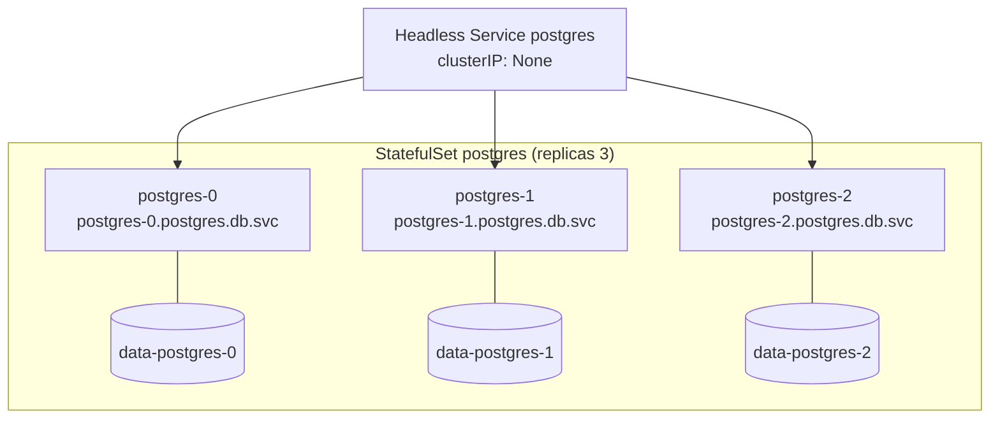
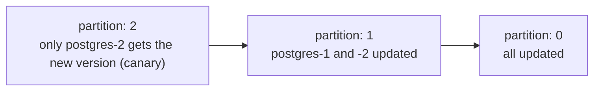
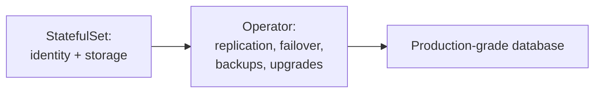

<!-- devopsshack:header -->
> ☸️ **Kubernetes Mastery: Zero to Production** · by **DevOps Shack** · [YouTube](https://www.youtube.com/@devopsshack) · [Hindi channel](https://www.youtube.com/@shackverse) · [devopsshack.com](https://devopsshack.com)
<!-- /devopsshack:header -->

# Module 08 · StatefulSets

Deployments treat pods as interchangeable cattle. Databases, queues and consensus systems need **pets**: each replica has a stable name, stable network identity and its own disk that follows it around.



## What a StatefulSet guarantees

| Guarantee | Meaning |
|---|---|
| Stable names | Pods are `name-0`, `name-1`, ... forever |
| Stable DNS | `name-N.<headless-svc>.<ns>.svc.cluster.local` |
| Stable storage | `volumeClaimTemplates` create one PVC per ordinal, reattached on reschedule |
| Ordered start (default) | `-0` must be Running and Ready before `-1` starts |
| Ordered, reverse termination | Scale down removes the highest ordinal first |

## Manifest

```yaml
apiVersion: v1
kind: Service
metadata: { name: postgres, namespace: db }
spec:
  clusterIP: None
  selector: { app: postgres }
  ports: [{ name: pg, port: 5432 }]
---
apiVersion: apps/v1
kind: StatefulSet
metadata: { name: postgres, namespace: db }
spec:
  serviceName: postgres            # the headless Service that governs DNS
  replicas: 3
  podManagementPolicy: OrderedReady   # or Parallel for faster start
  selector: { matchLabels: { app: postgres } }
  updateStrategy:
    type: RollingUpdate
    rollingUpdate:
      partition: 0                 # raise to stage updates on high ordinals only
  persistentVolumeClaimRetentionPolicy:
    whenDeleted: Retain
    whenScaled: Retain
  template:
    metadata: { labels: { app: postgres } }
    spec:
      terminationGracePeriodSeconds: 60
      containers:
        - name: postgres
          image: postgres:17
          ports: [{ name: pg, containerPort: 5432 }]
          env:
            - name: PGDATA
              value: /var/lib/postgresql/data/pgdata
            - name: POSTGRES_PASSWORD
              valueFrom: { secretKeyRef: { name: pg-secret, key: password } }
          volumeMounts:
            - { name: data, mountPath: /var/lib/postgresql/data }
          readinessProbe:
            exec: { command: ["pg_isready", "-U", "postgres"] }
  volumeClaimTemplates:
    - metadata: { name: data }
      spec:
        accessModes: ["ReadWriteOnce"]
        storageClassName: gp3
        resources: { requests: { storage: 50Gi } }
```

## Updates and partitions



Rolling updates go from the highest ordinal down, one at a time, each waiting for Ready. With `OnDelete`, nothing updates until you delete pods yourself, which gives full manual control for delicate databases.

## What a StatefulSet does NOT do

It doesn't make your database highly available. It gives each replica identity and storage. **Replication, leader election, failover and backups are the application's job**, which is why production teams run databases with an **operator** (CloudNativePG, Percona, Strimzi for Kafka, the Redis operators) or use a managed database service outside the cluster.



## Common gotchas

- Deleting a StatefulSet doesn't delete its PVCs by default. Good for safety, surprising for your cloud bill.
- A pod stuck on a dead node isn't automatically replaced while the node is unreachable (to avoid two pods with the same identity). Confirm the node is gone, then delete the pod with `--force` or let the node lifecycle and out-of-service taint handle it.
- Changing `volumeClaimTemplates` on an existing StatefulSet isn't allowed (you must recreate with `--cascade=orphan`).
- A Service of type ClusterIP alongside the headless one is common: clients use it for "any replica" traffic, headless for specific members.

## Practice

- [Lab 07 · StatefulSet Database](../04-labs/lab-07-statefulset-database/README.md)
- Assignments [A029](../06-assignments/A029-postgres-statefulset.md)–[A031](../06-assignments/A031-statefulset-rolling-partition.md)

Next: [Module 09 · DaemonSets, Jobs & CronJobs](09-daemonsets-jobs-cronjobs.md)

<!-- devopsshack:footer -->
---

<p align="center">
  Made with ❤️ by <b><a href="https://devopsshack.com">DevOps Shack</a></b> · Part of <b>Kubernetes Mastery: Zero to Production</b><br/>
  <a href="https://www.youtube.com/@devopsshack">YouTube · DevOps Shack</a> · <a href="https://www.youtube.com/@shackverse">YouTube · DevOps Shack Hindi</a> · <a href="https://devopsshack.com">devopsshack.com</a> · <a href="https://www.instagram.com/devopsshack">Instagram · @devopsshack</a><br/>
  <sub>© DevOps Shack. Original content created by DevOps Shack. Free to learn from and share with credit to DevOps Shack. See <a href="../LICENSE">LICENSE</a>.</sub>
</p>
<!-- /devopsshack:footer -->
