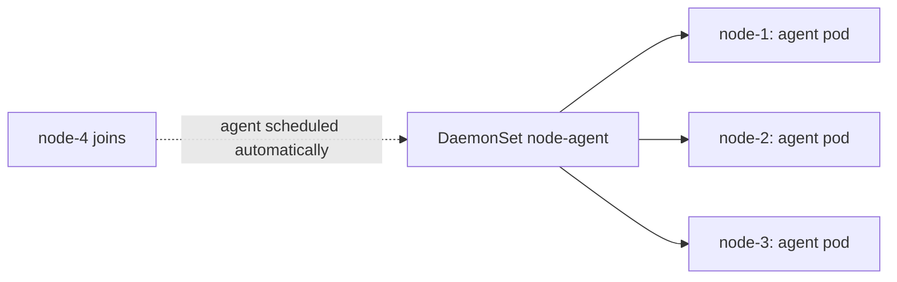
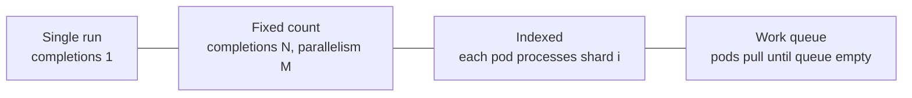

<!-- devopsshack:header -->
> ☸️ **Kubernetes Mastery: Zero to Production** · by **DevOps Shack** · [YouTube](https://www.youtube.com/@devopsshack) · [Hindi channel](https://www.youtube.com/@shackverse) · [devopsshack.com](https://devopsshack.com)
<!-- /devopsshack:header -->

# Module 09 · DaemonSets, Jobs & CronJobs

## DaemonSets: one pod per node



Used for node-level agents: log collectors (Fluent Bit), metrics (node-exporter), CNI agents (Calico, Cilium), CSI node plugins, security agents (Falco), kube-proxy.

```yaml
apiVersion: apps/v1
kind: DaemonSet
metadata: { name: node-exporter, namespace: monitoring }
spec:
  selector: { matchLabels: { app: node-exporter } }
  updateStrategy:
    type: RollingUpdate
    rollingUpdate: { maxUnavailable: 10% }
  template:
    metadata: { labels: { app: node-exporter } }
    spec:
      hostNetwork: true
      hostPID: true
      priorityClassName: system-node-critical
      tolerations:
        - operator: Exists          # run on every node, including tainted ones
      nodeSelector:
        kubernetes.io/os: linux
      containers:
        - name: node-exporter
          image: quay.io/prometheus/node-exporter:v1.8.2
          args: ["--path.rootfs=/host"]
          resources:
            requests: { cpu: 50m, memory: 64Mi }
            limits: { memory: 128Mi }
          volumeMounts:
            - { name: root, mountPath: /host, readOnly: true }
      volumes:
        - name: root
          hostPath: { path: / }
```

Limit DaemonSets to a subset of nodes with `nodeSelector` or node affinity (e.g., GPU drivers only on GPU nodes).

## Jobs: run to completion

```yaml
apiVersion: batch/v1
kind: Job
metadata: { name: thumbnails }
spec:
  completions: 100          # total successful pods needed
  parallelism: 10           # run 10 at a time
  completionMode: Indexed   # each pod gets JOB_COMPLETION_INDEX 0..99
  backoffLimit: 4           # retries before the Job fails
  activeDeadlineSeconds: 3600
  ttlSecondsAfterFinished: 86400   # auto-clean finished Jobs
  podFailurePolicy:
    rules:
      - action: FailJob             # bad input: don't retry
        onExitCodes: { containerName: worker, operator: In, values: [42] }
      - action: Ignore              # node disruption: don't count against backoffLimit
        onPodConditions: [{ type: DisruptionTarget }]
  template:
    spec:
      restartPolicy: Never
      containers:
        - name: worker
          image: shop/thumbs:1.2
          command: ["./process", "--shard=$(JOB_COMPLETION_INDEX)"]
```



## CronJobs: Jobs on a schedule

```yaml
apiVersion: batch/v1
kind: CronJob
metadata: { name: db-backup }
spec:
  schedule: "30 1 * * *"            # 01:30 every day
  timeZone: "Asia/Kolkata"
  concurrencyPolicy: Forbid          # skip if the previous run is still going
  startingDeadlineSeconds: 600       # skip if it couldn't start within 10 min
  successfulJobsHistoryLimit: 3
  failedJobsHistoryLimit: 5
  jobTemplate:
    spec:
      backoffLimit: 2
      template:
        spec:
          restartPolicy: OnFailure
          containers:
            - name: backup
              image: shop/pg-backup:1.0
              envFrom: [{ secretRef: { name: backup-creds } }]
```

| concurrencyPolicy | If the previous run is still active |
|---|---|
| Allow (default) | Start another anyway |
| Forbid | Skip this run |
| Replace | Kill the old one, start the new one |

```bash
kubectl create job --from=cronjob/db-backup db-backup-manual-1   # run now
kubectl patch cronjob db-backup -p '{"spec":{"suspend":true}}'   # pause
kubectl get jobs --sort-by=.status.startTime
```

## Gotchas

- Jobs must be **idempotent**: a pod can run twice (node failure, retry).
- `restartPolicy: OnFailure` restarts the container in place (logs of earlier attempts are lost); `Never` creates new pods (easier to debug, more clutter).
- Without `ttlSecondsAfterFinished` or history limits, thousands of completed pods pile up.
- Sidecars (like a mesh proxy) used to keep Jobs from finishing; native sidecars fix this.

## Practice

- [Lab 08 · Jobs, CronJobs & DaemonSets](../04-labs/lab-08-jobs-cronjobs-daemonsets/README.md)
- Assignments [A032](../06-assignments/A032-node-exporter-daemonset.md)–[A035](../06-assignments/A035-job-failure-policy.md)

Next: [Module 10 · Resource Management](10-resource-management.md)

<!-- devopsshack:footer -->
---

<p align="center">
  Made with ❤️ by <b><a href="https://devopsshack.com">DevOps Shack</a></b> · Part of <b>Kubernetes Mastery: Zero to Production</b><br/>
  <a href="https://www.youtube.com/@devopsshack">YouTube · DevOps Shack</a> · <a href="https://www.youtube.com/@shackverse">YouTube · DevOps Shack Hindi</a> · <a href="https://devopsshack.com">devopsshack.com</a> · <a href="https://www.instagram.com/devopsshack">Instagram · @devopsshack</a><br/>
  <sub>© DevOps Shack. Original content created by DevOps Shack. Free to learn from and share with credit to DevOps Shack. See <a href="../LICENSE">LICENSE</a>.</sub>
</p>
<!-- /devopsshack:footer -->
