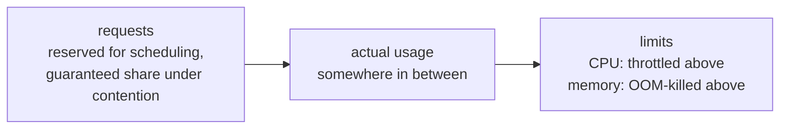
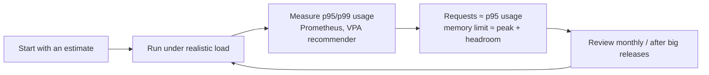

<!-- devopsshack:header -->
> ☸️ **Kubernetes Mastery: Zero to Production** · by **DevOps Shack** · [YouTube](https://www.youtube.com/@devopsshack) · [Hindi channel](https://www.youtube.com/@shackverse) · [devopsshack.com](https://devopsshack.com)
<!-- /devopsshack:header -->

# Module 10 · Resource Management: Requests, Limits, Quotas

Getting resources right is the difference between a cluster that's cheap and stable and one that's expensive *and* unstable.

## Requests vs limits



```yaml
resources:
  requests:
    cpu: 250m        # 0.25 core
    memory: 256Mi
  limits:
    memory: 512Mi    # hard cap
    # cpu limit intentionally omitted for a latency-sensitive service
```

| | CPU | Memory |
|---|---|---|
| Compressible? | Yes: processes slow down | No: you can't take memory back |
| Above request | Fine if spare CPU exists | Fine until node pressure, then eviction candidate |
| Above limit | Throttled (CFS quota) | OOMKilled (exit 137) |
| Units | `1` = 1 vCPU, `500m` = half | `Mi`, `Gi` (binary), not `M`/`G` |

## QoS classes

| Class | Rule | Eviction order |
|---|---|---|
| Guaranteed | Every container has CPU and memory requests == limits | Last |
| Burstable | At least one request or limit set | Middle (by usage above request) |
| BestEffort | Nothing set | First |

```bash
kubectl get pod web -o jsonpath='{.status.qosClass}'
```

## Practical sizing approach



- **Memory:** request about what it normally uses; limit = request or modestly higher. Memory overcommit is how nodes get OOM-killed.
- **CPU:** request typical usage. Many teams skip CPU limits for latency-sensitive services because throttling hurts tail latency; keep limits where you need hard fairness (multi-tenant, batch).
- **JVM / Node.js / Go:** make the runtime container-aware (`-XX:MaxRAMPercentage=75`, `--max-old-space-size`, `GOMEMLIMIT`).

## LimitRange: defaults and bounds per namespace

```yaml
apiVersion: v1
kind: LimitRange
metadata: { name: defaults, namespace: team-a }
spec:
  limits:
    - type: Container
      defaultRequest: { cpu: 100m, memory: 128Mi }   # applied if missing
      default: { memory: 512Mi }                      # default limit
      min: { cpu: 50m, memory: 64Mi }
      max: { cpu: "4", memory: 8Gi }
    - type: PersistentVolumeClaim
      max: { storage: 100Gi }
```

## ResourceQuota: a budget per namespace

```yaml
apiVersion: v1
kind: ResourceQuota
metadata: { name: team-a-quota, namespace: team-a }
spec:
  hard:
    requests.cpu: "40"
    requests.memory: 80Gi
    limits.memory: 120Gi
    pods: "200"
    services.loadbalancers: "2"
    persistentvolumeclaims: "30"
    requests.storage: 2Ti
    count/deployments.apps: "50"
```

Once a quota covers `requests.cpu`, every pod in that namespace **must** specify CPU requests (or get them from a LimitRange), or it's rejected. That's why quota and LimitRange are usually deployed together.

```bash
kubectl describe quota -n team-a
kubectl describe limitrange -n team-a
```

## Ephemeral storage and PIDs

```yaml
resources:
  requests: { ephemeral-storage: 1Gi }
  limits: { ephemeral-storage: 2Gi }   # container logs + writable layer + emptyDir
```

Exceeding it gets the pod evicted. Node-level `podPidsLimit` protects against fork bombs.

## In-place pod resize

Recent Kubernetes versions can change a running pod's CPU/memory without recreating it (`kubectl patch pod ... --subresource resize`), controlled per resource by `resizePolicy`. Useful for VPA and for stateful pods you don't want to restart.

## Practice

- [Lab 09 · Resources & QoS](../04-labs/lab-09-resources-qos/README.md)
- Assignments [A036](../06-assignments/A036-requests-limits-qos.md)–[A040](../06-assignments/A040-cpu-throttling-analysis.md)
- Playbooks: [OOMKilled](../05-troubleshooting-playbooks/04-oomkilled.md) · [CPU throttling](../05-troubleshooting-playbooks/20-cpu-throttling-latency.md)

Next: [Module 11 · Health Probes & Lifecycle](11-health-probes-lifecycle.md)

<!-- devopsshack:footer -->
---

<p align="center">
  Made with ❤️ by <b><a href="https://devopsshack.com">DevOps Shack</a></b> · Part of <b>Kubernetes Mastery: Zero to Production</b><br/>
  <a href="https://www.youtube.com/@devopsshack">YouTube · DevOps Shack</a> · <a href="https://www.youtube.com/@shackverse">YouTube · DevOps Shack Hindi</a> · <a href="https://devopsshack.com">devopsshack.com</a> · <a href="https://www.instagram.com/devopsshack">Instagram · @devopsshack</a><br/>
  <sub>© DevOps Shack. Original content created by DevOps Shack. Free to learn from and share with credit to DevOps Shack. See <a href="../LICENSE">LICENSE</a>.</sub>
</p>
<!-- /devopsshack:footer -->
