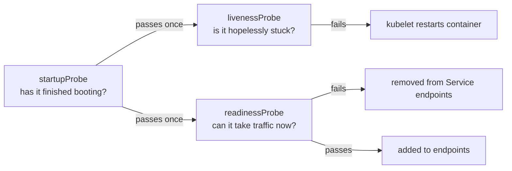
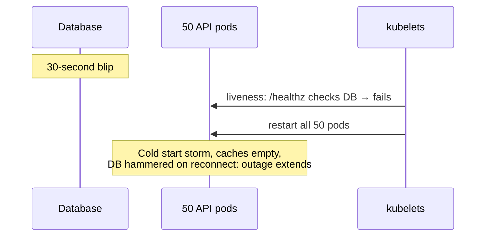
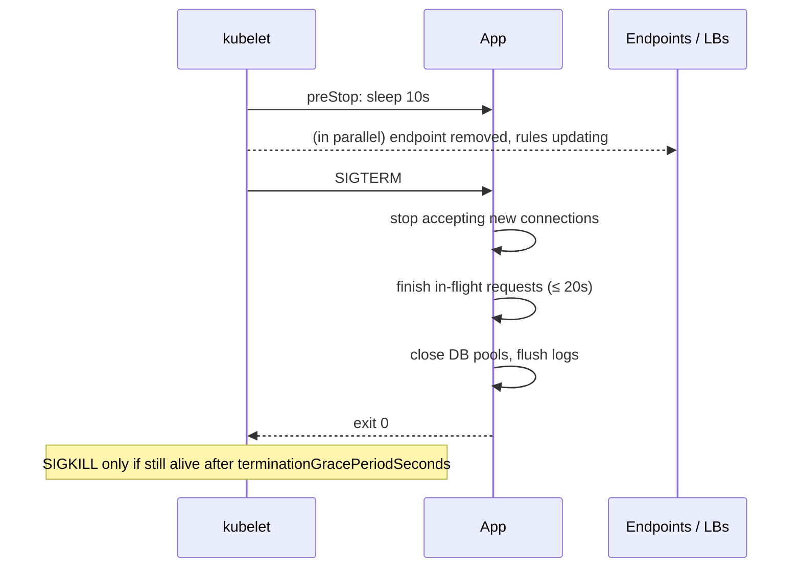

<!-- devopsshack:header -->
> ☸️ **Kubernetes Mastery: Zero to Production** · by **DevOps Shack** · [YouTube](https://www.youtube.com/@devopsshack) · [Hindi channel](https://www.youtube.com/@shackverse) · [devopsshack.com](https://devopsshack.com)
<!-- /devopsshack:header -->

# Module 11 · Health Probes & Lifecycle Hooks

## The three probes



```yaml
containers:
  - name: api
    image: shop/api:2.1.0
    ports: [{ name: http, containerPort: 8080 }]
    startupProbe:
      httpGet: { path: /healthz, port: http }
      periodSeconds: 5
      failureThreshold: 60        # up to 5 minutes to start
    livenessProbe:
      httpGet: { path: /healthz, port: http }   # process-local check only
      periodSeconds: 10
      timeoutSeconds: 2
      failureThreshold: 3
    readinessProbe:
      httpGet: { path: /ready, port: http }     # can I serve? (warm cache, DB pool ok)
      periodSeconds: 5
      failureThreshold: 2
```

Probe mechanisms: `httpGet` (2xx/3xx = success), `tcpSocket`, `exec` (exit 0), and `grpc` (gRPC health protocol).

## Designing good probes

| Do | Don't |
|---|---|
| Liveness checks only the process itself (event loop alive, not deadlocked) | Liveness that calls the database or other services |
| Readiness reflects "can I serve right now" | Readiness that always returns 200 |
| Use startupProbe for slow starters | Huge `initialDelaySeconds` on liveness |
| Keep probe endpoints cheap and unauthenticated on an internal port | Expensive queries every 5 seconds × 200 pods |
| Tune `timeoutSeconds` above your real p99 under load | Default 1s timeout on a JVM during GC |



That's the "liveness probe checks a dependency" anti-pattern, and it has caused many real outages.

## Lifecycle hooks

```yaml
lifecycle:
  postStart:
    exec: { command: ["sh", "-c", "echo started > /tmp/started"] }
  preStop:
    sleep: { seconds: 10 }
```

- `postStart` runs right after the container starts, **not** necessarily before the entrypoint. The container isn't marked Running until it completes. Rarely needed.
- `preStop` runs before SIGTERM. The main use: give load balancers and kube-proxy time to stop sending traffic.

## Graceful shutdown, the full recipe



```yaml
spec:
  terminationGracePeriodSeconds: 45   # > preStop + drain time
```

Application side:

- Handle SIGTERM. Most frameworks have a graceful shutdown hook (Spring `server.shutdown=graceful`, Node `server.close()`, Go `http.Server.Shutdown`).
- Be PID 1 or use `tini`/`dumb-init`; shell-form `CMD` runs your app under `sh`, which doesn't forward signals.
- Long-lived connections (WebSockets, gRPC streams) need explicit draining.

## Readiness gates

External systems can add conditions a pod must meet before it's Ready (e.g., the AWS Load Balancer Controller waits until the pod is registered healthy in the ALB target group). This prevents a rollout from outrunning the load balancer.

## Practice

- [Lab 10 · Probes & Graceful Shutdown](../04-labs/lab-10-probes-graceful-shutdown/README.md)
- Assignments [A041](../06-assignments/A041-probe-design.md)–[A043](../06-assignments/A043-slow-start-app.md)
- Playbooks: [Running but not Ready](../05-troubleshooting-playbooks/07-running-not-ready.md) · [Errors during deploys](../05-troubleshooting-playbooks/26-errors-during-deploys.md)

Next: [Module 12 · Scheduling](12-scheduling.md)

<!-- devopsshack:footer -->
---

<p align="center">
  Made with ❤️ by <b><a href="https://devopsshack.com">DevOps Shack</a></b> · Part of <b>Kubernetes Mastery: Zero to Production</b><br/>
  <a href="https://www.youtube.com/@devopsshack">YouTube · DevOps Shack</a> · <a href="https://www.youtube.com/@shackverse">YouTube · DevOps Shack Hindi</a> · <a href="https://devopsshack.com">devopsshack.com</a> · <a href="https://www.instagram.com/devopsshack">Instagram · @devopsshack</a><br/>
  <sub>© DevOps Shack. Original content created by DevOps Shack. Free to learn from and share with credit to DevOps Shack. See <a href="../LICENSE">LICENSE</a>.</sub>
</p>
<!-- /devopsshack:footer -->
