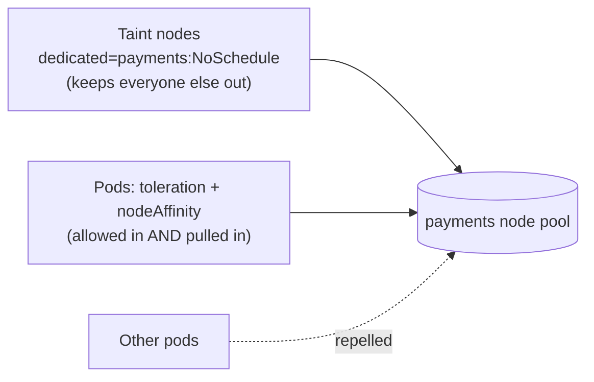
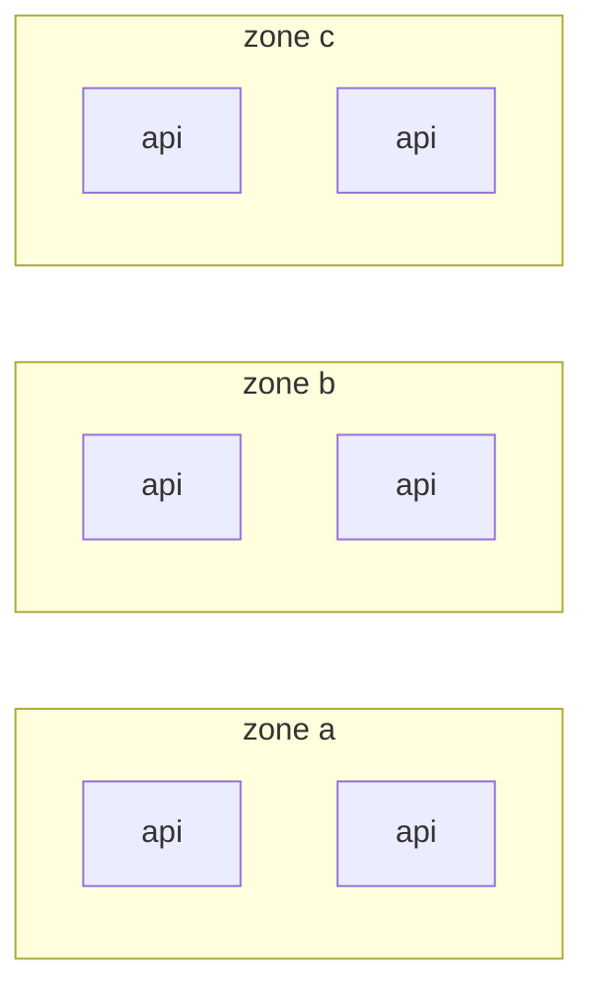

<!-- devopsshack:header -->
> ☸️ **Kubernetes Mastery: Zero to Production** · by **DevOps Shack** · [YouTube](https://www.youtube.com/@devopsshack) · [Hindi channel](https://www.youtube.com/@shackverse) · [devopsshack.com](https://devopsshack.com)
<!-- /devopsshack:header -->

# Module 12 · Advanced Scheduling

How the scheduler works internally is in [Architecture 04](../01-architecture/04-kube-scheduler.md). Here are the recipes you'll use in real clusters.

## Recipe 1: Dedicated node pool for one team or workload



```bash
kubectl taint nodes -l pool=payments dedicated=payments:NoSchedule
kubectl label nodes -l pool=payments dedicated=payments
```

```yaml
spec:
  tolerations:
    - { key: dedicated, operator: Equal, value: payments, effect: NoSchedule }
  affinity:
    nodeAffinity:
      requiredDuringSchedulingIgnoredDuringExecution:
        nodeSelectorTerms:
          - matchExpressions:
              - { key: dedicated, operator: In, values: [payments] }
```

## Recipe 2: Survive a zone outage

```yaml
spec:
  replicas: 6
  template:
    spec:
      topologySpreadConstraints:
        - maxSkew: 1
          topologyKey: topology.kubernetes.io/zone
          whenUnsatisfiable: DoNotSchedule
          labelSelector: { matchLabels: { app: api } }
          minDomains: 3
        - maxSkew: 1
          topologyKey: kubernetes.io/hostname
          whenUnsatisfiable: ScheduleAnyway
          labelSelector: { matchLabels: { app: api } }
```



Lose a zone, keep 4 of 6 replicas, provided the remaining zones have headroom to absorb load (or autoscaling).

## Recipe 3: Never co-locate replicas (hard anti-affinity)

```yaml
affinity:
  podAntiAffinity:
    requiredDuringSchedulingIgnoredDuringExecution:
      - topologyKey: kubernetes.io/hostname
        labelSelector: { matchLabels: { app: redis } }
```

Hard anti-affinity means replicas > nodes leaves pods Pending. Prefer topology spread for most cases; reserve hard anti-affinity for things like quorum members.

## Recipe 4: Keep chatty services together

```yaml
affinity:
  podAffinity:
    preferredDuringSchedulingIgnoredDuringExecution:
      - weight: 80
        podAffinityTerm:
          topologyKey: topology.kubernetes.io/zone
          labelSelector: { matchLabels: { app: cache } }
```

Same zone = lower latency and no cross-zone data transfer cost.

## Recipe 5: Protect critical workloads with priority

```yaml
apiVersion: scheduling.k8s.io/v1
kind: PriorityClass
metadata: { name: critical-api }
value: 100000
---
apiVersion: scheduling.k8s.io/v1
kind: PriorityClass
metadata: { name: batch-low }
value: 1000
preemptionPolicy: Never      # waits instead of evicting others
```

## Taint effects

| Effect | New pods without toleration | Running pods without toleration |
|---|---|---|
| PreferNoSchedule | Avoided if possible | Stay |
| NoSchedule | Rejected | Stay |
| NoExecute | Rejected | **Evicted** (after `tolerationSeconds` if set) |

Built-in taints you'll see: `node.kubernetes.io/not-ready`, `node.kubernetes.io/unreachable` (pods get a default 300s toleration, which is why pods take ~5 minutes to move off a dead node), `node.kubernetes.io/disk-pressure`, `node.kubernetes.io/unschedulable` (cordon), `node-role.kubernetes.io/control-plane`.

## Manual placement

- `nodeSelector`: the simplest label match.
- `nodeName`: bypasses the scheduler entirely. Useful for debugging, dangerous in production (no resource checks beyond the kubelet's admission).

## Practice

- [Lab 11 · Scheduling](../04-labs/lab-11-scheduling/README.md)
- Assignments [A044](../06-assignments/A044-dedicated-node-pool.md)–[A048](../06-assignments/A048-pending-pod-puzzle.md)
- Playbook: [Pod Pending](../05-troubleshooting-playbooks/01-pod-pending.md)

Next: [Module 13 · Autoscaling](13-autoscaling.md)

<!-- devopsshack:footer -->
---

<p align="center">
  Made with ❤️ by <b><a href="https://devopsshack.com">DevOps Shack</a></b> · Part of <b>Kubernetes Mastery: Zero to Production</b><br/>
  <a href="https://www.youtube.com/@devopsshack">YouTube · DevOps Shack</a> · <a href="https://www.youtube.com/@shackverse">YouTube · DevOps Shack Hindi</a> · <a href="https://devopsshack.com">devopsshack.com</a> · <a href="https://www.instagram.com/devopsshack">Instagram · @devopsshack</a><br/>
  <sub>© DevOps Shack. Original content created by DevOps Shack. Free to learn from and share with credit to DevOps Shack. See <a href="../LICENSE">LICENSE</a>.</sub>
</p>
<!-- /devopsshack:footer -->
