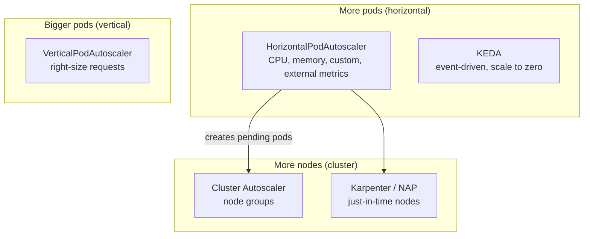
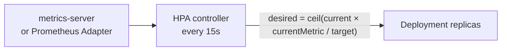
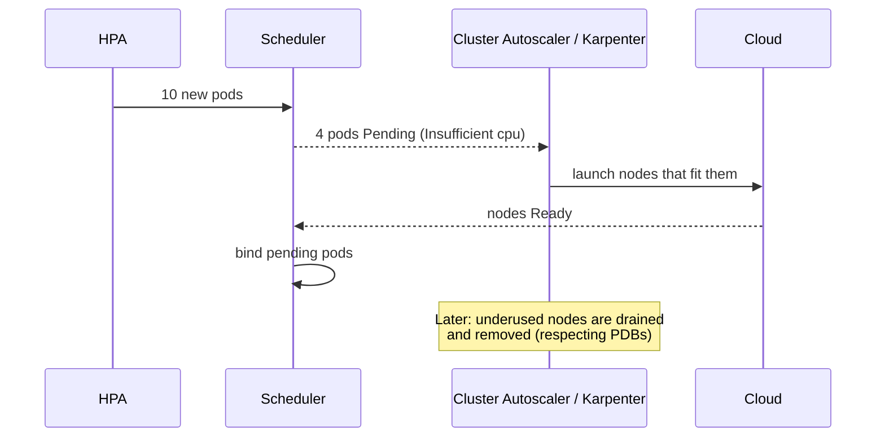

<!-- devopsshack:header -->
> ☸️ **Kubernetes Mastery: Zero to Production** · by **DevOps Shack** · [YouTube](https://www.youtube.com/@devopsshack) · [Hindi channel](https://www.youtube.com/@shackverse) · [devopsshack.com](https://devopsshack.com)
<!-- /devopsshack:header -->

# Module 13 · Autoscaling

Kubernetes scales on three axes. Each has its own tool.



## HPA



```yaml
apiVersion: autoscaling/v2
kind: HorizontalPodAutoscaler
metadata: { name: api, namespace: shop }
spec:
  scaleTargetRef: { apiVersion: apps/v1, kind: Deployment, name: api }
  minReplicas: 3
  maxReplicas: 30
  metrics:
    - type: Resource
      resource:
        name: cpu
        target: { type: Utilization, averageUtilization: 65 }   # % of REQUEST
    - type: Pods
      pods:
        metric: { name: http_requests_per_second }
        target: { type: AverageValue, averageValue: "50" }
  behavior:
    scaleUp:
      stabilizationWindowSeconds: 0
      policies: [{ type: Percent, value: 100, periodSeconds: 30 }]
    scaleDown:
      stabilizationWindowSeconds: 300      # wait 5 min before shrinking
      policies: [{ type: Percent, value: 20, periodSeconds: 60 }]
```

Key facts:

- CPU utilisation is a percentage of the **request**. No request, no CPU-based HPA.
- With several metrics, the HPA picks the **largest** desired replica count.
- Don't set `replicas` in your Deployment manifest when an HPA manages it, or every GitOps sync fights the HPA.
- Scale on what correlates with load: RPS, queue depth, or latency often beat CPU.

## VPA

VPA watches usage and recommends (or applies) better requests.

| Mode | Behaviour |
|---|---|
| Off | Recommendations only. Safest; use them in reviews |
| Initial | Sets requests only when pods are created |
| Recreate / Auto | Evicts pods to apply new requests (in-place resize where supported) |

Don't run VPA (in Auto) and HPA on the **same metric** (CPU/memory) for the same workload; they fight.

## KEDA

KEDA scales on external events (Kafka lag, SQS depth, RabbitMQ, Prometheus queries, cron) and can scale to **zero**.

```yaml
apiVersion: keda.sh/v1alpha1
kind: ScaledObject
metadata: { name: order-worker }
spec:
  scaleTargetRef: { name: order-worker }
  minReplicaCount: 0
  maxReplicaCount: 50
  triggers:
    - type: aws-sqs-queue
      metadata:
        queueURL: https://sqs.ap-south-1.amazonaws.com/123456789012/orders
        queueLength: "20"
        awsRegion: ap-south-1
      authenticationRef: { name: keda-aws }
```

## Node autoscaling



| | Cluster Autoscaler | Karpenter |
|---|---|---|
| Model | Scales predefined node groups | Provisions right-sized nodes directly from pending pod needs |
| Instance flexibility | One shape per group | Many instance types, spot + on-demand mix |
| Speed | Minutes | Usually faster |
| Consolidation | Scale-down of empty/underused nodes | Active bin-packing and replacement |

Things that block scale-down: pods without a controller, local storage, restrictive PDBs, `cluster-autoscaler.kubernetes.io/safe-to-evict: "false"` (or `karpenter.sh/do-not-disrupt`).

## Practice

- [Lab 12 · HPA Autoscaling](../04-labs/lab-12-hpa-autoscaling/README.md)
- Assignments [A049](../06-assignments/A049-hpa-cpu.md)–[A053](../06-assignments/A053-cluster-autoscaler-sim.md)
- Playbooks: [HPA not scaling](../05-troubleshooting-playbooks/19-hpa-not-scaling.md) · [Node autoscaler not scaling](../05-troubleshooting-playbooks/27-node-autoscaler-not-scaling.md)

Next: [Module 14 · Ingress & Gateway API](14-ingress-gateway-api.md)

<!-- devopsshack:footer -->
---

<p align="center">
  Made with ❤️ by <b><a href="https://devopsshack.com">DevOps Shack</a></b> · Part of <b>Kubernetes Mastery: Zero to Production</b><br/>
  <a href="https://www.youtube.com/@devopsshack">YouTube · DevOps Shack</a> · <a href="https://www.youtube.com/@shackverse">YouTube · DevOps Shack Hindi</a> · <a href="https://devopsshack.com">devopsshack.com</a> · <a href="https://www.instagram.com/devopsshack">Instagram · @devopsshack</a><br/>
  <sub>© DevOps Shack. Original content created by DevOps Shack. Free to learn from and share with credit to DevOps Shack. See <a href="../LICENSE">LICENSE</a>.</sub>
</p>
<!-- /devopsshack:footer -->
