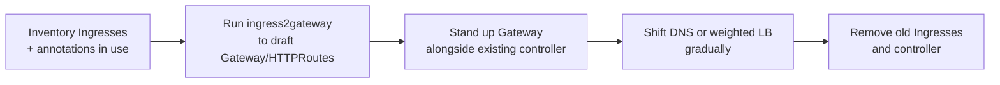

<!-- devopsshack:header -->
> ☸️ **Kubernetes Mastery: Zero to Production** · by **DevOps Shack** · [YouTube](https://www.youtube.com/@devopsshack) · [Hindi channel](https://www.youtube.com/@shackverse) · [devopsshack.com](https://devopsshack.com)
<!-- /devopsshack:header -->

# Module 14 · Ingress & Gateway API

The traffic architecture is in [Architecture 16](../01-architecture/16-ingress-gateway-traffic.md). This module is hands-on usage.

## Install a controller

A resource does nothing without a controller. On kind:

```bash
# Gateway API CRDs (standard channel)
kubectl apply -f https://github.com/kubernetes-sigs/gateway-api/releases/latest/download/standard-install.yaml
# A Gateway API implementation, e.g. Envoy Gateway
helm install eg oci://docker.io/envoyproxy/gateway-helm -n envoy-gateway-system --create-namespace
```

Popular controllers: Envoy Gateway, Istio, Cilium, NGINX Gateway Fabric, Traefik, Kong, HAProxy, Contour, and the cloud ones (AWS Load Balancer Controller, GKE Gateway, Azure Application Gateway for Containers).

## Ingress recipes

```yaml
# Path-based routing with TLS
apiVersion: networking.k8s.io/v1
kind: Ingress
metadata: { name: shop, namespace: shop }
spec:
  ingressClassName: traefik
  tls: [{ hosts: [shop.example.com], secretName: shop-tls }]
  rules:
    - host: shop.example.com
      http:
        paths:
          - { path: /api, pathType: Prefix, backend: { service: { name: api, port: { number: 80 } } } }
          - { path: /, pathType: Prefix, backend: { service: { name: web, port: { number: 80 } } } }
```

`pathType`: `Exact` (exact match), `Prefix` (by path segments: `/api` matches `/api/x` but not `/apix`), `ImplementationSpecific` (controller decides).

## Gateway API recipes

### HTTP → HTTPS redirect

```yaml
apiVersion: gateway.networking.k8s.io/v1
kind: HTTPRoute
metadata: { name: redirect-https, namespace: infra }
spec:
  parentRefs: [{ name: public, sectionName: http }]
  rules:
    - filters:
        - type: RequestRedirect
          requestRedirect: { scheme: https, statusCode: 301 }
```

### Header-based routing (internal testers hit v2)

```yaml
rules:
  - matches:
      - headers: [{ name: x-beta-user, value: "true" }]
    backendRefs: [{ name: api-v2, port: 80 }]
  - backendRefs: [{ name: api-v1, port: 80 }]
```

### URL rewrite and timeouts

```yaml
rules:
  - matches: [{ path: { type: PathPrefix, value: /legacy } }]
    filters:
      - type: URLRewrite
        urlRewrite: { path: { type: ReplacePrefixMatch, replacePrefixMatch: / } }
    timeouts: { request: 10s }
    backendRefs: [{ name: legacy, port: 80 }]
```

### Cross-namespace backend with ReferenceGrant

```yaml
apiVersion: gateway.networking.k8s.io/v1beta1
kind: ReferenceGrant
metadata: { name: allow-shop-routes, namespace: payments }
spec:
  from: [{ group: gateway.networking.k8s.io, kind: HTTPRoute, namespace: shop }]
  to: [{ group: "", kind: Service, name: payments-api }]
```

## Checking status

Gateway API resources report status you can actually use:

```bash
kubectl get gateway -A
kubectl describe httproute shop -n shop     # Accepted? ResolvedRefs? which parent?
```

`ResolvedRefs=False` usually means a wrong Service name/port or a missing ReferenceGrant. `Accepted=False` means the Gateway's `allowedRoutes` doesn't permit this namespace or hostname.

## Migrating from Ingress



## Practice

- Labs: [Lab 13 · Ingress](../04-labs/lab-13-ingress/README.md) · [Lab 14 · Gateway API](../04-labs/lab-14-gateway-api/README.md)
- Assignments [A054](../06-assignments/A054-ingress-host-path.md)–[A057](../06-assignments/A057-ingress-to-gateway-migration.md)
- Playbook: [Ingress 404/502/503](../05-troubleshooting-playbooks/10-ingress-errors.md)

Next: [Module 15 · Network Policies](15-network-policies.md)

<!-- devopsshack:footer -->
---

<p align="center">
  Made with ❤️ by <b><a href="https://devopsshack.com">DevOps Shack</a></b> · Part of <b>Kubernetes Mastery: Zero to Production</b><br/>
  <a href="https://www.youtube.com/@devopsshack">YouTube · DevOps Shack</a> · <a href="https://www.youtube.com/@shackverse">YouTube · DevOps Shack Hindi</a> · <a href="https://devopsshack.com">devopsshack.com</a> · <a href="https://www.instagram.com/devopsshack">Instagram · @devopsshack</a><br/>
  <sub>© DevOps Shack. Original content created by DevOps Shack. Free to learn from and share with credit to DevOps Shack. See <a href="../LICENSE">LICENSE</a>.</sub>
</p>
<!-- /devopsshack:footer -->
