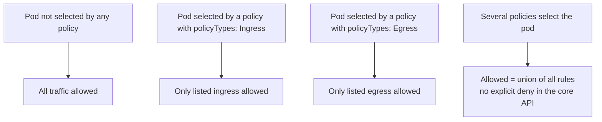
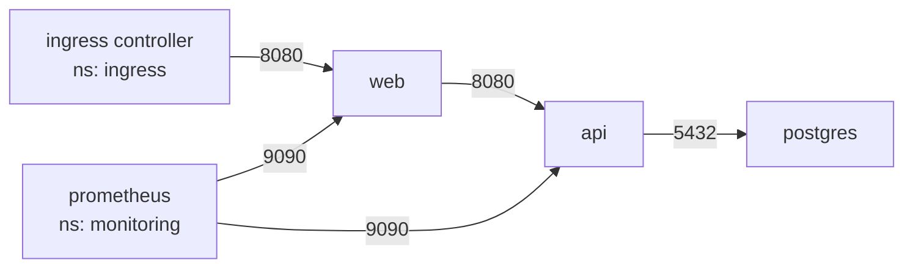

<!-- devopsshack:header -->
> ☸️ **Kubernetes Mastery: Zero to Production** · by **DevOps Shack** · [YouTube](https://www.youtube.com/@devopsshack) · [Hindi channel](https://www.youtube.com/@shackverse) · [devopsshack.com](https://devopsshack.com)
<!-- /devopsshack:header -->

# Module 15 · Network Policies

By default every pod can talk to every other pod in the cluster, across namespaces. A compromised frontend can reach your database directly. **NetworkPolicies** are the firewall rules that fix that. They need a CNI that enforces them (Calico, Cilium, Antrea, cloud CNIs with policy enabled).

## The mental model



## Step 1: default deny per namespace

```yaml
apiVersion: networking.k8s.io/v1
kind: NetworkPolicy
metadata: { name: default-deny-all, namespace: shop }
spec:
  podSelector: {}                 # every pod in the namespace
  policyTypes: ["Ingress", "Egress"]
```

## Step 2: allow DNS (or nothing works)

```yaml
apiVersion: networking.k8s.io/v1
kind: NetworkPolicy
metadata: { name: allow-dns, namespace: shop }
spec:
  podSelector: {}
  policyTypes: ["Egress"]
  egress:
    - to:
        - namespaceSelector:
            matchLabels: { kubernetes.io/metadata.name: kube-system }
          podSelector:
            matchLabels: { k8s-app: kube-dns }
      ports:
        - { protocol: UDP, port: 53 }
        - { protocol: TCP, port: 53 }
```

## Step 3: allow the real flows



```yaml
apiVersion: networking.k8s.io/v1
kind: NetworkPolicy
metadata: { name: api-policy, namespace: shop }
spec:
  podSelector: { matchLabels: { app: api } }
  policyTypes: ["Ingress", "Egress"]
  ingress:
    - from:
        - podSelector: { matchLabels: { app: web } }
      ports: [{ protocol: TCP, port: 8080 }]
    - from:
        - namespaceSelector: { matchLabels: { kubernetes.io/metadata.name: monitoring } }
          podSelector: { matchLabels: { app.kubernetes.io/name: prometheus } }
      ports: [{ protocol: TCP, port: 9090 }]
  egress:
    - to:
        - podSelector: { matchLabels: { app: postgres } }
      ports: [{ protocol: TCP, port: 5432 }]
```

## The AND vs OR trap

```yaml
# ONE element: namespace AND pod must match (pods labelled app=prom IN monitoring)
- from:
    - namespaceSelector: { matchLabels: { team: monitoring } }
      podSelector: { matchLabels: { app: prom } }

# TWO elements: namespace OR pod (ANY pod in monitoring, OR app=prom pods in THIS namespace)
- from:
    - namespaceSelector: { matchLabels: { team: monitoring } }
    - podSelector: { matchLabels: { app: prom } }
```

One dash difference, completely different security. Always review this carefully.

## Egress to the outside world

```yaml
egress:
  - to:
      - ipBlock:
          cidr: 0.0.0.0/0
          except: ["169.254.169.254/32", "10.0.0.0/8"]   # block cloud metadata + internal ranges
    ports: [{ protocol: TCP, port: 443 }]
```

The core API matches IPs and ports only. For FQDN rules (`allow api.stripe.com`), L7 rules (HTTP methods/paths) or cluster-wide deny policies, use CNI extensions: Cilium `CiliumNetworkPolicy`, Calico `GlobalNetworkPolicy`. The upstream **AdminNetworkPolicy** API brings cluster-admin-level policies with explicit deny and priorities.

## Testing policies

```bash
kubectl run t -n shop --rm -it --image=nicolaka/netshoot -l app=web -- bash
  curl -m 3 api:8080/healthz          # should work
  curl -m 3 postgres:5432             # should time out
# Cilium users:
hubble observe -n shop --verdict DROPPED
```

Roll out in stages: start with policies in audit/log mode if your CNI supports it, observe real flows, then enforce.

## Practice

- [Lab 15 · Network Policies](../04-labs/lab-15-network-policies/README.md)
- Assignments [A058](../06-assignments/A058-default-deny-namespace.md)–[A061](../06-assignments/A061-cross-namespace-policy.md)
- Playbook: [NetworkPolicy blocking traffic](../05-troubleshooting-playbooks/11-networkpolicy-blocking.md)

Next: [Module 16 · RBAC & ServiceAccounts](16-rbac-service-accounts.md)

<!-- devopsshack:footer -->
---

<p align="center">
  Made with ❤️ by <b><a href="https://devopsshack.com">DevOps Shack</a></b> · Part of <b>Kubernetes Mastery: Zero to Production</b><br/>
  <a href="https://www.youtube.com/@devopsshack">YouTube · DevOps Shack</a> · <a href="https://www.youtube.com/@shackverse">YouTube · DevOps Shack Hindi</a> · <a href="https://devopsshack.com">devopsshack.com</a> · <a href="https://www.instagram.com/devopsshack">Instagram · @devopsshack</a><br/>
  <sub>© DevOps Shack. Original content created by DevOps Shack. Free to learn from and share with credit to DevOps Shack. See <a href="../LICENSE">LICENSE</a>.</sub>
</p>
<!-- /devopsshack:footer -->
