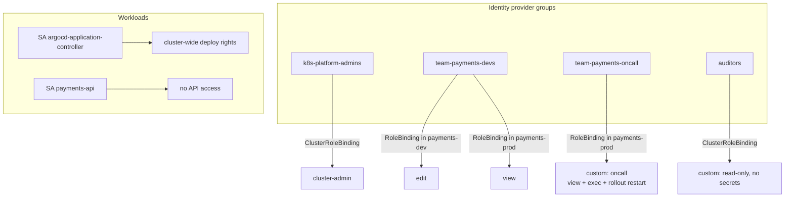

<!-- devopsshack:header -->
> ☸️ **Kubernetes Mastery: Zero to Production** · by **DevOps Shack** · [YouTube](https://www.youtube.com/@devopsshack) · [Hindi channel](https://www.youtube.com/@shackverse) · [devopsshack.com](https://devopsshack.com)
<!-- /devopsshack:header -->

# Module 16 · RBAC & ServiceAccounts

How authentication and authorization fit into the API request pipeline is covered in [Architecture 14](../01-architecture/14-authn-authz-admission.md). This module is about designing access that is least-privilege and still usable.

## A typical access model



Principles:

- **Bind groups, not individuals.** Joiners and leavers are handled in the IdP.
- **Reuse ClusterRoles, scope with RoleBindings.** The built-in `view`, `edit`, `admin` ClusterRoles bound per namespace cover most needs.
- **Humans read in prod, pipelines write.** With GitOps, almost nobody needs write access to production.
- **Break-glass access** exists, is audited and alerts when used.

## Built-in user-facing ClusterRoles

| Role | Can | Can't |
|---|---|---|
| view | Read most objects | Read Secrets, change anything |
| edit | Create/update/delete most namespaced objects, read Secrets | Change RBAC or quotas |
| admin | Everything in the namespace, including RoleBindings | Change quotas, namespace itself |
| cluster-admin | Everything everywhere | — |

## Custom role: on-call engineer

```yaml
apiVersion: rbac.authorization.k8s.io/v1
kind: ClusterRole
metadata: { name: oncall }
rules:
  - apiGroups: ["", "apps", "batch", "autoscaling", "networking.k8s.io"]
    resources: ["*"]
    verbs: ["get", "list", "watch"]
  - apiGroups: [""]
    resources: ["pods/exec", "pods/portforward"]
    verbs: ["create"]
  - apiGroups: [""]
    resources: ["pods"]
    verbs: ["delete"]
  - apiGroups: ["apps"]
    resources: ["deployments", "statefulsets"]
    verbs: ["patch"]          # rollout restart / undo, scale
  - apiGroups: ["apps"]
    resources: ["deployments/scale", "statefulsets/scale"]
    verbs: ["update", "patch"]
```

Careful: the core group `""` with resources `*` includes Secrets, so this role can read them. That's acceptable for on-call in some orgs; for auditors, list resources explicitly and leave Secrets out.

## Aggregated ClusterRoles

Add rights for your CRDs to the built-in roles automatically:

```yaml
apiVersion: rbac.authorization.k8s.io/v1
kind: ClusterRole
metadata:
  name: databases-view
  labels:
    rbac.authorization.k8s.io/aggregate-to-view: "true"
rules:
  - apiGroups: ["platform.devopsshack.com"]
    resources: ["databases"]
    verbs: ["get", "list", "watch"]
```

## ServiceAccounts

```yaml
apiVersion: v1
kind: ServiceAccount
metadata:
  name: payments-api
  namespace: payments
  annotations:
    eks.amazonaws.com/role-arn: arn:aws:iam::123456789012:role/payments-api   # IRSA example
automountServiceAccountToken: false
```

- One ServiceAccount per workload, not the shared `default`.
- Disable token automount unless the app calls the Kubernetes API.
- Need a token for an external system (CI)? Prefer OIDC federation (GitHub Actions → cloud IAM → cluster) over long-lived tokens. If you must: `kubectl create token ci-deployer --duration=1h`.

## Auditing who can do what

```bash
kubectl auth can-i --list --as=system:serviceaccount:payments:payments-api -n payments
kubectl auth can-i get secrets -A --as=alice --as-group=team-payments-devs
kubectl get rolebindings,clusterrolebindings -A -o wide | grep -i payments
kubectl krew install who-can rbac-tool
kubectl who-can delete deployments -n payments
kubectl rbac-tool viz          # graph of bindings
```

## Privilege escalation paths to know

| Permission | Why it's dangerous |
|---|---|
| `create pods` / `create deployments` | Mount any Secret or SA token in the namespace; run privileged if PSA allows |
| `get/list secrets` | Every credential in scope |
| `bind`, `escalate` on roles | Grant yourself more |
| `impersonate` | Act as any user/group |
| `create/patch` webhooks | Intercept or modify every object |
| `nodes/proxy` | Talk to kubelets directly, exec into pods |
| `patch` on `namespaces` | Remove Pod Security labels |

## Practice

- [Lab 16 · RBAC](../04-labs/lab-16-rbac/README.md)
- Assignments [A062](../06-assignments/A062-developer-role.md)–[A065](../06-assignments/A065-oidc-groups-mapping.md)
- Playbook: [RBAC forbidden](../05-troubleshooting-playbooks/25-rbac-forbidden.md)

Next: [Module 17 · Pod Security & Hardening](17-pod-security-hardening.md)

<!-- devopsshack:footer -->
---

<p align="center">
  Made with ❤️ by <b><a href="https://devopsshack.com">DevOps Shack</a></b> · Part of <b>Kubernetes Mastery: Zero to Production</b><br/>
  <a href="https://www.youtube.com/@devopsshack">YouTube · DevOps Shack</a> · <a href="https://www.youtube.com/@shackverse">YouTube · DevOps Shack Hindi</a> · <a href="https://devopsshack.com">devopsshack.com</a> · <a href="https://www.instagram.com/devopsshack">Instagram · @devopsshack</a><br/>
  <sub>© DevOps Shack. Original content created by DevOps Shack. Free to learn from and share with credit to DevOps Shack. See <a href="../LICENSE">LICENSE</a>.</sub>
</p>
<!-- /devopsshack:footer -->
