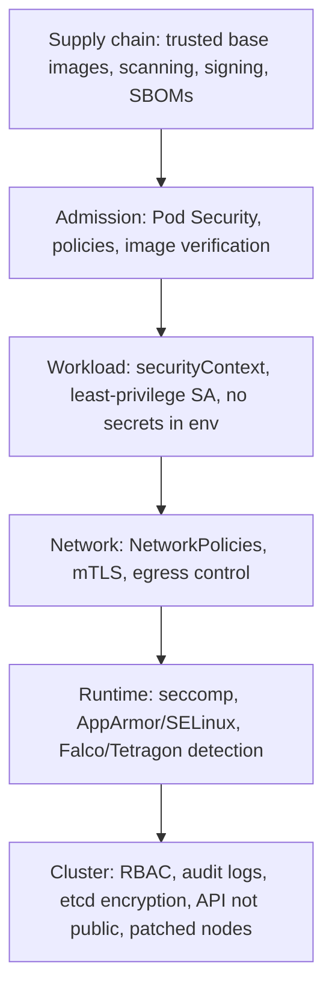

<!-- devopsshack:header -->
> ☸️ **Kubernetes Mastery: Zero to Production** · by **DevOps Shack** · [YouTube](https://www.youtube.com/@devopsshack) · [Hindi channel](https://www.youtube.com/@shackverse) · [devopsshack.com](https://devopsshack.com)
<!-- /devopsshack:header -->

# Module 17 · Pod Security & Cluster Hardening

## Defence in depth



## A hardened container

```yaml
spec:
  automountServiceAccountToken: false
  securityContext:
    runAsNonRoot: true
    runAsUser: 10001
    runAsGroup: 10001
    fsGroup: 10001
    seccompProfile: { type: RuntimeDefault }
  containers:
    - name: app
      image: ghcr.io/devopsshack/api@sha256:3f1c...   # pinned digest
      securityContext:
        allowPrivilegeEscalation: false
        readOnlyRootFilesystem: true
        privileged: false
        capabilities:
          drop: ["ALL"]
          # add: ["NET_BIND_SERVICE"]   # only if binding < 1024
      volumeMounts:
        - { name: tmp, mountPath: /tmp }
  volumes:
    - name: tmp
      emptyDir: { sizeLimit: 100Mi }
```

| Setting | Stops |
|---|---|
| runAsNonRoot | Root in container (one kernel bug from root on node) |
| allowPrivilegeEscalation: false | setuid binaries gaining privileges |
| readOnlyRootFilesystem | Attackers dropping tools/binaries |
| drop ALL capabilities | Raw sockets, mounting, ptrace, etc. |
| seccomp RuntimeDefault | ~40+ dangerous syscalls |
| No hostNetwork/hostPID/hostPath | Escaping into the node |

## Pod Security Admission

```bash
# Start with warn + audit to find violations without breaking anything
kubectl label ns shop pod-security.kubernetes.io/warn=restricted pod-security.kubernetes.io/audit=restricted
kubectl label --dry-run=server --overwrite ns --all pod-security.kubernetes.io/enforce=restricted   # preview impact
# Then enforce
kubectl label ns shop pod-security.kubernetes.io/enforce=restricted --overwrite
```

Keep `kube-system` and node-agent namespaces at `privileged` (CNI, CSI, log agents need host access), and lock those namespaces down with RBAC.

## Policy engines: going beyond PSA

| Tool | Style | Typical policies |
|---|---|---|
| ValidatingAdmissionPolicy | Built-in CEL | Required labels, disallowed fields, replica limits |
| Kyverno | YAML policies, validate/mutate/generate/verify images | Require resource requests, add default NetworkPolicy per namespace, verify cosign signatures |
| OPA Gatekeeper | Rego constraints | Org-wide compliance libraries |

```yaml
apiVersion: kyverno.io/v1
kind: ClusterPolicy
metadata: { name: disallow-latest-tag }
spec:
  validationFailureAction: Enforce
  rules:
    - name: require-pinned-tag
      match:
        any: [{ resources: { kinds: ["Pod"] } }]
      validate:
        message: "Images must not use the ':latest' tag."
        pattern:
          spec:
            containers:
              - image: "!*:latest"
```

## Supply chain security

```mermaid
flowchart LR
    SRC[Source] --> BUILD[CI build<br/>minimal / distroless base]
    BUILD --> SCAN[Scan: Trivy / Grype<br/>fail on critical CVEs]
    SCAN --> SBOM[Generate SBOM: Syft]
    SBOM --> SIGN[Sign: cosign keyless<br/>+ provenance attestation]
    SIGN --> REG[(Registry)]
    REG --> ADM[Admission verifies signature<br/>Kyverno / policy-controller]
    ADM --> RUN[Runs in cluster]
    RUN --> RESCAN[Continuous rescans<br/>new CVEs on old images]
```



## Runtime security

- **Falco** / **Tetragon**: detect a shell spawned in a container, writes to `/etc`, unexpected outbound connections, crypto-miner behaviour.
- **Sandboxed runtimes** (gVisor, Kata) via RuntimeClass for untrusted code.
- **User namespaces** (`hostUsers: false`) map container root to an unprivileged host UID.

## Cluster hardening checklist

- API server endpoint private or IP-restricted; OIDC for humans; no shared admin kubeconfigs.
- Audit logging on and shipped off-cluster.
- etcd encryption at rest with KMS; etcd not reachable from workloads.
- Kubelet: anonymous auth off, authorization webhook mode, read-only port 10255 disabled.
- Block pod access to cloud metadata (IMDSv2 hop limit 1, or NetworkPolicy to 169.254.169.254).
- Nodes on minimal, patched OS images; automated node replacement.
- Run CIS benchmark checks (`kube-bench`) and posture scanners (Kubescape, Trivy Operator).

## Practice

- [Lab 17 · Pod Security](../04-labs/lab-17-pod-security/README.md)
- Assignments [A066](../06-assignments/A066-restricted-pod-security.md)–[A071](../06-assignments/A071-runtime-detection-falco.md)
- Certification: [CKS guide](../09-certification-prep/cks.md)

Next: [Module 18 · Secrets Management](18-secrets-management.md)

<!-- devopsshack:footer -->
---

<p align="center">
  Made with ❤️ by <b><a href="https://devopsshack.com">DevOps Shack</a></b> · Part of <b>Kubernetes Mastery: Zero to Production</b><br/>
  <a href="https://www.youtube.com/@devopsshack">YouTube · DevOps Shack</a> · <a href="https://www.youtube.com/@shackverse">YouTube · DevOps Shack Hindi</a> · <a href="https://devopsshack.com">devopsshack.com</a> · <a href="https://www.instagram.com/devopsshack">Instagram · @devopsshack</a><br/>
  <sub>© DevOps Shack. Original content created by DevOps Shack. Free to learn from and share with credit to DevOps Shack. See <a href="../LICENSE">LICENSE</a>.</sub>
</p>
<!-- /devopsshack:footer -->
