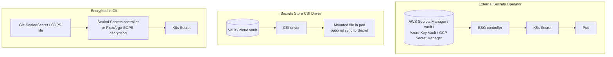
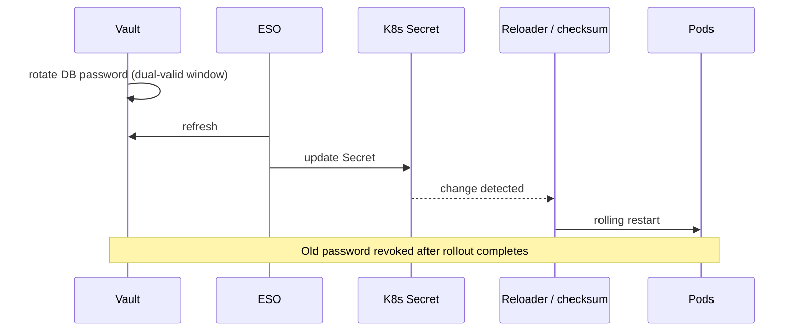

<!-- devopsshack:header -->
> ☸️ **Kubernetes Mastery: Zero to Production** · by **DevOps Shack** · [YouTube](https://www.youtube.com/@devopsshack) · [Hindi channel](https://www.youtube.com/@shackverse) · [devopsshack.com](https://devopsshack.com)
<!-- /devopsshack:header -->

# Module 18 · Secrets Management in Production

Native Secrets (see [Module 06](06-configmaps-secrets.md)) are a delivery mechanism, not a secrets management system. Production needs: a single source of truth, rotation, audit, and **no plaintext in Git**.

## The options



| | External Secrets Operator | Secrets Store CSI | Sealed Secrets | SOPS |
|---|---|---|---|---|
| Source of truth | External vault | External vault | Git | Git |
| Rotation | Refresh interval syncs changes | Rotation polling | Re-seal and commit | Re-encrypt and commit |
| Creates K8s Secret | Yes | Optional | Yes | Yes |
| Best for | Most cloud setups | Avoiding Secrets in etcd | Simple GitOps without a vault | GitOps with KMS/age keys |

## External Secrets Operator example

```yaml
apiVersion: external-secrets.io/v1
kind: ClusterSecretStore
metadata: { name: aws-sm }
spec:
  provider:
    aws:
      service: SecretsManager
      region: ap-south-1
      auth:
        jwt:
          serviceAccountRef: { name: external-secrets, namespace: external-secrets }
---
apiVersion: external-secrets.io/v1
kind: ExternalSecret
metadata: { name: payments-db, namespace: payments }
spec:
  refreshInterval: 1h
  secretStoreRef: { kind: ClusterSecretStore, name: aws-sm }
  target:
    name: payments-db            # the K8s Secret ESO creates
    creationPolicy: Owner
  data:
    - secretKey: password
      remoteRef: { key: prod/payments/db, property: password }
```

## Sealed Secrets example

```bash
kubectl create secret generic api-key --from-literal=key=abc123 --dry-run=client -o yaml \
  | kubeseal --format yaml > api-key-sealed.yaml      # safe to commit
kubectl apply -f api-key-sealed.yaml                  # controller decrypts in-cluster
```

Back up the controller's private key; lose it and every sealed secret is unrecoverable.

## Rotation without downtime



Apps that read mounted files and watch them can reload without restarts. Apps reading env vars need a restart (Stakater Reloader automates it).

## Encrypting Secrets at rest in etcd

```yaml
apiVersion: apiserver.config.k8s.io/v1
kind: EncryptionConfiguration
resources:
  - resources: ["secrets"]
    providers:
      - kms:
          apiVersion: v2
          name: cloud-kms
          endpoint: unix:///var/run/kms-provider.sock
      - identity: {}        # allows reading old unencrypted data during migration
```

After enabling, rewrite existing Secrets so they're stored encrypted:

```bash
kubectl get secrets -A -o json | kubectl replace -f -
```

## Rules

- No secrets in images, Git (unencrypted), Helm values files, CI logs or `ConfigMap`s.
- Narrow `get secrets` RBAC; audit-log secret reads.
- Prefer workload identity over static cloud credentials entirely.

## Practice

- Assignments [A072](../06-assignments/A072-external-secrets.md)–[A074](../06-assignments/A074-etcd-encryption-at-rest.md)

Next: [Module 19 · Helm](19-helm.md)

<!-- devopsshack:footer -->
---

<p align="center">
  Made with ❤️ by <b><a href="https://devopsshack.com">DevOps Shack</a></b> · Part of <b>Kubernetes Mastery: Zero to Production</b><br/>
  <a href="https://www.youtube.com/@devopsshack">YouTube · DevOps Shack</a> · <a href="https://www.youtube.com/@shackverse">YouTube · DevOps Shack Hindi</a> · <a href="https://devopsshack.com">devopsshack.com</a> · <a href="https://www.instagram.com/devopsshack">Instagram · @devopsshack</a><br/>
  <sub>© DevOps Shack. Original content created by DevOps Shack. Free to learn from and share with credit to DevOps Shack. See <a href="../LICENSE">LICENSE</a>.</sub>
</p>
<!-- /devopsshack:footer -->
