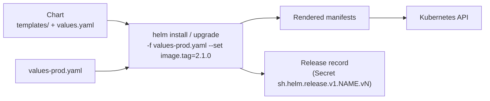

<!-- devopsshack:header -->
> ☸️ **Kubernetes Mastery: Zero to Production** · by **DevOps Shack** · [YouTube](https://www.youtube.com/@devopsshack) · [Hindi channel](https://www.youtube.com/@shackverse) · [devopsshack.com](https://devopsshack.com)
<!-- /devopsshack:header -->

# Module 19 · Helm

Helm is the package manager for Kubernetes. A **chart** is a templated bundle of manifests; a **release** is an installed instance of a chart with specific values.



## Using charts

```bash
helm repo add bitnami https://charts.bitnami.com/bitnami
helm search repo redis
helm show values bitnami/redis > redis-values.yaml
helm install cache bitnami/redis -n cache --create-namespace -f redis-values.yaml
helm install podinfo oci://ghcr.io/stefanprodan/charts/podinfo --version 6.7.0   # OCI registry
helm list -A
helm status cache -n cache
helm get values cache -n cache
helm get manifest cache -n cache
helm upgrade cache bitnami/redis -n cache -f redis-values.yaml --atomic --timeout 5m
helm history cache -n cache
helm rollback cache 3 -n cache
helm uninstall cache -n cache
```

`--atomic` rolls back automatically if the upgrade fails; `--wait` waits for resources to be ready. Always pin chart versions in production.

## Chart anatomy

```text
shop-api/
  Chart.yaml            # name, version (chart), appVersion (app), dependencies
  values.yaml           # defaults
  values.schema.json    # optional: validate user values
  templates/
    _helpers.tpl        # named templates (labels, names)
    deployment.yaml
    service.yaml
    hpa.yaml
    NOTES.txt           # printed after install
    tests/test-connection.yaml
  charts/               # dependencies
```

## Templating essentials

```yaml
# templates/deployment.yaml
apiVersion: apps/v1
kind: Deployment
metadata:
  name: {{ include "shop-api.fullname" . }}
  labels:
    {{- include "shop-api.labels" . | nindent 4 }}
spec:
  {{- if not .Values.autoscaling.enabled }}
  replicas: {{ .Values.replicaCount }}
  {{- end }}
  selector:
    matchLabels:
      {{- include "shop-api.selectorLabels" . | nindent 6 }}
  template:
    metadata:
      annotations:
        checksum/config: {{ include (print $.Template.BasePath "/configmap.yaml") . | sha256sum }}
      labels:
        {{- include "shop-api.selectorLabels" . | nindent 8 }}
    spec:
      containers:
        - name: api
          image: "{{ .Values.image.repository }}:{{ .Values.image.tag | default .Chart.AppVersion }}"
          {{- with .Values.resources }}
          resources:
            {{- toYaml . | nindent 12 }}
          {{- end }}
          env:
            {{- range $key, $val := .Values.env }}
            - name: {{ $key }}
              value: {{ $val | quote }}
            {{- end }}
```

| Construct | Use |
|---|---|
| `.Values`, `.Release`, `.Chart`, `.Capabilities` | Built-in objects |
| `include` + `nindent` | Reuse named templates with correct indentation |
| `with`, `range`, `if/else` | Scope, loops, conditionals |
| `default`, `required`, `quote`, `toYaml`, `tpl` | Common functions |
| `lookup` | Read live cluster objects (empty during `helm template`) |

## Hooks

Annotate resources to run at lifecycle points: `pre-install`, `post-install`, `pre-upgrade` (database migrations), `pre-delete`, `test`.

```yaml
metadata:
  annotations:
    "helm.sh/hook": pre-upgrade
    "helm.sh/hook-weight": "-5"
    "helm.sh/hook-delete-policy": before-hook-creation,hook-succeeded
```

## Quality gates

```bash
helm lint ./shop-api
helm template shop ./shop-api -f values-prod.yaml | kubeconform -strict -summary
helm install shop ./shop-api --dry-run=server --debug
helm test shop
helm plugin install https://github.com/databus23/helm-diff && helm diff upgrade shop ./shop-api -f values-prod.yaml
```

## Helm in GitOps

Argo CD and Flux render Helm charts themselves (Argo `Application` with `helm.valueFiles`, Flux `HelmRelease`). In that model Helm is a templating engine; the GitOps tool owns the release lifecycle. Don't also run `helm upgrade` manually against the same release.

## Practice

- [Lab 18 · Helm](../04-labs/lab-18-helm/README.md)
- Assignments [A075](../06-assignments/A075-helm-chart-from-scratch.md)–[A078](../06-assignments/A078-helm-chart-testing.md)
- Cheat sheet: [Helm](../03-cheatsheets/helm.md)

Next: [Module 20 · Kustomize](20-kustomize.md)

<!-- devopsshack:footer -->
---

<p align="center">
  Made with ❤️ by <b><a href="https://devopsshack.com">DevOps Shack</a></b> · Part of <b>Kubernetes Mastery: Zero to Production</b><br/>
  <a href="https://www.youtube.com/@devopsshack">YouTube · DevOps Shack</a> · <a href="https://www.youtube.com/@shackverse">YouTube · DevOps Shack Hindi</a> · <a href="https://devopsshack.com">devopsshack.com</a> · <a href="https://www.instagram.com/devopsshack">Instagram · @devopsshack</a><br/>
  <sub>© DevOps Shack. Original content created by DevOps Shack. Free to learn from and share with credit to DevOps Shack. See <a href="../LICENSE">LICENSE</a>.</sub>
</p>
<!-- /devopsshack:footer -->
