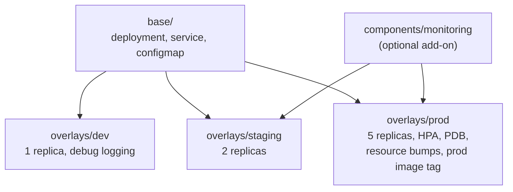

<!-- devopsshack:header -->
> ☸️ **Kubernetes Mastery: Zero to Production** · by **DevOps Shack** · [YouTube](https://www.youtube.com/@devopsshack) · [Hindi channel](https://www.youtube.com/@shackverse) · [devopsshack.com](https://devopsshack.com)
<!-- /devopsshack:header -->

# Module 20 · Kustomize

Kustomize customises plain YAML without templates: a **base** of real manifests plus **overlays** that patch them per environment. It's built into kubectl (`kubectl apply -k`).



## Layout

```text
app/
  base/
    kustomization.yaml
    deployment.yaml
    service.yaml
  overlays/
    dev/kustomization.yaml
    prod/
      kustomization.yaml
      replicas-patch.yaml
      pdb.yaml
  components/
    monitoring/kustomization.yaml
```

```yaml
# base/kustomization.yaml
apiVersion: kustomize.config.k8s.io/v1beta1
kind: Kustomization
resources:
  - deployment.yaml
  - service.yaml
labels:
  - pairs: { app.kubernetes.io/part-of: shop }
    includeSelectors: false
configMapGenerator:
  - name: api-config
    literals: [LOG_LEVEL=info]
```

```yaml
# overlays/prod/kustomization.yaml
apiVersion: kustomize.config.k8s.io/v1beta1
kind: Kustomization
namespace: shop-prod
resources:
  - ../../base
  - pdb.yaml
components:
  - ../../components/monitoring
images:
  - name: ghcr.io/devopsshack/api
    newTag: "2.1.0"
replicas:
  - name: api
    count: 5
configMapGenerator:
  - name: api-config
    behavior: merge
    literals: [LOG_LEVEL=warn]
patches:
  - path: replicas-patch.yaml
  - target: { kind: Deployment, name: api }
    patch: |-
      - op: replace
        path: /spec/template/spec/containers/0/resources/requests/cpu
        value: 500m
```

```bash
kubectl kustomize overlays/prod          # render
kubectl apply -k overlays/prod
kubectl diff -k overlays/prod
```

## Why generators matter

`configMapGenerator` appends a content hash to the name (`api-config-7t2m9k`) and rewrites references. Change the config, the name changes, the pod template changes, and pods roll automatically. No stale config.

## Helm vs Kustomize

| | Helm | Kustomize |
|---|---|---|
| Approach | Templates + values | Patches over plain YAML |
| Packaging and sharing | Charts, repos, OCI, versions | Git directories / remote bases |
| Logic (loops, conditionals) | Yes | Intentionally no |
| Readability of output | Must render to see | Base is already valid YAML |
| Common combination | Third-party software | Your own apps; also patching rendered Helm output (`helmCharts` field, or post-rendering) |

Many teams use both: Helm for vendor charts, Kustomize for in-house services and environment overlays.

## Practice

- [Lab 19 · Kustomize](../04-labs/lab-19-kustomize/README.md)
- Assignments [A079](../06-assignments/A079-kustomize-overlays.md)–[A080](../06-assignments/A080-kustomize-components.md)

Next: [Module 21 · GitOps](21-gitops.md)

<!-- devopsshack:footer -->
---

<p align="center">
  Made with ❤️ by <b><a href="https://devopsshack.com">DevOps Shack</a></b> · Part of <b>Kubernetes Mastery: Zero to Production</b><br/>
  <a href="https://www.youtube.com/@devopsshack">YouTube · DevOps Shack</a> · <a href="https://www.youtube.com/@shackverse">YouTube · DevOps Shack Hindi</a> · <a href="https://devopsshack.com">devopsshack.com</a> · <a href="https://www.instagram.com/devopsshack">Instagram · @devopsshack</a><br/>
  <sub>© DevOps Shack. Original content created by DevOps Shack. Free to learn from and share with credit to DevOps Shack. See <a href="../LICENSE">LICENSE</a>.</sub>
</p>
<!-- /devopsshack:footer -->
