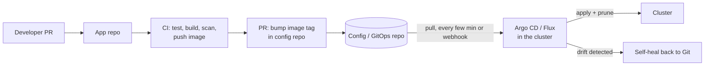
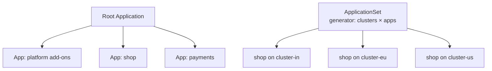

<!-- devopsshack:header -->
> ☸️ **Kubernetes Mastery: Zero to Production** · by **DevOps Shack** · [YouTube](https://www.youtube.com/@devopsshack) · [Hindi channel](https://www.youtube.com/@shackverse) · [devopsshack.com](https://devopsshack.com)
<!-- /devopsshack:header -->

# Module 21 · GitOps with Argo CD & Flux

**GitOps** means Git is the single source of truth for what runs in the cluster, and an agent *inside* the cluster continuously pulls and reconciles it. Kubernetes reconciliation, applied to your whole delivery process.



## The four GitOps principles

1. **Declarative:** the desired system is described declaratively.
2. **Versioned and immutable:** stored in Git, with full history.
3. **Pulled automatically:** agents pull desired state; CI doesn't push into the cluster.
4. **Continuously reconciled:** drift is detected and corrected.

Benefits: audit trail for free (Git log), rollback = `git revert`, no cluster credentials in CI, easy disaster recovery (point a new cluster at the repo).

## Argo CD

```yaml
apiVersion: argoproj.io/v1alpha1
kind: Application
metadata:
  name: shop-prod
  namespace: argocd
  finalizers: ["resources-finalizer.argocd.argoproj.io"]
spec:
  project: shop
  source:
    repoURL: https://github.com/devopsshack/shop-config
    targetRevision: main
    path: overlays/prod
  destination:
    server: https://kubernetes.default.svc
    namespace: shop-prod
  syncPolicy:
    automated:
      prune: true        # delete what's removed from Git
      selfHeal: true     # revert manual changes
    syncOptions:
      - CreateNamespace=true
      - ServerSideApply=true
    retry:
      limit: 5
      backoff: { duration: 10s, factor: 2, maxDuration: 3m }
```

### App of Apps and ApplicationSets



```yaml
apiVersion: argoproj.io/v1alpha1
kind: ApplicationSet
metadata: { name: shop, namespace: argocd }
spec:
  generators:
    - clusters:
        selector: { matchLabels: { env: prod } }
  template:
    metadata: { name: "shop-{{name}}" }
    spec:
      project: shop
      source:
        repoURL: https://github.com/devopsshack/shop-config
        targetRevision: main
        path: "overlays/{{metadata.labels.region}}"
      destination: { server: "{{server}}", namespace: shop }
      syncPolicy: { automated: { prune: true, selfHeal: true } }
```

### Sync waves and hooks

```yaml
metadata:
  annotations:
    argocd.argoproj.io/sync-wave: "-1"       # CRDs/namespaces first, apps later
    argocd.argoproj.io/hook: PreSync          # e.g. DB migration Job
    argocd.argoproj.io/hook-delete-policy: HookSucceeded
```

## Flux

Flux is a set of controllers: `source-controller` (Git/OCI/Helm repos), `kustomize-controller`, `helm-controller`, `notification-controller`, `image-automation-controller`.

```yaml
apiVersion: source.toolkit.fluxcd.io/v1
kind: GitRepository
metadata: { name: shop-config, namespace: flux-system }
spec:
  interval: 1m
  url: https://github.com/devopsshack/shop-config
  ref: { branch: main }
---
apiVersion: kustomize.toolkit.fluxcd.io/v1
kind: Kustomization
metadata: { name: shop-prod, namespace: flux-system }
spec:
  interval: 5m
  path: ./overlays/prod
  prune: true
  sourceRef: { kind: GitRepository, name: shop-config }
  healthChecks:
    - { apiVersion: apps/v1, kind: Deployment, name: api, namespace: shop-prod }
```

## Repo structure that scales

```text
platform-config/
  clusters/
    prod-in/            # per-cluster entry point (root app / flux-system)
    prod-eu/
  platform/             # shared add-ons: ingress, cert-manager, monitoring
  apps/
    shop/
      base/
      overlays/{dev,staging,prod}/
```

**Promotion** between environments is a PR that changes the image tag (or chart version) in the next overlay, automated with Argo CD Image Updater, Flux image automation, Kargo, or a CI step.

## Practice

- [Lab 20 · Argo CD GitOps](../04-labs/lab-20-argocd-gitops/README.md)
- Assignments [A081](../06-assignments/A081-argocd-app-of-apps.md)–[A084](../06-assignments/A084-gitops-promotion.md)

Next: [Module 22 · CI/CD for Kubernetes](22-cicd-for-kubernetes.md)

<!-- devopsshack:footer -->
---

<p align="center">
  Made with ❤️ by <b><a href="https://devopsshack.com">DevOps Shack</a></b> · Part of <b>Kubernetes Mastery: Zero to Production</b><br/>
  <a href="https://www.youtube.com/@devopsshack">YouTube · DevOps Shack</a> · <a href="https://www.youtube.com/@shackverse">YouTube · DevOps Shack Hindi</a> · <a href="https://devopsshack.com">devopsshack.com</a> · <a href="https://www.instagram.com/devopsshack">Instagram · @devopsshack</a><br/>
  <sub>© DevOps Shack. Original content created by DevOps Shack. Free to learn from and share with credit to DevOps Shack. See <a href="../LICENSE">LICENSE</a>.</sub>
</p>
<!-- /devopsshack:footer -->
