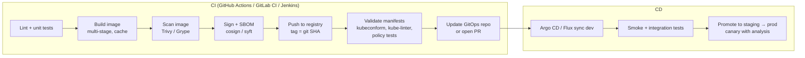

<!-- devopsshack:header -->
> ☸️ **Kubernetes Mastery: Zero to Production** · by **DevOps Shack** · [YouTube](https://www.youtube.com/@devopsshack) · [Hindi channel](https://www.youtube.com/@shackverse) · [devopsshack.com](https://devopsshack.com)
<!-- /devopsshack:header -->

# Module 22 · CI/CD for Kubernetes

## The pipeline end to end



## Push vs pull deployment

| Push (CI runs `kubectl`/`helm`) | Pull (GitOps agent) |
|---|---|
| Simple to start | Agent in cluster pulls from Git |
| CI needs cluster credentials | No cluster credentials in CI |
| Drift not corrected | Continuous drift correction |
| Fine for small teams / dev | Preferred for production |

## Example: GitHub Actions building and promoting via GitOps

```yaml
name: build-and-promote
on:
  push:
    branches: [main]
permissions:
  contents: read
  packages: write
  id-token: write        # keyless signing / cloud OIDC
jobs:
  build:
    runs-on: ubuntu-latest
    outputs:
      digest: ${{ steps.push.outputs.digest }}
    steps:
      - uses: actions/checkout@v4
      - uses: docker/setup-buildx-action@v3
      - uses: docker/login-action@v3
        with:
          registry: ghcr.io
          username: ${{ github.actor }}
          password: ${{ secrets.GITHUB_TOKEN }}
      - id: push
        uses: docker/build-push-action@v6
        with:
          push: true
          tags: ghcr.io/${{ github.repository }}/api:${{ github.sha }}
          cache-from: type=gha
          cache-to: type=gha,mode=max
      - name: Scan
        uses: aquasecurity/trivy-action@0.28.0
        with:
          image-ref: ghcr.io/${{ github.repository }}/api:${{ github.sha }}
          severity: CRITICAL,HIGH
          exit-code: "1"
          ignore-unfixed: true
  promote-dev:
    needs: build
    runs-on: ubuntu-latest
    steps:
      - uses: actions/checkout@v4
        with:
          repository: devopsshack/shop-config
          token: ${{ secrets.CONFIG_REPO_TOKEN }}
      - name: Bump image in dev overlay
        run: |
          cd apps/shop/overlays/dev
          kustomize edit set image ghcr.io/devopsshack/shop/api=ghcr.io/devopsshack/shop/api:${{ github.sha }}
          git config user.name "ci-bot"
          git config user.email "ci-bot@users.noreply.github.com"
          git commit -am "dev: api ${{ github.sha }}"
          git push
```

## Manifest validation in CI

```bash
kustomize build overlays/prod | kubeconform -strict -summary -kubernetes-version 1.34.0
kube-linter lint overlays/prod
conftest test rendered.yaml -p policy/          # OPA policies
kyverno apply policies/ --resource rendered.yaml
pluto detect-files -d manifests/                # deprecated APIs
```

## Preview environments

Spin up a namespace per pull request (`shop-pr-412`), deploy the PR's image, post the URL on the PR, and delete the namespace on merge. Argo CD's ApplicationSet **pull request generator** automates this.

## Tagging rules

- Tag images with the **git SHA** (immutable, traceable). Add semver tags for releases.
- Deploy by digest in production for true immutability.
- Never rebuild for promotion: the image tested in staging must be the exact image that reaches prod.

## Practice

- Assignments [A085](../06-assignments/A085-github-actions-to-k8s.md)–[A086](../06-assignments/A086-preview-environments.md)

Next: [Module 23 · Observability](23-observability.md)

<!-- devopsshack:footer -->
---

<p align="center">
  Made with ❤️ by <b><a href="https://devopsshack.com">DevOps Shack</a></b> · Part of <b>Kubernetes Mastery: Zero to Production</b><br/>
  <a href="https://www.youtube.com/@devopsshack">YouTube · DevOps Shack</a> · <a href="https://www.youtube.com/@shackverse">YouTube · DevOps Shack Hindi</a> · <a href="https://devopsshack.com">devopsshack.com</a> · <a href="https://www.instagram.com/devopsshack">Instagram · @devopsshack</a><br/>
  <sub>© DevOps Shack. Original content created by DevOps Shack. Free to learn from and share with credit to DevOps Shack. See <a href="../LICENSE">LICENSE</a>.</sub>
</p>
<!-- /devopsshack:footer -->
