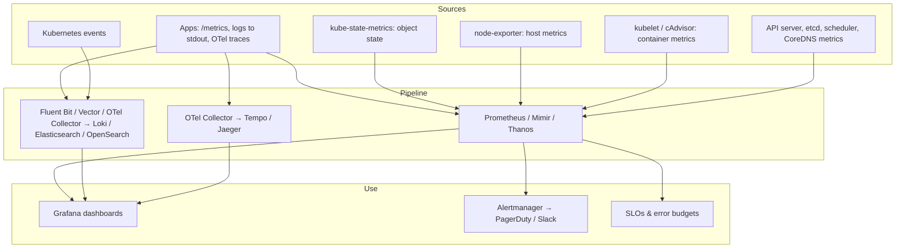
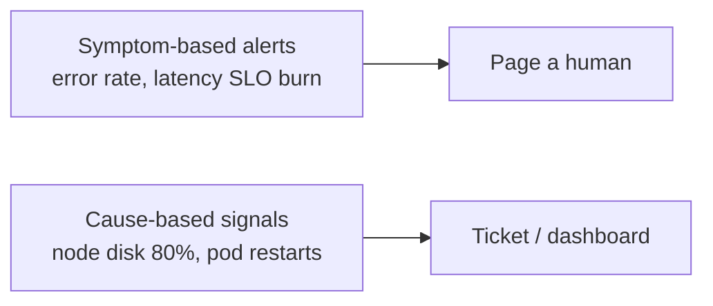

<!-- devopsshack:header -->
> ☸️ **Kubernetes Mastery: Zero to Production** · by **DevOps Shack** · [YouTube](https://www.youtube.com/@devopsshack) · [Hindi channel](https://www.youtube.com/@shackverse) · [devopsshack.com](https://devopsshack.com)
<!-- /devopsshack:header -->

# Module 23 · Observability: Metrics, Logs, Traces

You can't operate what you can't see. Kubernetes adds layers (node, pod, container, Service, control plane) that each need visibility.



## Metrics

Install the standard stack:

```bash
helm repo add prometheus-community https://prometheus-community.github.io/helm-charts
helm install kps prometheus-community/kube-prometheus-stack -n monitoring --create-namespace
```

This gives Prometheus (via the Prometheus Operator), Alertmanager, Grafana, node-exporter, kube-state-metrics and ready-made dashboards and alerts.

Scrape your app with a ServiceMonitor:

```yaml
apiVersion: monitoring.coreos.com/v1
kind: ServiceMonitor
metadata:
  name: api
  namespace: shop
  labels: { release: kps }
spec:
  selector: { matchLabels: { app: api } }
  endpoints:
    - port: metrics
      interval: 30s
```

### Queries every Kubernetes engineer should know

```promql
# CPU usage vs request per pod
sum by (pod) (rate(container_cpu_usage_seconds_total{namespace="shop",container!=""}[5m]))
  / sum by (pod) (kube_pod_container_resource_requests{namespace="shop",resource="cpu"})

# Memory working set vs limit
sum by (pod) (container_memory_working_set_bytes{namespace="shop",container!=""})
  / sum by (pod) (kube_pod_container_resource_limits{namespace="shop",resource="memory"})

# CPU throttling ratio
sum by (pod) (rate(container_cpu_cfs_throttled_periods_total[5m]))
  / sum by (pod) (rate(container_cpu_cfs_periods_total[5m]))

# Pods restarting
increase(kube_pod_container_status_restarts_total[1h]) > 3

# Deployment not at desired replicas
kube_deployment_spec_replicas != kube_deployment_status_replicas_available

# Request rate, errors, latency (RED) for an app exposing http metrics
sum(rate(http_requests_total{job="api"}[5m]))
sum(rate(http_requests_total{job="api",code=~"5.."}[5m])) / sum(rate(http_requests_total{job="api"}[5m]))
histogram_quantile(0.99, sum by (le) (rate(http_request_duration_seconds_bucket{job="api"}[5m])))
```

## Logs

- Apps log to **stdout/stderr** in structured JSON. The kubelet/runtime writes them to `/var/log/pods/...`.
- A **DaemonSet** agent (Fluent Bit, Vector, OTel Collector) tails those files, adds Kubernetes metadata (namespace, pod, labels) and ships them.
- `kubectl logs` only shows what's still on the node; logs vanish with the pod or after rotation. Centralised logging isn't optional in production.

```bash
kubectl logs deploy/api -n shop --since=15m --all-containers
stern -n shop api --since 10m          # tail many pods at once
```

## Traces

Instrument with **OpenTelemetry** SDKs (or auto-instrumentation via the OTel Operator), send to an OTel Collector, store in Tempo or Jaeger. Traces answer "which service in this 12-hop request is slow?" in a way metrics and logs can't.

## Alerting that doesn't burn people out



- Page on **user-facing symptoms** (SLO burn rate), not on every pod restart.
- Every alert has a runbook link and a clear owner.
- Multi-window burn-rate alerts (e.g., 2% of the monthly error budget in 1 hour) catch fast and slow burns.

## Golden signals per service

**Latency, traffic, errors, saturation.** Build one dashboard per service with these four, plus Kubernetes context: replicas, restarts, CPU/memory vs requests, throttling, HPA state.

## Practice

- [Lab 21 · Prometheus & Grafana](../04-labs/lab-21-prometheus-grafana/README.md)
- Assignments [A087](../06-assignments/A087-prometheus-stack.md)–[A091](../06-assignments/A091-dashboards-golden-signals.md)

Next: [Module 24 · Deployment Strategies](24-deployment-strategies.md)

<!-- devopsshack:footer -->
---

<p align="center">
  Made with ❤️ by <b><a href="https://devopsshack.com">DevOps Shack</a></b> · Part of <b>Kubernetes Mastery: Zero to Production</b><br/>
  <a href="https://www.youtube.com/@devopsshack">YouTube · DevOps Shack</a> · <a href="https://www.youtube.com/@shackverse">YouTube · DevOps Shack Hindi</a> · <a href="https://devopsshack.com">devopsshack.com</a> · <a href="https://www.instagram.com/devopsshack">Instagram · @devopsshack</a><br/>
  <sub>© DevOps Shack. Original content created by DevOps Shack. Free to learn from and share with credit to DevOps Shack. See <a href="../LICENSE">LICENSE</a>.</sub>
</p>
<!-- /devopsshack:footer -->
