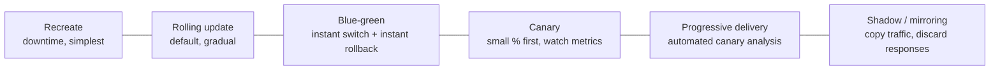
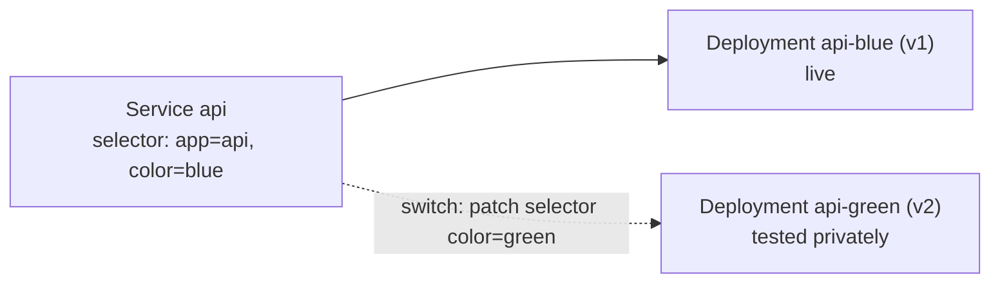
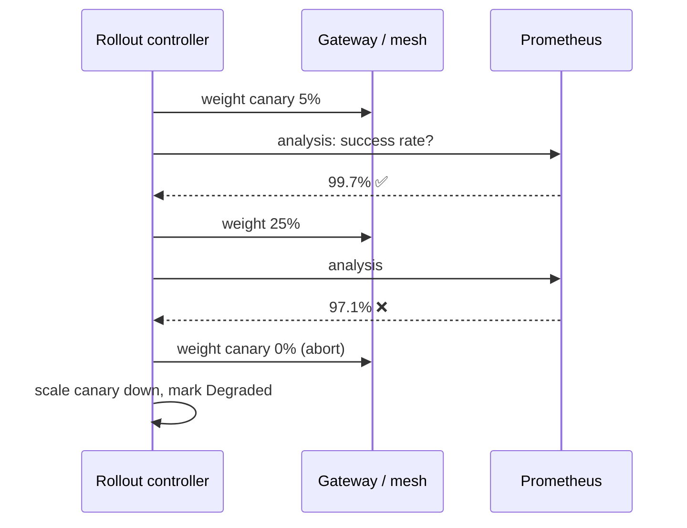

<!-- devopsshack:header -->
> ☸️ **Kubernetes Mastery: Zero to Production** · by **DevOps Shack** · [YouTube](https://www.youtube.com/@devopsshack) · [Hindi channel](https://www.youtube.com/@shackverse) · [devopsshack.com](https://devopsshack.com)
<!-- /devopsshack:header -->

# Module 24 · Deployment Strategies



| Strategy | Downtime | Two versions live at once | Rollback speed | Extra capacity | Tools |
|---|---|---|---|---|---|
| Recreate | Yes | No | Redeploy | None | Deployment |
| Rolling | No | Yes (briefly) | Rolling back | maxSurge | Deployment |
| Blue-green | No | Yes (idle standby) | Instant (switch back) | 2× | Two Deployments + Service selector, Argo Rollouts |
| Canary | No | Yes | Fast (weight to 0) | Small | Gateway API weights, mesh, Argo Rollouts, Flagger |
| Shadow | No | Yes (shadow gets copies) | n/a | Shadow capacity | Mesh / gateway mirroring |

## Blue-green with plain Kubernetes



```bash
kubectl apply -f api-green.yaml
kubectl rollout status deploy/api-green
# smoke-test via a separate preview Service, then switch:
kubectl patch svc api -p '{"spec":{"selector":{"app":"api","color":"green"}}}'
# rollback = patch back to blue
```

## Canary with Argo Rollouts

```yaml
apiVersion: argoproj.io/v1alpha1
kind: Rollout
metadata: { name: api, namespace: shop }
spec:
  replicas: 10
  selector: { matchLabels: { app: api } }
  template:
    metadata: { labels: { app: api } }
    spec:
      containers:
        - name: api
          image: ghcr.io/devopsshack/api:2.2.0
  strategy:
    canary:
      canaryService: api-canary
      stableService: api-stable
      trafficRouting:
        plugins:
          argoproj-labs/gatewayAPI:
            httpRoute: api
            namespace: shop
      steps:
        - setWeight: 5
        - pause: { duration: 5m }
        - analysis:
            templates: [{ templateName: success-rate }]
        - setWeight: 25
        - pause: { duration: 10m }
        - setWeight: 50
        - pause: { duration: 10m }
---
apiVersion: argoproj.io/v1alpha1
kind: AnalysisTemplate
metadata: { name: success-rate, namespace: shop }
spec:
  metrics:
    - name: success-rate
      interval: 1m
      count: 5
      successCondition: result[0] >= 0.99
      failureLimit: 1
      provider:
        prometheus:
          address: http://kps-prometheus.monitoring:9090
          query: |
            sum(rate(http_requests_total{service="api-canary",code!~"5.."}[2m]))
            / sum(rate(http_requests_total{service="api-canary"}[2m]))
```

If the success rate drops below 99%, the Rollout aborts and shifts all traffic back to stable automatically.



## Things that make every strategy safer

- **Backward-compatible database migrations** (expand → migrate → contract). The old and new app versions must work against the same schema during rollout.
- **Feature flags** to decouple deploy from release.
- **Good readiness probes and graceful shutdown**, without which no strategy is zero-downtime.
- **Automated rollback criteria** decided *before* the deploy.

## Practice

- Assignments [A092](../06-assignments/A092-blue-green.md)–[A094](../06-assignments/A094-progressive-delivery-analysis.md)

Next: [Module 25 · Service Mesh](25-service-mesh.md)

<!-- devopsshack:footer -->
---

<p align="center">
  Made with ❤️ by <b><a href="https://devopsshack.com">DevOps Shack</a></b> · Part of <b>Kubernetes Mastery: Zero to Production</b><br/>
  <a href="https://www.youtube.com/@devopsshack">YouTube · DevOps Shack</a> · <a href="https://www.youtube.com/@shackverse">YouTube · DevOps Shack Hindi</a> · <a href="https://devopsshack.com">devopsshack.com</a> · <a href="https://www.instagram.com/devopsshack">Instagram · @devopsshack</a><br/>
  <sub>© DevOps Shack. Original content created by DevOps Shack. Free to learn from and share with credit to DevOps Shack. See <a href="../LICENSE">LICENSE</a>.</sub>
</p>
<!-- /devopsshack:footer -->
