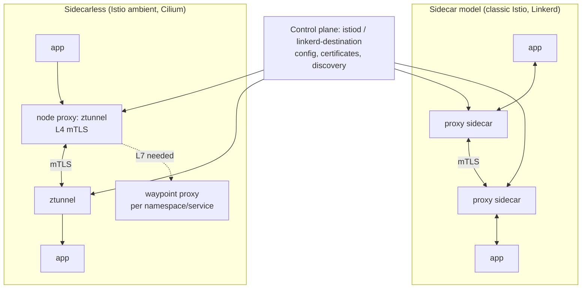
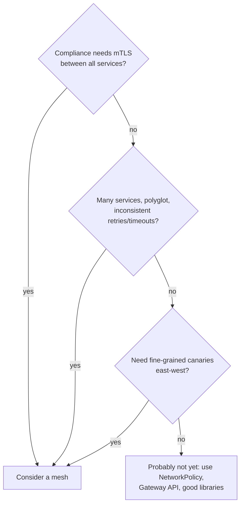

<!-- devopsshack:header -->
> ☸️ **Kubernetes Mastery: Zero to Production** · by **DevOps Shack** · [YouTube](https://www.youtube.com/@devopsshack) · [Hindi channel](https://www.youtube.com/@shackverse) · [devopsshack.com](https://devopsshack.com)
<!-- /devopsshack:header -->

# Module 25 · Service Mesh

A service mesh moves cross-cutting network concerns (mTLS, retries, timeouts, traffic shifting, telemetry) out of application code into infrastructure.

## Architectures



## What a mesh gives you

| Capability | Example |
|---|---|
| Zero-trust security | Automatic mTLS between every service; identity-based authorization policies |
| Traffic management | Weighted routing, header routing, mirroring, fault injection |
| Resilience | Retries with budgets, timeouts, circuit breaking, outlier detection |
| Observability | Uniform golden-signal metrics and traces for every hop, no code changes |

## Istio examples

```yaml
# Require mTLS for the whole mesh
apiVersion: security.istio.io/v1
kind: PeerAuthentication
metadata: { name: default, namespace: istio-system }
spec:
  mtls: { mode: STRICT }
---
# Only the web service account may call api
apiVersion: security.istio.io/v1
kind: AuthorizationPolicy
metadata: { name: api-allow-web, namespace: shop }
spec:
  selector: { matchLabels: { app: api } }
  action: ALLOW
  rules:
    - from:
        - source: { principals: ["cluster.local/ns/shop/sa/web"] }
      to:
        - operation: { methods: ["GET", "POST"], paths: ["/api/*"] }
---
# Resilience
apiVersion: networking.istio.io/v1
kind: DestinationRule
metadata: { name: api, namespace: shop }
spec:
  host: api
  trafficPolicy:
    connectionPool:
      http: { http1MaxPendingRequests: 100, maxRequestsPerConnection: 10 }
    outlierDetection:
      consecutive5xxErrors: 5
      interval: 10s
      baseEjectionTime: 30s
```

Modern meshes also implement the **Gateway API** for both north-south and east-west (GAMMA) routing, so `HTTPRoute` can configure service-to-service traffic too.

## Do you need a mesh?



Costs: extra latency (small, but real), CPU/memory for proxies, operational complexity, upgrade coordination, and a new layer to debug.

## Debugging a mesh

```bash
istioctl analyze -n shop
istioctl proxy-status
istioctl proxy-config routes deploy/web -n shop
linkerd check && linkerd viz stat deploy -n shop
```

## Practice

- Assignments [A095](../06-assignments/A095-mesh-mtls.md)–[A096](../06-assignments/A096-mesh-traffic-shifting.md)

Next: [Module 26 · Building a Cluster with kubeadm](26-cluster-setup-kubeadm.md)

<!-- devopsshack:footer -->
---

<p align="center">
  Made with ❤️ by <b><a href="https://devopsshack.com">DevOps Shack</a></b> · Part of <b>Kubernetes Mastery: Zero to Production</b><br/>
  <a href="https://www.youtube.com/@devopsshack">YouTube · DevOps Shack</a> · <a href="https://www.youtube.com/@shackverse">YouTube · DevOps Shack Hindi</a> · <a href="https://devopsshack.com">devopsshack.com</a> · <a href="https://www.instagram.com/devopsshack">Instagram · @devopsshack</a><br/>
  <sub>© DevOps Shack. Original content created by DevOps Shack. Free to learn from and share with credit to DevOps Shack. See <a href="../LICENSE">LICENSE</a>.</sub>
</p>
<!-- /devopsshack:footer -->
