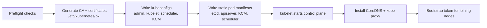

<!-- devopsshack:header -->
> ☸️ **Kubernetes Mastery: Zero to Production** · by **DevOps Shack** · [YouTube](https://www.youtube.com/@devopsshack) · [Hindi channel](https://www.youtube.com/@shackverse) · [devopsshack.com](https://devopsshack.com)
<!-- /devopsshack:header -->

# Module 26 · Building a Cluster with kubeadm

Managed services hide the control plane. Building one yourself once is the fastest way to truly understand it, and it's core CKA material.

## What kubeadm does



## Prepare every node

```bash
# 1. Disable swap (or configure kubelet swap support deliberately)
sudo swapoff -a && sudo sed -i '/ swap / s/^/#/' /etc/fstab

# 2. Kernel modules and sysctls
cat <<EOF | sudo tee /etc/modules-load.d/k8s.conf
overlay
br_netfilter
EOF
sudo modprobe overlay && sudo modprobe br_netfilter
cat <<EOF | sudo tee /etc/sysctl.d/k8s.conf
net.bridge.bridge-nf-call-iptables  = 1
net.bridge.bridge-nf-call-ip6tables = 1
net.ipv4.ip_forward                 = 1
EOF
sudo sysctl --system

# 3. containerd with systemd cgroups
sudo apt-get update && sudo apt-get install -y containerd
containerd config default | sudo tee /etc/containerd/config.toml
sudo sed -i 's/SystemdCgroup = false/SystemdCgroup = true/' /etc/containerd/config.toml
sudo systemctl restart containerd

# 4. kubeadm, kubelet, kubectl from pkgs.k8s.io (pick your minor version)
K8S=v1.34
sudo apt-get install -y apt-transport-https ca-certificates curl gpg
curl -fsSL https://pkgs.k8s.io/core:/stable:/$K8S/deb/Release.key | sudo gpg --dearmor -o /etc/apt/keyrings/kubernetes-apt-keyring.gpg
echo "deb [signed-by=/etc/apt/keyrings/kubernetes-apt-keyring.gpg] https://pkgs.k8s.io/core:/stable:/$K8S/deb/ /" | sudo tee /etc/apt/sources.list.d/kubernetes.list
sudo apt-get update && sudo apt-get install -y kubelet kubeadm kubectl
sudo apt-mark hold kubelet kubeadm kubectl
```

## Initialise the control plane

```bash
sudo kubeadm init \
  --control-plane-endpoint "k8s-api.lab.local:6443" \
  --pod-network-cidr 10.244.0.0/16 \
  --upload-certs
mkdir -p $HOME/.kube && sudo cp /etc/kubernetes/admin.conf $HOME/.kube/config && sudo chown $(id -u):$(id -g) $HOME/.kube/config

# Install a CNI (nodes stay NotReady until you do)
kubectl apply -f https://raw.githubusercontent.com/projectcalico/calico/v3.29.0/manifests/calico.yaml
```

## Join nodes

```bash
# Workers
sudo kubeadm join k8s-api.lab.local:6443 --token <token> --discovery-token-ca-cert-hash sha256:<hash>
# Extra control plane nodes (HA)
sudo kubeadm join k8s-api.lab.local:6443 --token <token> --discovery-token-ca-cert-hash sha256:<hash> \
  --control-plane --certificate-key <key>
# Lost the command?
kubeadm token create --print-join-command
```

## What's on a control plane node afterwards

```text
/etc/kubernetes/
  admin.conf, kubelet.conf, controller-manager.conf, scheduler.conf
  manifests/  etcd.yaml  kube-apiserver.yaml  kube-controller-manager.yaml  kube-scheduler.yaml
  pki/        ca.crt ca.key apiserver.crt ... etcd/ca.crt ...
/var/lib/kubelet/config.yaml
/var/lib/etcd/
```

Edit a static pod manifest and the kubelet restarts that component automatically. That's how you change API server flags (e.g., enable audit logging or encryption at rest).

## Common setup failures

| Symptom | Cause |
|---|---|
| Nodes NotReady after init | No CNI installed |
| kubelet crash-looping | Swap on, cgroup driver mismatch (containerd vs kubelet), wrong config |
| Pods can't reach each other across nodes | CNI pod CIDR mismatch, firewall blocking VXLAN/BGP, MTU |
| `join` fails | Expired token (24h default), wrong CA hash, port 6443 blocked |
| CoreDNS Pending | No CNI yet, or control plane taint and no workers |

## Other ways to build clusters

kubespray (Ansible), Cluster API (clusters as Kubernetes objects), k3s/RKE2, Talos Linux (immutable, API-managed OS), and managed services via Terraform/OpenTofu or eksctl.

## Practice

- Assignment [A097 · Build a Cluster with kubeadm](../06-assignments/A097-kubeadm-cluster.md)
- Certification: [CKA guide](../09-certification-prep/cka.md)

Next: [Module 27 · Cluster Operations & Upgrades](27-cluster-operations-upgrades.md)

<!-- devopsshack:footer -->
---

<p align="center">
  Made with ❤️ by <b><a href="https://devopsshack.com">DevOps Shack</a></b> · Part of <b>Kubernetes Mastery: Zero to Production</b><br/>
  <a href="https://www.youtube.com/@devopsshack">YouTube · DevOps Shack</a> · <a href="https://www.youtube.com/@shackverse">YouTube · DevOps Shack Hindi</a> · <a href="https://devopsshack.com">devopsshack.com</a> · <a href="https://www.instagram.com/devopsshack">Instagram · @devopsshack</a><br/>
  <sub>© DevOps Shack. Original content created by DevOps Shack. Free to learn from and share with credit to DevOps Shack. See <a href="../LICENSE">LICENSE</a>.</sub>
</p>
<!-- /devopsshack:footer -->
