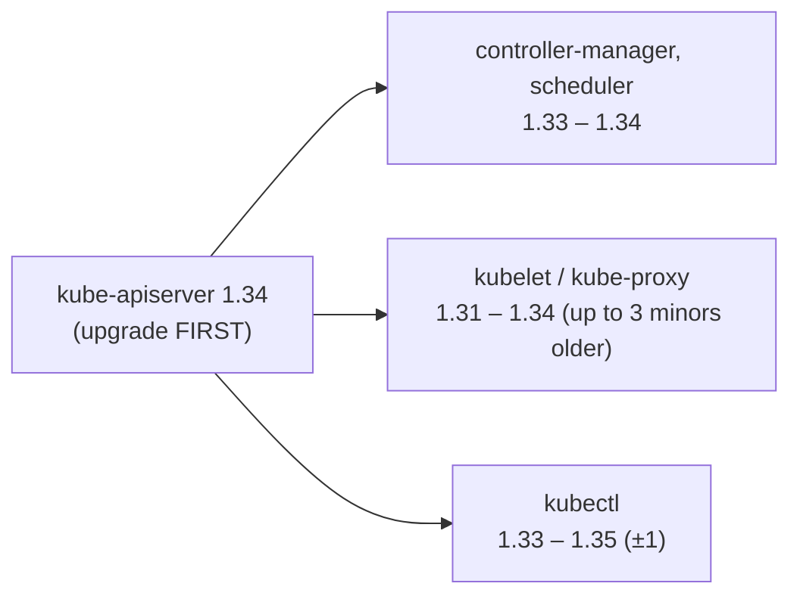
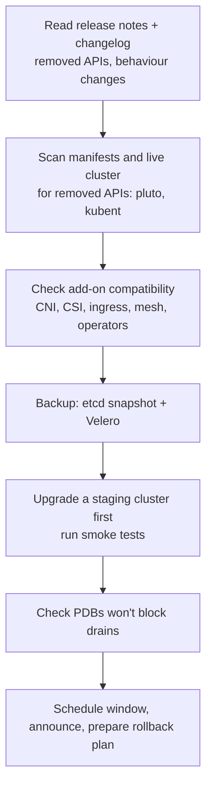
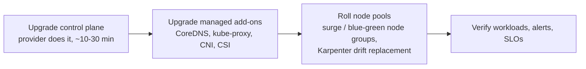
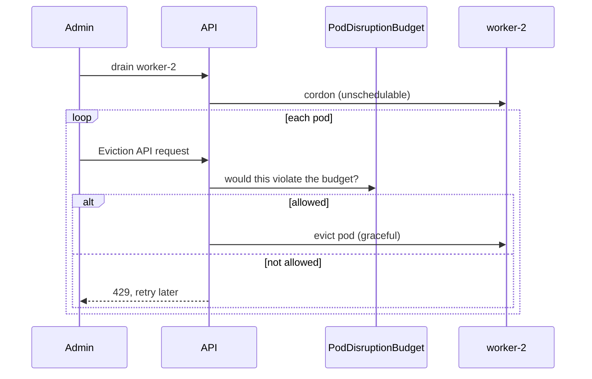

<!-- devopsshack:header -->
> ☸️ **Kubernetes Mastery: Zero to Production** · by **DevOps Shack** · [YouTube](https://www.youtube.com/@devopsshack) · [Hindi channel](https://www.youtube.com/@shackverse) · [devopsshack.com](https://devopsshack.com)
<!-- /devopsshack:header -->

# Module 27 · Cluster Operations & Upgrades

## Version skew rules



- Upgrade **one minor version at a time** (1.32 → 1.33 → 1.34). No skipping.
- Control plane first, then nodes. Kubelets may never be newer than the API server.

## Pre-upgrade checklist



## kubeadm upgrade, step by step

```bash
# --- First control plane node ---
sudo apt-mark unhold kubeadm && sudo apt-get install -y kubeadm='1.34.2-*' && sudo apt-mark hold kubeadm
sudo kubeadm upgrade plan
sudo kubeadm upgrade apply v1.34.2
kubectl drain cp-1 --ignore-daemonsets
sudo apt-mark unhold kubelet kubectl && sudo apt-get install -y kubelet='1.34.2-*' kubectl='1.34.2-*' && sudo apt-mark hold kubelet kubectl
sudo systemctl daemon-reload && sudo systemctl restart kubelet
kubectl uncordon cp-1

# --- Other control plane nodes ---
sudo kubeadm upgrade node        # instead of 'apply'
# then drain, upgrade kubelet/kubectl, restart, uncordon

# --- Each worker, one at a time (or in small batches) ---
kubectl drain worker-1 --ignore-daemonsets --delete-emptydir-data
# on worker-1:
sudo apt-get install -y kubeadm='1.34.2-*' && sudo kubeadm upgrade node
sudo apt-get install -y kubelet='1.34.2-*' && sudo systemctl daemon-reload && sudo systemctl restart kubelet
kubectl uncordon worker-1
```

## Managed cluster upgrades



Blue-green node pools (create a new pool on the new version, cordon the old one, drain gradually) give the safest rollback for node upgrades.

## Node maintenance

```bash
kubectl cordon worker-2                       # no new pods
kubectl drain worker-2 --ignore-daemonsets --delete-emptydir-data --timeout=10m
# patch / reboot / replace
kubectl uncordon worker-2
```



A drain that hangs forever usually means a PDB with zero allowed disruptions, or a pod without a controller (use `--force` only if you accept losing it).

## Certificates, tokens and other expiring things

| What | Default lifetime | Check |
|---|---|---|
| kubeadm component certs | 1 year (renewed by `kubeadm upgrade`) | `kubeadm certs check-expiration` |
| Cluster CA | 10 years | `openssl x509 -enddate -in /etc/kubernetes/pki/ca.crt` |
| Bootstrap tokens | 24 hours | `kubeadm token list` |
| Ingress TLS certs | Typically 90 days (Let's Encrypt) | cert-manager `Certificate` status |
| ServiceAccount tokens (projected) | 1 hour, auto-refreshed | — |

## Routine operations calendar

- **Daily:** alerts, failed jobs, pending pods, node health.
- **Weekly:** capacity and cost review, deprecated API report, image vulnerability report.
- **Monthly:** restore test from backups, access review, rightsizing.
- **Quarterly:** Kubernetes minor upgrade, DR game day, certificate inventory.

## Practice

- Assignments [A098](../06-assignments/A098-cluster-upgrade.md)–[A101](../06-assignments/A101-certificate-renewal.md)
- [Lab 23 · etcd Backup & Restore](../04-labs/lab-23-etcd-backup-restore/README.md)
- Playbook: [Cluster upgrade gone wrong](../05-troubleshooting-playbooks/30-upgrade-gone-wrong.md)

Next: [Module 28 · Backup & Disaster Recovery](28-backup-disaster-recovery.md)

<!-- devopsshack:footer -->
---

<p align="center">
  Made with ❤️ by <b><a href="https://devopsshack.com">DevOps Shack</a></b> · Part of <b>Kubernetes Mastery: Zero to Production</b><br/>
  <a href="https://www.youtube.com/@devopsshack">YouTube · DevOps Shack</a> · <a href="https://www.youtube.com/@shackverse">YouTube · DevOps Shack Hindi</a> · <a href="https://devopsshack.com">devopsshack.com</a> · <a href="https://www.instagram.com/devopsshack">Instagram · @devopsshack</a><br/>
  <sub>© DevOps Shack. Original content created by DevOps Shack. Free to learn from and share with credit to DevOps Shack. See <a href="../LICENSE">LICENSE</a>.</sub>
</p>
<!-- /devopsshack:footer -->
