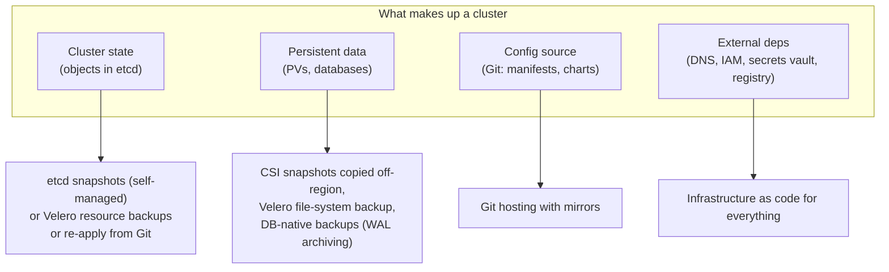
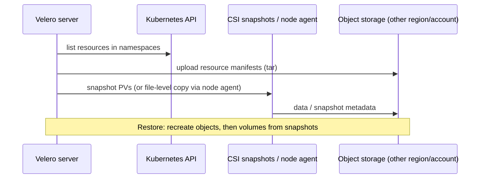
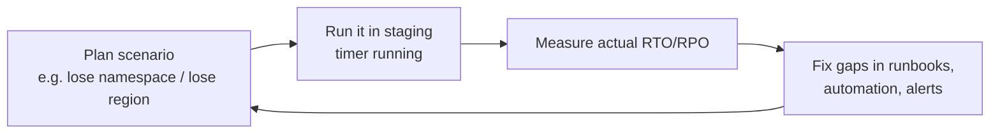

<!-- devopsshack:header -->
> ☸️ **Kubernetes Mastery: Zero to Production** · by **DevOps Shack** · [YouTube](https://www.youtube.com/@devopsshack) · [Hindi channel](https://www.youtube.com/@shackverse) · [devopsshack.com](https://devopsshack.com)
<!-- /devopsshack:header -->

# Module 28 · Backup & Disaster Recovery

## What can be lost, and how you'd get it back



With GitOps, rebuilding cluster *state* is mostly "point a new cluster at the repo." The hard part is **data**.

## RPO and RTO

- **RPO (Recovery Point Objective):** how much data you can afford to lose. Hourly backups mean up to 1 hour of loss.
- **RTO (Recovery Time Objective):** how long until service is back.

Every DR design starts by agreeing these per service with the business.

## DR strategies

| Strategy | RTO | Cost | How |
|---|---|---|---|
| Backup & restore | Hours | Low | Backups in another region; rebuild cluster with IaC + GitOps; restore data |
| Pilot light | Tens of minutes | Medium | Minimal cluster running in DR region, data replicated; scale up on failover |
| Warm standby | Minutes | Higher | Scaled-down full copy live; DNS failover |
| Active-active | ~Zero | Highest | Multiple regions serving traffic; global load balancing; data replication strategy needed |

## Velero



```bash
velero install --provider aws --plugins velero/velero-plugin-for-aws:v1.10.0 \
  --bucket dr-backups --backup-location-config region=ap-south-1 \
  --use-node-agent --features=EnableCSI

velero backup create shop-$(date +%F) --include-namespaces shop --snapshot-move-data
velero schedule create shop-nightly --schedule="0 2 * * *" --include-namespaces shop --ttl 720h
velero backup describe shop-2026-11-11 --details
velero restore create --from-backup shop-2026-11-11 --namespace-mappings shop:shop-restore-test
```

## Databases need their own backups

Volume snapshots are crash-consistent at best. For databases use the native tooling or an operator: continuous WAL archiving with point-in-time recovery (CloudNativePG + object storage, pgBackRest), or managed database snapshots and cross-region replicas.

## Game days



An untested DR plan fails in predictable ways: credentials stored only in the dead region, the backup bucket in the same account that was compromised, DNS TTLs of 24 hours, images only in a regional registry, runbooks that reference people who left.

## Practice

- [Lab 24 · Velero Backup & Restore](../04-labs/lab-24-velero-backup/README.md)
- Assignments [A102](../06-assignments/A102-velero-backup-restore.md)–[A103](../06-assignments/A103-dr-game-day.md)

Next: [Module 29 · Multi-Tenancy](29-multi-tenancy.md)

<!-- devopsshack:footer -->
---

<p align="center">
  Made with ❤️ by <b><a href="https://devopsshack.com">DevOps Shack</a></b> · Part of <b>Kubernetes Mastery: Zero to Production</b><br/>
  <a href="https://www.youtube.com/@devopsshack">YouTube · DevOps Shack</a> · <a href="https://www.youtube.com/@shackverse">YouTube · DevOps Shack Hindi</a> · <a href="https://devopsshack.com">devopsshack.com</a> · <a href="https://www.instagram.com/devopsshack">Instagram · @devopsshack</a><br/>
  <sub>© DevOps Shack. Original content created by DevOps Shack. Free to learn from and share with credit to DevOps Shack. See <a href="../LICENSE">LICENSE</a>.</sub>
</p>
<!-- /devopsshack:footer -->
