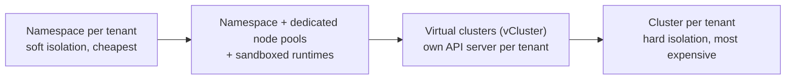
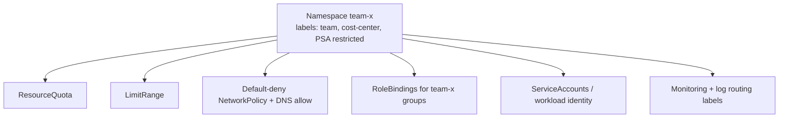

<!-- devopsshack:header -->
> ☸️ **Kubernetes Mastery: Zero to Production** · by **DevOps Shack** · [YouTube](https://www.youtube.com/@devopsshack) · [Hindi channel](https://www.youtube.com/@shackverse) · [devopsshack.com](https://devopsshack.com)
<!-- /devopsshack:header -->

# Module 29 · Multi-Tenancy

How do several teams (or customers) share Kubernetes safely and fairly?

## The spectrum

| Model | Isolation | Cost / overhead | Tenants can install CRDs? |
|---|---|---|---|
| Namespace per tenant | Soft (shared kernel, shared control plane) | Lowest | No |
| + dedicated nodes / gVisor / Kata | Stronger runtime isolation | Medium | No |
| Virtual cluster | Strong API isolation, shared nodes | Medium | Yes (in their vcluster) |
| Dedicated cluster | Strongest | Highest | Yes |

Teams inside one company usually do fine with namespaces. Untrusted customer code usually needs sandboxed runtimes or dedicated clusters.

## The namespace-as-a-service kit

Every new tenant namespace gets the same bundle, ideally created automatically (Kyverno `generate` rules, Capsule, Argo CD ApplicationSet, or a platform portal):

## Fairness

- ResourceQuota and LimitRange for capacity budgets.
- PriorityClasses so a batch tenant can't starve production.
- API Priority & Fairness for API server request fairness between tenants and controllers.
- Separate node pools for noisy workloads.

## Common leaks between tenants

- Wildcard ClusterRoles bound too broadly.
- Shared `default` ServiceAccount with extra permissions.
- No NetworkPolicies, so everything can reach everything.
- Cluster-scoped resources (CRDs, webhooks, StorageClasses, IngressClasses) managed by tenants.
- Ingress host collisions: one tenant claims another's hostname. Gateway API `allowedRoutes` with hostname restrictions helps.

## Practice

- Assignment [A104 · Self-Service Tenant Onboarding](../06-assignments/A104-tenant-onboarding.md)

Next: [Module 30 · Cost Optimization](30-cost-optimization.md)

<!-- devopsshack:footer -->
---

  Made with ❤️ by <b><a href="https://devopsshack.com">DevOps Shack</a></b> · Part of <b>Kubernetes Mastery: Zero to Production</b> 
  <a href="https://www.youtube.com/@devopsshack">YouTube · DevOps Shack</a> · <a href="https://www.youtube.com/@shackverse">YouTube · DevOps Shack Hindi</a> · <a href="https://devopsshack.com">devopsshack.com</a> · <a href="https://www.instagram.com/devopsshack">Instagram · @devopsshack</a> 
  © DevOps Shack. Original content created by DevOps Shack. Free to learn from and share with credit to DevOps Shack. See <a href="../LICENSE">LICENSE</a>.

<!-- /devopsshack:footer -->
