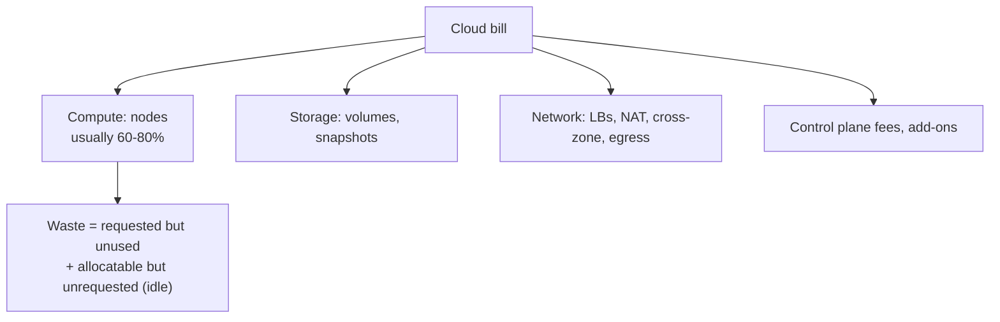
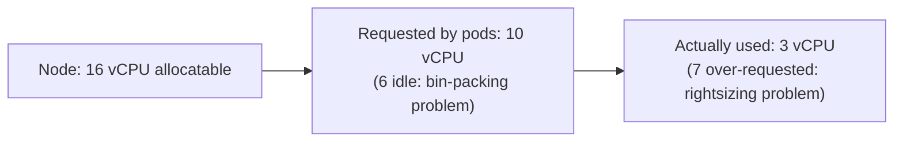

<!-- devopsshack:header -->
> ☸️ **Kubernetes Mastery: Zero to Production** · by **DevOps Shack** · [YouTube](https://www.youtube.com/@devopsshack) · [Hindi channel](https://www.youtube.com/@shackverse) · [devopsshack.com](https://devopsshack.com)
<!-- /devopsshack:header -->

# Module 30 · Cost Optimization (FinOps for Kubernetes)

Kubernetes makes it easy to waste money invisibly: requests far above usage, idle nodes, oversized LoadBalancers, cross-zone traffic, orphaned volumes.

## Where the money goes





## The playbook

| Lever | How | Typical saving |
|---|---|---|
| Rightsize requests | VPA recommendations, Goldilocks, p95 usage from Prometheus | Large |
| Bin-pack nodes | Karpenter consolidation, MostAllocated scoring, fewer node shapes | Medium |
| Autoscale | HPA on real signals; scale to zero with KEDA for dev/queues | Medium |
| Spot / preemptible | Stateless and batch on spot with diversified instance types + PDBs | 60-90% on those nodes |
| Commitments | Savings Plans / reserved instances / CUDs for the steady baseline | 30-60% on baseline |
| Arm nodes | Graviton / Ampere / Axion, multi-arch images | ~20% price-performance |
| Schedule non-prod | Scale dev/staging to zero at night and weekends | Up to ~65% of non-prod |
| Network | Topology-aware routing, avoid cross-AZ chatty traffic, VPC endpoints instead of NAT | Varies, often surprising |
| Storage hygiene | Delete orphaned PVs/snapshots; gp3 over gp2; right volume types | Small to medium |
| Fewer LoadBalancers | One gateway for many services | Per LB per month |

## Spot done right

```yaml
# Karpenter NodePool mixing spot and on-demand
apiVersion: karpenter.sh/v1
kind: NodePool
metadata: { name: general }
spec:
  template:
    spec:
      requirements:
        - { key: karpenter.sh/capacity-type, operator: In, values: ["spot", "on-demand"] }
        - { key: kubernetes.io/arch, operator: In, values: ["amd64", "arm64"] }
        - { key: karpenter.k8s.aws/instance-category, operator: In, values: ["c", "m", "r"] }
      nodeClassRef: { group: karpenter.k8s.aws, kind: EC2NodeClass, name: default }
  disruption:
    consolidationPolicy: WhenEmptyOrUnderutilized
    consolidateAfter: 1m
  limits: { cpu: "500" }
```

Spot workloads must tolerate 2-minute interruption: multiple replicas, PDBs, graceful shutdown, no single-replica stateful pods.

## Visibility and accountability

- **OpenCost / Kubecost:** cost per namespace, label, team.
- Mandatory `team` and `cost-center` labels enforced by admission policy.
- Showback/chargeback reports per team every month.

## Practice

- Assignments [A105](../06-assignments/A105-rightsizing-report.md)–[A106](../06-assignments/A106-spot-nodes.md)

Next: [Module 31 · Multi-Cluster](31-multi-cluster.md)

<!-- devopsshack:footer -->
---

<p align="center">
  Made with ❤️ by <b><a href="https://devopsshack.com">DevOps Shack</a></b> · Part of <b>Kubernetes Mastery: Zero to Production</b><br/>
  <a href="https://www.youtube.com/@devopsshack">YouTube · DevOps Shack</a> · <a href="https://www.youtube.com/@shackverse">YouTube · DevOps Shack Hindi</a> · <a href="https://devopsshack.com">devopsshack.com</a> · <a href="https://www.instagram.com/devopsshack">Instagram · @devopsshack</a><br/>
  <sub>© DevOps Shack. Original content created by DevOps Shack. Free to learn from and share with credit to DevOps Shack. See <a href="../LICENSE">LICENSE</a>.</sub>
</p>
<!-- /devopsshack:footer -->
